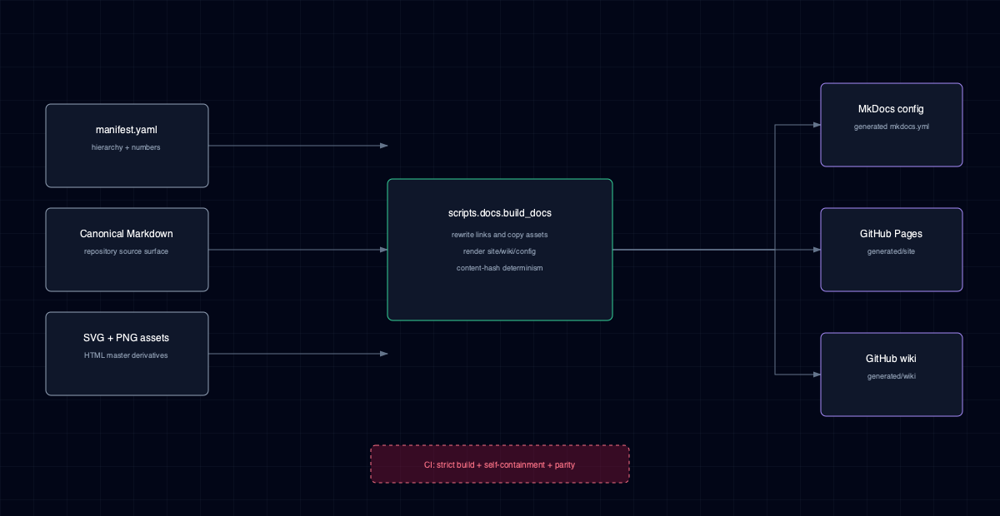

# 20. Contributing to NNx

Thanks for being interested in contributing. NNx is a small library; the goal is to keep it small, tested, and useful for the existing notebook consumers while inviting new ones.

## 1. Getting set up

```bash
git clone https://github.com/thekaveh/NNx.git
cd NNx
python -m pip install -r requirements-tools.txt
uv sync --all-extras --frozen
uv run pre-commit install       # optional but recommended
```

Diagram fallback generation also needs the native Cairo library: install it
with `brew install cairo` on macOS or `sudo apt-get install libcairo2` on
Debian/Ubuntu. CairoSVG itself is pinned in the `docs-publish` dependency group.

`--all-extras` installs every optional stack, including the `vision`,
`graph` and `plots` domains that `import nnx` never loads. A change to the
core / extra split is checked against an installed wheel per profile with
`scripts/smoke_core_install.py` (CI's `installed-profiles` job). Run it from a
clean environment outside the checkout with `PYTHONPATH` unset.

Verify a clean baseline:

```bash
uv run pytest -n logical --dist loadgroup  # full suite, on every CPU (pytest-xdist)
uv run ruff check src/ tests/ examples/ scripts/  # lint
uv run ruff format --check src/ tests/ examples/ scripts/  # format check
uv run pyright --warnings              # type check
uv run python -m scripts.docs.extract_architecture_svg --check
uv run python -m scripts.docs.build_docs --check
uv run python -m scripts.docs.build_docs
uv run mkdocs build --strict           # generated docs (gates CI)
```

Repository Markdown is canonical. `docs/manifest.yaml` is the single page
inventory and each source H1 begins with its manifest number;
`scripts.docs.build_docs` generates ignored `mkdocs.yml`,
`generated/site`, and `generated/wiki` projections. Do not edit generated
outputs. A successful push to `main` publishes the same canonical content to
GitHub Pages and the repository wiki.



Diagram HTML masters first flow through
`scripts.docs.extract_architecture_svg`. The site selects SVG assets while the
repository and wiki select PNG fallbacks. CI checks canonical GitHub links,
tracked-file ownership, placeholder markers, stale API signatures and diagrams,
projection determinism, generated links, and a strict MkDocs build before
publication.

Useful env vars:

- `NNX_TQDM_DISABLE=1` silences the training progress bar. Set this in CI / non-TTY contexts, and in any test that drives `NNModel.train()` or `Trainer.train()` (the test suite's `conftest.py` already does this session-wide). Accepts `1` / `true` / `yes`, case-insensitive.

## 2. Workflow

1. **Open an issue first** for non-trivial changes — saves churn if the design is off. Tiny fixes can go straight to PR.
2. **Branch from `develop`.** Name branches descriptively (`fix/...`, `feat/...`, `docs/...`, `refactor/...`).
3. **Write tests.** Every PR that changes behavior should land with a focused test that fails before the change and passes after it. The existing `tests/test_*_series.py` files (organized by audit pass) are good models.
4. **Keep PRs small.** One coherent change per PR is much easier to review than a sweeping mix.

## 3. What we care about

- **Strict back-compat for the existing notebook consumer.** Don't rename, remove, or restructure public APIs without a migration path. Preserve existing `runs/<id>/` artifacts; on-disk evolution requires a versioned, backward-compatible reader. New fields on params dataclasses must omit themselves from `.state()` when set to their defaults (preserves `run.id` hashes). See the omit-when-default regression tests in `tests/test_params_round_trip.py` (search for `test_nn_*_state_omits_*_when_*`) for the canonical pattern.
- **State / from_state round-trip.** Every params dataclass with a `state()` method must round-trip cleanly through `from_state(state())`. The contract is enforced by `tests/test_params_round_trip.py`.
- **Tests run on CPU and finish fast.** Keep new tests under a few seconds; build small `TensorDataset`s inline in the test.
- **One-line update to `CHANGELOG.md` under `[Unreleased]`** for any user-visible change.

## 4. Style

- **Ruff** enforces formatting and a curated lint rule set (`E F W B I UP`). Run `ruff check --fix src/ tests/ examples/ scripts/` and `ruff format src/ tests/ examples/ scripts/` before pushing. Pre-commit handles both automatically when installed.
- **Type annotations** are encouraged on new code. We type-check with pyright (basic mode) in CI, with `--strict` planned over time.
- **Docstrings** on public functions / classes explain the *why* (constraints, edge cases) — not just the *what*. Multi-paragraph is fine when warranted.
- **Comments** explain non-obvious decisions, hidden constraints, or surprising behavior. Don't narrate code that's already self-documenting.

## 5. Testing

```bash
uv run pytest -n logical --dist loadgroup  # full suite, on every CPU (pytest-xdist)
uv run pytest tests/test_pass2_n_series.py::test_n7_evaluate_aggregates_across_batches
uv run pytest -k "graph"               # name filter
uv run pytest -n logical --dist loadgroup --cov=nnx --cov-report=term-missing  # with coverage
```

Tests live under `tests/`. The `conftest.py` holds a few shared fixtures and hygiene guards. They include a session-wide `NNX_TQDM_DISABLE`, a per-test `env_snapshot` cache reset and a dynamo-dispatch skip guard. Otherwise it is intentionally minimal. Add a shared fixture there when boilerplate repeats across several tests, not preemptively.

### 5.1. Feature combinations

`docs/feature-composition.yaml` records which feature **combinations** are
verified, unsupported or unverified. Each has a stable scenario ID (`TC-01`,
`CR-03`, `MT-01`, ...), its profile and the pytest node ids that prove it.
[Feature composition](docs/feature-composition.md) renders it.

A change can move a boundary: what two features do together, what is
refused, or a test being renamed. Review the scenario IDs such a change
touches; `grep` the registry for the feature or the test file. Update their
`status`, `expected` and `tests`:

```bash
uv run python scripts/check_feature_composition.py --check                 # schema, unique IDs, every node id collected
uv run python scripts/check_feature_composition.py --check --run --report composition.json  # run and gate them
uv run python scripts/check_feature_composition.py --render                # refresh the committed page (no evidence)
```

An import, a skip, an xfail or a setup / teardown failure is never proof of a
combination. A verified scenario lists tests that assert its behaviour and pass
in every phase. An unsupported one links an executed negative test (or the
exact documented limitation). The CI `feature-composition` job fails when a
verified row fails or loses coverage.

The gate is strict only on a published evidence profile: the same OS,
Python version and device (`cpu` is Linux, Python 3.12). There, `--run` also
fails when an extra in the profile's `dependencies` (under
`evidence_profiles`) is not installed. Run it after `uv sync --all-extras`.
Elsewhere, rows needing a missing extra are simply not judged.

#### GPU evidence

The registry publishes two evidence profiles: `cpu` (the CI docs job) and
`cuda`. The CUDA rows are TC-06 FP16 AMP, TC-10 BF16 AMP and TC-11 two-GPU
NCCL DDP. They are verified only by a report from the `cuda` profile. On CPU
their tests skip and the page shows them *unverified*. To produce that report:

- **GPU runner:** register a self-hosted runner labelled `self-hosted, linux,
  x64, gpu`. TC-11 needs two CUDA devices. Then set the repository variable
  `NNX_GPU_RUNNER` to `true`. The docs workflow's `GPU composition
  evidence` job then runs the scenarios on it, and the docs build renders the
  page from both reports.
- **Manual run** on a Linux machine with Python 3.12 and CUDA:

    ```bash
    uv sync --frozen --all-extras --python 3.12
    uv run python scripts/check_feature_composition.py --run --report composition-cuda.json
    uv run python scripts/check_feature_composition.py --render --report composition.json --report composition-cuda.json
    ```

    Each `--report` counts for the profile it ran on; a report from a profile the
    registry does not list, or from other sources, renders *unverified*.

    The render with reports rewrites `docs/feature-composition.md` with
    their evidence. Do not commit that page: the committed one is rendered
    without evidence, which `--check` enforces. Restore it with `--render`
    alone.

Change `docs/external-contracts.md` and the matrix rows only from executed
evidence: a CUDA report whose listed tests passed in every phase.

## 6. Submitting a PR

- Push to your fork and open a PR against `develop`.
- Fill in the PR template (Summary / Test plan).
- Wait for every CI job to go green. The jobs are lint, format, tests and
  mkdocs on Python 3.10–3.14. They also include the feature-composition,
  export-conformance, installed-profile and `floor-deps` lanes.
- The branch ruleset requires only `lint-and-test` and `pip-audit` on
  3.10–3.12. Check the other lanes before you arm auto-merge.
- Address review comments by pushing new commits; pull requests merge with a merge commit.

## 7. Releases

NNx uses [release-please](https://github.com/googleapis/release-please-action) for automated version bumps, changelog updates, and tagging. Contributors don't touch versions or tags. Write a [Conventional Commit](https://www.conventionalcommits.org/)-style PR title (`feat:`, `fix:`, `chore:`, `docs:`, etc.). For any user-visible change, add a one-line entry under `[Unreleased]` in `CHANGELOG.md`.

The end-to-end flow:

1. Every merge to `main` updates a long-lived "Release" PR maintained by `release-please.yml`. The PR accumulates the next version + `CHANGELOG.md` diff based on the conventional-commit types since the last tag. Before 1.0, `feat:` and `fix:` both trigger a patch bump (`0.X.Y`; `bump-patch-for-minor-pre-major` in `release-please-config.json`). A breaking change (`!` or a `BREAKING CHANGE:` footer) bumps the minor version (`0.X.0`; `bump-minor-pre-major`). To force a minor bump otherwise, add a `Release-As: 0.X.0` footer to a commit.

    The Release PR carries only release-please's own commit. Nothing else pushes to it, because the `main` ruleset holds a PR for review when a bot made its latest push. That holds even for a verified commit, so each release PR needs one approval.

    release-please bumps the version in three places, so the lock and the API-reference check stay consistent:

    - `pyproject.toml`, through its Python updater.
    - The lines marked `x-release-please-version`: the `__version__` fallback in `src/nnx/__init__.py`, the `nnx.__version__` line of `docs/api.md` and the version line of `README.md` / `PYPI_README.md`.
    - The package's version in `uv.lock`, through a toml updater.

    Each time the workflow creates or updates the Release PR, it dispatches the required CI and security checks on the release branch. The CHANGELOG on the release commit is not finalized: release-please's generated list sits above the curated `[Unreleased]` notes. When the release is created, the workflow publishes the curated notes as the release body (`scripts/release/finalize_changelog.py --release-notes`).

    The post-release sync of `main` into `develop` finalizes the CHANGELOG against the one the release shipped:

    ```bash
    git show vX.Y.Z:CHANGELOG.md > /tmp/released-changelog.md
    python3 scripts/release/finalize_changelog.py CHANGELOG.md --released /tmp/released-changelog.md
    ```

    It moves the shipped curated notes under the new version heading in place of the generated list. Entries added on `develop` after the release stay in `[Unreleased]`. A shipped entry edited on `develop` after the release is refused, to be fixed by hand. That includes an item appended to a grouped entry such as "Smaller fixes", so start a new entry for a later change. Keep `[Unreleased]` curated: it becomes the release notes.

    Some changes to `[Unreleased]` reach `main` only through hidden commit types (`docs:`, `chore:`, `test:`). Such a change does not refresh the Release PR until the next visible one.

2. A maintainer reviews and merges the Release PR when ready to ship. Release Please then creates the tag and draft release. It publishes the curated notes as the release body. It then dispatches the top-level `release.yml` workflow with the immutable release commit and tag.
3. `release.yml` runs these steps:
    - It verifies the Release Please commit belongs to `main`.
    - It runs the full test matrix and builds the package.
    - It publishes through PyPI trusted publishing, gated by the `pypi` GitHub Environment's approval rule.
    - It verifies `pip install thekaveh-nnx==X.Y.Z` from a clean environment.

    Keeping trusted publishing in this top-level workflow ensures its OIDC token and package attestations carry the same PyPI-authorized workflow identity.

The `[project]` version is intentionally static and managed by release-please. **Do not distribute wheels or sdists built from an untagged commit.** After development resumes, such an artifact can contain code newer than the release. It still carries the last release number. Use editable installs for local source work. Distributable artifacts must come from Release Please's dispatched release workflow, which verifies tag/version and tag/commit agreement before publishing. Direct tag pushes do not publish packages.

### 7.1. CI runner image

Every workflow job runs on one pinned GitHub-hosted image, `ubuntu-26.04` (`tests/test_ci_runner_image.py` checks it). The exception is the opt-in self-hosted GPU evidence job (§5.1). Jobs never run on a moving label such as `ubuntu-latest`. GitHub re-points such a label to new Ubuntu releases without a change in this repository.

Moving to a new image is a deliberate pull request:

1. Change every `runs-on` and the test's `RUNNER` together.
2. Let that pull request's CI run on the new image. Also run the release scripts there; `scripts/release/finalize_changelog.py` runs on the image's system `python3`.
3. Note the result.

apt steps carry their own short `timeout-minutes`, so a package-mirror stall fails fast instead of consuming the job's budget.

## 8. Things we won't merge

- Changes that break on-disk format compatibility without a versioned reader.
- Public API renames without a deprecation shim and a `__getattr__` alias for at least one minor version.
- Code without tests.
- Dependencies added to `[project.dependencies]` (the core deps list) when they could go under `[project.optional-dependencies]` instead.

## 9. License

By contributing you agree that your contribution will be licensed under the [Apache License 2.0](LICENSE).
