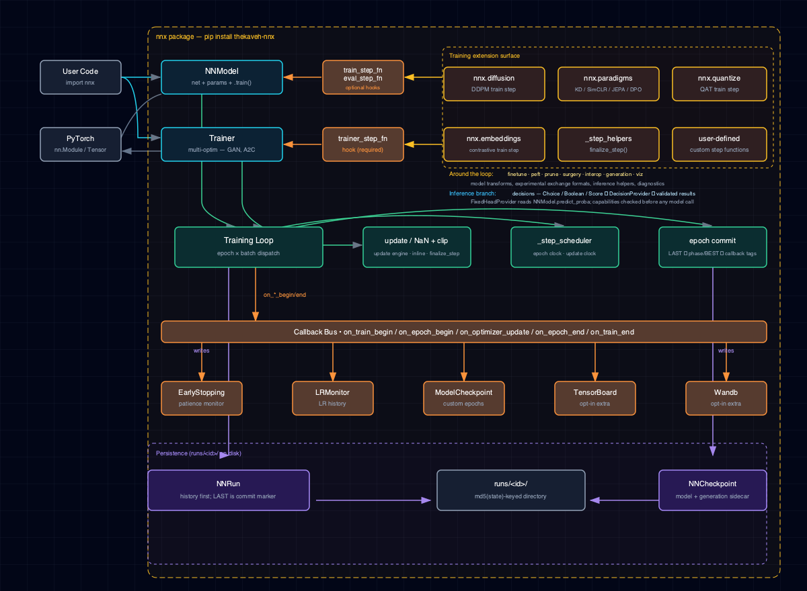

# 3. Concepts

This document explains the design decisions behind NNx: the architecture and the foundational patterns every other feature builds on. It then covers the specialization subpackages and the decoder-only LM path on top:

- Tier-1 (§7–§11): `finetune`, `peft`, `diffusion`, `paradigms`, `trainer`.
- Tier-2 (§12, §15–§16): `quantize`, `prune`, `surgery`, `embeddings`, `interop`, `viz`, `generation`.
- The inference branch: `decisions` (§17).
- Evaluation and experiment tooling (§18–§29). It covers calibration, abstention, experiment plans, streaming prediction and run bundles. It also covers multi-seed comparison, ranking, graph and link tasks, `Result` values, compilation and benchmarks, and budgeted search.

Sections are ordered from most fundamental to most specialized. Read top-to-bottom on a first pass; jump by anchor for reference.

## 1. Architecture

The architecture diagram summarizes NNx's public surface, internal orchestration, callback bus and on-disk persistence. The main README and the [Architecture](architecture.md) page embed it too:



The diagram has eight layers, top-to-bottom:

1. **User code + PyTorch** (slate) — the consumer surface.
2. **`NNModel` / `Trainer`** (cyan) — the two public entry classes.
3. **`train_step_fn` / `eval_step_fn` / `trainer_step_fn`** (orange bus) — the training-loop extension hooks.
4. **Specialization subpackages** (amber) — `nnx.diffusion`, `nnx.paradigms`, `nnx.quantize`, and `nnx.embeddings` provide hook-compatible factories. The diffusion, paradigm and embeddings steps share their finalization in `nnx._step_helpers`. Other subpackages compose around the loop without claiming a hook relationship. These are the model transforms (`nnx.finetune`, `nnx.peft`, `nnx.prune`, `nnx.surgery`), exchange formats (`nnx.interop`), inference utilities (`nnx.generation`) and diagnostics (`nnx.viz`).
5. **Training-loop internals** (emerald) — the epoch × batch dispatch and the inline NaN guard + grad-clip in `default_train_step`. They also include `_step_scheduler` and `_save_checkpoints` (FIRST/Q1/Q2/Q3/LAST/BEST cadence). `_step_scheduler` steps an epoch-clock scheduler once per epoch. An `optimizer_update`-clock scheduler is stepped by its clock after each committed update (§2.5).

    Note: the shared `finalize_step` helper lives under the **Specialization subpackages** layer (Layer 4, in `nnx._step_helpers`). Only paradigm, diffusion and embeddings step-fn factories invoke it — not the supervised loop, which has its own inline NaN+clip path.

6. **Callback bus** (orange) — `on_train_begin / on_epoch_begin / on_epoch_end / on_train_end`, plus `on_optimizer_update` in objective runs (§5).
7. **Callback listeners** (orange) — `EarlyStopping`, `LRMonitor`, `ModelCheckpoint`, `TensorBoardCallback`, `WandbCallback`.
8. **Persistence** (violet) — `NNRun` writes `run.yaml + idps.csv + metadata.yaml` and `NNCheckpoint` writes `*.pt + *.opt.pt` into `runs/<id>/`.

## 2. Params as the source of truth

Every config in NNx is a frozen, kw-only, slotted dataclass with a `state()` / `from_state()` pair:

```python
NNParams         # network shape: dims, dropout, activation, n_heads
NNModelParams    # device + loss + net kind + precision policy (FP32 / FP16 / BF16)
NNOptimParams    # SGD / Adam + LR / momentum / grad clipping / accumulation / param_groups
NNSchedulerParams # ReduceLROnPlateau / Step / Cosine / OneCycle / LinearWarmup
NNTrainParams    # epochs + loaders + optim + scheduler + seed + ...
NNTrainerParams  # multi-optim version: dict of optims + dict of schedulers
```

### 2.1. The round-trip contract

`ParamsClass.from_state(obj.state()).state() == obj.state()` for every params class, so the rebuilt object has the same run id. This is the persistence contract: anything that survives `NNRun.save → run.yaml → NNRun.load` flows through it.

The rebuilt object need not equal the original. Runtime-only fields are not carried: loaders, `extra_metrics` and `resume_mode`, for example. Nor are omitted defaults, such as an `activations` list that repeats the net-wide activation. A resume request comes back as `parent_run_id` lineage (§8.4).

The run-configuration params and specs (`NNParams`, `NNOptimParams`, `NNSchedulerParams`, `NNTransformerParams`, `NNTrainParams` / `NNTrainerParams`, `NNParamGroupSpec`, `MetricSpec` / `MonitorSpec`, `TaskSpec`, `ModelSpec`, `OptimizerFactorySpec` and `NNRun.salt`) store a NumPy scalar or a `str` subclass such as `numpy.str_` (a sweep-grid point, a DataFrame cell) as the plain Python value it equals, so `state()` stays YAML-safe and the configuration hashes like the one written with `float(value)`, `int(value)` or `str(value)`. A plain `int`, `float` or `str` is kept as given, so `weight_decay=0` and `weight_decay=0.0` remain different run ids. Other constructors may still keep a `numpy.str_` as given (`CompileSpec(backend=...)`, for example), so pass `str(value)` there.

### 2.2. The omit-when-default invariant

New fields added to an existing params class **must omit themselves from `state()` when at their default**. Otherwise every existing `run.id` (md5 of `state()`) shifts and on-disk runs become unfindable. Every params class follows the pattern. Regression tests pin it per field:

- `mixed_precision` / `precision` / `kind` / `trainer`: `tests/test_params_round_trip.py`.
- `param_groups`: `tests/test_finetune_param_groups.py`.
- `seed`: `tests/test_trainer_params.py` and `tests/test_pass2_v_series.py`.
- `save_phase_checkpoints`: `tests/test_trainer_params.py` and `tests/test_pass2_ou_series.py`.
- `schedulers`: `tests/test_trainer_params.py`.

### 2.3. Finite numeric domains

Every public real-valued hyperparameter is validated in `__post_init__` (or the direct constructor). It is checked as a *finite real number* first and against its domain second. NaN and ±infinity are rejected, and so are booleans and numeric strings, which are never coerced. The `ValueError` names the field and its accepted domain, and it is raised before any optimizer, run directory or RoPE table exists. The inventory:

- `NNOptimParams.max_lr` and `weight_decay` ≥ 0 (zero is meaningful: frozen updates / no decay). `eps` > 0. `grad_clip_norm` > 0 when set (`None` disables). SGD `momentum` ≥ 0, Adam betas in `[0, 1)`.
- `NNParamGroupSpec.lr` / `lr_multiplier` > 0 (freeze a group with `nnx.finetune.freeze`, not `lr=0`) and group `weight_decay` ≥ 0. The *resolved* per-group learning rate must also be finite before the optimizer is built.
- `NNSchedulerParams.min_lr` / `threshold` ≥ 0, `factor` > 0 (and < 1 for a plateau scheduler), optional `max_lr` > 0.
- `NNTransformerParams.rope_base` > 0 (also enforced by a direct `RoPE(base=...)`).
- `RMSNorm(eps)` finite and ≥ 0; `EarlyStopping(min_delta)` finite and ≥ 0; LoRA / DoRA `alpha` finite and > 0.

Probability fields keep their existing `[0, 1]` domains, and integer counts are validated separately. Validation never touches `state()`, so a valid configuration hashes to the same run identity as before.

Integer *counts* get the same treatment through a sibling validator. These fields must be *non-boolean integers*:

- `NNParams.input_dim` / `output_dim` / every `hidden_dims` entry / `n_heads` (when set).
- `NNTransformerParams.vocab_size` / `n_layers` / `d_model` / `max_seq_len` / `ffn_mult`.
- `NNConvParams.conv_channels` entries / `in_channels` / `kernel_size` / `stride` / `pool_size`.
- `NNViTParams.image_size` / `patch_size` / `in_channels` / `d_model` / `n_layers` / `ffn_mult`.
- `NNMoEParams.num_experts` (≥ 2) / `top_k` (1 … `num_experts`).
- `NNOptimParams.accumulate_grad_batches` (≥ 1); `NNTrainParams.n_epochs` / `NNTrainerParams.n_epochs` (≥ 1).
- `NNSchedulerParams.step_size` / `T_max` / `total_steps` / `warmup_steps` (> 0 when set; `None` stays the variant sentinel).
- Direct `RoPE(dim, max_seq_len)`.

Any `numbers.Integral` is accepted, NumPy integers included. It is normalized to a plain `int` before immutable lists, `_dims`, modulo / `isqrt` / `range` arithmetic or `state()` see it. So `np.int64(2)` serializes and hashes exactly like `2`. Booleans (`True == 1` is not a count), every float (`2.0` is not rounded), numeric strings and NaN/±infinity raise a `ValueError` naming the field.

Zero keeps its distinct meaning per field. `NNConvParams.padding`, `NNSchedulerParams.patience` / `cooldown` and `EarlyStopping(patience)` accept 0 (no padding; react on the first non-improving epoch). Epochs, accumulation and dimensions require ≥ 1.

A transformer additionally needs `d_model % n_heads == 0` *and* an even head width, because RoPE rotates channel pairs. This is enforced at construction and in `.builder().layers(...)` before the divisibility arithmetic. So the builder and the direct constructor reject the same inputs.

Dataset `batch_sizes` tuples follow the same count rule, with `None` as the only automatic full-split sentinel. Zero never means "full split" or "no split". They are validated before any dataset factory or tokenizer runs (see [Quickstart → Batch sizes](quickstart.md#25-tabular-regression-targets)).

### 2.4. Variant-gated construction via `.builder()`

Params dataclasses with **tagged-union shape** expose a `.builder()` classmethod as an alternative to the direct kwarg constructor. Tagged-union shape means a `kind` field whose value gates which other fields are meaningful. The Builder methods are named after the variants. Each writes exactly the fields its variant uses, so the user can't construct an invalid combination by accident.

`NNSchedulerParams.builder()` has five variant methods:
`reduce_on_plateau`, `step`, `cosine_annealing`, `one_cycle` and
`linear_warmup_decay`. Each sets the variant's knobs and leaves the rest at
the dataclass defaults. Each also sets `kind`, except `reduce_on_plateau`,
which leaves it `None` so legacy run ids stay unchanged. State() and
from_state() round-trip unchanged, and the direct-kwarg ctor still works.

```python
from nnx import NNSchedulerParams

scheduler = NNSchedulerParams.builder().one_cycle(
    max_lr=1e-3, total_steps=10_000,
    min_lr=1e-7, factor=0.5, patience=10, cooldown=2, threshold=1e-3,
).build()
```

`NNOptimParams.builder()` extends the pattern with **five optimizer-variant methods**:
`adam`, `adam_amsgrad`, `adamw`, `sgd` and `sgd_nesterov`. It adds three optional chained
modifiers: `grad_clip(norm)`, `accumulate_grad(batches)` and `param_groups(specs)`.

The Adam-family variants take the PyTorch-native `betas: tuple[float, float]` kwarg.
The Builder maps it onto the underlying `NNOptimParams.momentum` field; the field name
stays `momentum` for on-disk back-compat. They also take an optional
`eps`, which is torch's `1e-8` when omitted and then left out of `state()`. SGD
variants keep the float `momentum=` kwarg and reject a non-default `eps`.
`adamw` defaults `weight_decay` to torch's `1e-2`; see §3.1 for how its decay
differs from Adam's.

```python
from nnx import NNOptimParams

# Adam with PyTorch-native spelling
opt = NNOptimParams.builder().adam(max_lr=1e-3, betas=(0.9, 0.999), weight_decay=0.0).build()

# SGD with grad-clip and gradient accumulation
opt = (
    NNOptimParams.builder()
    .sgd(max_lr=1e-2, momentum=0.9, weight_decay=5e-5)
    .grad_clip(1.0)
    .accumulate_grad(4)
    .build()
)
```

Three more Builders follow the same pattern:

- **`NNTransformerParams.builder()`** — LM-path config. Six fluent methods (`vocab`, `layers`, `ffn`, `context`, `dropout`, `tied_embeddings`) hide the dead parent-NNParams kwargs (`hidden_dims` / `activation` / `dropout_prob`) the transformer net doesn't read. `.layers(n=..., heads=..., d_model=...)` (keyword-only) enforces `d_model % heads == 0` at call-time. Full walkthrough in [`docs/lm.md`](lm.md).
- **`NNTrainerParams.builder()`** — composite, wraps the optimizer and scheduler Builders. `.optimizer(name, NNOptimParams)` + `.scheduler(name, NNSchedulerParams)` register entries under user-chosen names. `.build()` enforces `schedulers.keys() ⊆ optims.keys()` with an actionable error. Used for the GAN-recipe pattern in §8.
- **`LogitsChain.builder()`** — LM-decoding power-user surface. Chain `.repetition_penalty(p)` / `.top_k(k)` / `.top_p(p)` / `.temperature(t)` / `.custom(processor)` in any order. `.build()` sorts the standard processors into NNx's canonical order and appends custom processors after them. The order is `RepetitionPenalty → TopKFilter → TopPFilter → TemperatureScaling`, with temperature deliberately last (see [`docs/lm.md` §5](lm.md#5-power-user-decoding-logitschain)). Pass the result via `GenerativeNNModel.generate(logits_chain=...)`. Full walkthrough in [`docs/lm.md`](lm.md).

**Branching a builder (`copy()` / `from_params()`).** The four params builders above (optimizer, scheduler, transformer, trainer) are mutable. Without branching, a shared base would be retyped per variant. `builder.copy()` branches a complete *or partial* builder. Afterwards, setters on either one never affect the other, and neither touches a value already built.

`Builder.from_params(params)` goes the other way: it pre-loads a builder from an existing params value. Then `from_params(params).build() == params`, with the same `state()` (key order, omitted defaults, hence the same run id). The result can be varied like any hand-written chain.

```python
base = NNOptimParams.builder().grad_clip(1.0)            # partial: no variant yet
adamw = base.copy().adamw(max_lr=1e-3).build()
sgd = base.copy().sgd(max_lr=0.05).build()               # base itself is unchanged

trainer = NNTrainerParams.builder().n_epochs(3).train_loader(loader).optimizer("head", adamw)
plain = trainer.copy().data_id("split-a").build()
scheduled = trainer.copy().data_id("split-b").scheduler("head", plateau).build()

# .context() sets max_seq_len AND rope_base: pass a carried rope_base again to keep it
longer = NNTransformerParamsBuilder.from_params(lm_params).context(max_seq_len=2048, rope_base=lm_params.rope_base).build()
```

Ownership follows the built values. Configuration containers are copied one level deep: the `param_groups` list, the per-layer lists, the `optims` / `schedulers` maps and the `extra_metrics` mapping. The immutable params values, loaders (any iterable), metric callables and registered-factory specs are shared by identity. Neither method iterates data, builds a model, advances an RNG or does I/O. Validation still happens at `build()`, per branch; a branch that schedules a name absent from its `optims` fails there.

Setter semantics are the same on a branch. Setters mutate and return the same builder, the last variant wins, and modifiers survive a variant change. `.vocab(size)` still resets `input_dim` / `output_dim`, and a group setter still replaces its whole group. `.context()` resets an omitted `rope_base` and `.dropout()` an omitted rate, so pass a carried value again to keep it.

`from_params` accepts exactly its own params class. A subclass or foreign value raises `TypeError` naming the type, and a field the builder cannot carry raises `ValueError`. An `NNOptimFactoryParams` has no builder; pass it straight to `NNTrainerParamsBuilder.optimizer`. `NNTransformerParamsBuilder.from_params` also carries the inherited `NNParams` fields no setter exposes (`hidden_dims`, `activation(s)`, `dropout_prob(s)`, custom dims). `NNTrainerParamsBuilder` has `data_id(...)` / `overwrite_existing(...)` setters, so sibling branches over different data get distinct run ids. Runnable walkthrough: [`examples/builder_branching.py`](https://github.com/thekaveh/NNx/blob/main/examples/builder_branching.py).

### 2.5. Scheduler clocks

`NNSchedulerParams.clock` says what one scheduler step counts.

- `"epoch"` is the default. It steps once per completed epoch and is omitted from `state()`, so every existing run id is unchanged.
- `"optimizer_update"` steps once per **committed** update of the scheduler's optimizer. It never steps per microbatch, per all-masked window or per skipped AMP step. In the builder, call `.clock("optimizer_update")` before or after the variant; a variant call keeps the clock, and so does a loaded builder.

On the update clock, `step_size`, `T_max`, `total_steps` and `warmup_steps` count updates. For example, two epochs of five microbatches with `accumulate_grad_batches=2` form windows of 2 + 2 + 1 microbatches. That is three updates per epoch, six in all.

Updates come from an explicit source:

- the update engine, for an objective;
- `default_train_step`, after each optimizer step it takes;
- `finalize_step`, so every built-in paradigm step;
- a custom step calling `ctx.report_update()` (`NNModel.train`, no name) or `ctx.report_update(name)` (`Trainer`).

NNx never infers updates around an opaque step, and it warns when an epoch reports none. Whoever calls `optimizer.step()` reports it, and every report counts. `default_train_step` and `finalize_step` report their own steps, so a step function that delegates to them does not report again. `default_train_step` does not report a step the AMP scaler skipped, fused optimizers included.

**Budgets.** NNx may own the windows (the default step, passed explicitly or not, or an objective) while the loader has a length. Then the default horizon is the planned updates, `n_epochs × ceil(batches / accumulate_grad_batches)`. Otherwise the budget (`total_steps`, `T_max` or `step_size`) must be explicit.

A one-cycle / warmup-decay schedule stops the run with an error at the first committed update past its `total_steps`. That update is never scheduled, and no checkpoint is written after it. This applies to a default budget too. So a loader that yields more batches than its `len()` reports needs an explicit `total_steps`; an `IterableDataset` read by several workers can do this.

A cosine schedule warns once when it passes its `T_max`, since its rate then climbs back up. It does not warn when that is the period the run chose: an explicit `T_max`, or a subclass's own. Torch lets a schedule run past it on purpose. A stateful resume keeps the checkpoint's `T_max`, so set it in the run that starts the schedule.

The warm-up multiplier keeps its `(step + 1) / warmup_steps` form. With a base LR of 0.12, `warmup_steps=3` and `total_steps=8`, the first four updates train at 0.04, 0.08, 0.12, 0.12.

A plateau scheduler reads a monitored metric at the epoch boundary and refuses the update clock. So does a scheduler without a `last_epoch` position, such as torch's `ChainedScheduler` from a `_build_scheduler` override.

**Checkpointing.** Each update-clock scheduler is checkpointed as a required component (`nnx.scheduler_clock`, or `nnx.scheduler_clock.<name>` per Trainer optimizer). The component holds its clock, owner and budget, beside the scheduler's own state and position. A stateful resume restores them before anything steps, which reproduces the uninterrupted run's LR sequence.

The resume refuses a mismatched clock or budget, or a budget the resumed updates would pass. A default budget does not resume: see the shared horizon in §14.2. It also refuses a checkpoint without component state, whose scheduler position counts epochs. Runnable walkthrough: [`examples/scheduler_clocks.py`](https://github.com/thekaveh/NNx/blob/main/examples/scheduler_clocks.py).

## 3. Enums-as-factories

Every enum's `__call__` constructs the underlying object:

```python
Optims.ADAM(net=net, lr_start=1e-3, ...)              # → torch.optim.Adam
Losses.CROSS_ENTROPY()                                 # → nn.CrossEntropyLoss
Nets.GRAPH_CONV(params=NNParams(...))                  # → GraphConvNN
Nets.VIT(params=NNViTParams(...))                      # → ViTNN (rebuilt from a stored run)
Schedulers.COSINE_ANNEALING(opt, params, n_epochs)     # → CosineAnnealingLR
NoiseSchedulers.LINEAR(T=1000, beta_min=1e-4, beta_max=2e-2)  # → NoiseSchedule
```

Adding a new option extends the enum and its `match` block. An `Optims` member also joins its optimizer family (`NNOptimParams`) and gains a builder method. A `Nets` member with its own params class also joins the params map and `NNParams.resolve_from_state`.

### 3.1. Optimizers: AdamW, registered factories and the shared build hook

**Adam vs AdamW decay.** `Optims.ADAM` / `ADAM_AMSGRAD` apply `weight_decay` as a *coupled* L2 term. The term is added to the gradient and then rescaled by Adam's adaptive denominator, so heavily-updated weights are barely decayed. `Optims.ADAMW` builds `torch.optim.AdamW`, which decays *decoupled*. Each step first scales every weight by `1 - lr * weight_decay` and then applies the Adam update.

With `lr=0.1, weight_decay=0.2, betas=(0, 0)` and a zero gradient, a weight of `2.0` becomes `1.96` under AdamW but `1.9` under Adam. Per-group `NNParamGroupSpec` overrides apply to both exactly as for the other variants.

**Registered optimizer factories.** An optimizer NNx does not ship joins a run through `nnx.optimizers` without borrowing a built-in name:

```python
from nnx import NNOptimFactoryParams, OptimizerFactorySpec, register_optimizer_factory

def lion(param_groups, config):            # resolved groups + read-only JSON-like config
    return MyLion(param_groups, betas=tuple(config["betas"]))

register_optimizer_factory("acme.lion", 1, lion)
optim = NNOptimFactoryParams(
    factory=OptimizerFactorySpec(id="acme.lion", version=1, config={"betas": [0.9, 0.99]}),
    max_lr=3e-4, weight_decay=0.1,
)
```

The factory lifecycle:

1. **Resolve** — `train()` looks the spec's `(id, version)` up in the process-local registry before any run directory exists. An unknown id or version fails up front; resolution never imports a module or evaluates a string.
2. **Construct** — the factory is called **once** per optimizer with two arguments. The first is the *resolved* parameter groups, each carrying explicit `params`, `lr` and `weight_decay`. The second is the spec's read-only `config` (lists arrive as tuples, NumPy scalars as plain numbers).

    The groups are exactly what a built-in optimizer would receive: every parameter in one group when `param_groups` is `None`. Otherwise they are the `NNParamGroupSpec` buckets, with frozen parameters dropped and the Trainer's strict ownership applied.

    The factory must return a `torch.optim.Optimizer` holding exactly those parameters. A missing, duplicated or foreign parameter, or any other return type, raises before the first epoch. Construction happens before the run is reserved, so keep factories side-effect-free constructors. A factory may be called for a run that is then refused, for example an existing run without `overwrite_existing`.

3. **Persist** — `run.yaml` stores only the spec (`factory: {id, version, config}`), never the callable. A lambda or other callable passed as the factory or inside `config` is rejected at construction. The `factory` entry is also how `NNRun.load` tells a registered variant from a built-in `NNOptimParams`. Built-in configurations serialize exactly as before, so their run ids are unchanged.

**Metadata reload vs state resume.** Reloading a run's *metadata* needs nothing registered and runs no factory code. This covers `NNRun.load(id)`, `str(run)` and the notebook view. The optimizer is shown by its `id@vN`, never with fabricated `name` / `momentum` fields.

Warm *resume* (`resume_from_run_id`, §14) rebuilds the optimizer, so the same `(id, version)` must be registered. The checkpoint's recorded factory identity (id, version and config) must match the new configuration exactly. So must its ordered named-parameter topology. Switching between a built-in and a factory, or changing any of those, raises. Bump `version` whenever a factory's behaviour changes.

**One build hook.** `NNModel.train()` and `Trainer.train()` both construct optimizers through `nnx.build_optimizer(net, optim_params, strict_param_groups=...)`. It is non-strict for `NNModel` (unmatched trainable parameters join a default group) and strict for the Trainer (§8.1). Both build before the run is reserved, for built-ins and factories alike. [`examples/optimizer_factories.py`](https://github.com/thekaveh/NNx/blob/main/examples/optimizer_factories.py) runs a Trainer update with a registered factory and a built-in AdamW over disjoint named groups. It then reloads the run offline.

Built-in nets return **raw logits**; `predict().logits` is always that raw output. Native `torch.nn.NLLLoss` (`Losses.NEGATIVE_LOG_LIKELIHOOD`) requires log-probabilities. So some NNx-owned paths apply `log_softmax` over the class axis internally before calling the exact native loss. These are the supervised loop, `evaluate()` and the NNx-owned classifier step factories (KD, feature-KD, MoE, Mixup, CutMix, and Born-Again through KD). The reported loss is the normalized NLL. The backpropagated gradient carries the competing-class term, matching cross-entropy from the same weights.

The loss object's class weights, `ignore_index` and reduction remain authoritative. Any other loss module receives the raw output unchanged and owns its own normalization. That includes an `NLLLoss` *subclass* with its own `forward`, a custom `train_step_fn`, or the standalone `lr_finder` callable.

**Probability-aware prediction.** `predict()` and `PredictResult` stay logits + classes. For a model with a task (§6.3), `classes` holds the task's decoded values. `NNModel.predict_proba(X, spec)` is the opt-in alternative. `spec` may be omitted when the model declares a task. A regression task returns `probabilities=None`, `spec=None` with its continuous values in `decoded`.

A `ProbabilitySpec(kind, class_axis, labels)` *declares* the task rather than inferring it from the loss or the output shape. The kinds are:

- `"categorical"`: softmax over `class_axis`, rows sum to 1, argmax decoding.
- `"bernoulli"`: independent element-wise sigmoid, rows not normalized, `logit >= 0` indicators.

The returned `PredictionResult` carries the same raw `logits` as `predict()`, `probabilities`, `decoded` values and the spec (class axis and ordered labels). It also carries `sample_ids`:

- the input row index for arrays and tensors;
- the iteration position for an ordinary loader (a shuffling loader warns);
- the global node index for graph seed rows;
- the graph id for a graph classifier's rows (§25).

It runs through the same inference path as `predict()`: the same inputs, graph seed-row slicing, `no_grad`, and non-destructive mode handling (§13.2). It never touches parameters or gradients. `class_indices` exists only for categorical results. So Bernoulli indicators cannot be fed to class-index consumers such as `VisUtils.confusion_matrix` by mistake. `prediction_from_logits(logits, spec)` exposes the same computation for logits obtained elsewhere.

### 3.2. Arbitrary modules and registered model factories

`NNModelParams.net` is not limited to the `Nets` enum. It holds one of three **descriptors** (`nnx.models`), and every artifact records the descriptor, never code:

| Descriptor | Construction | `net_params` | Rebuildable from artifacts |
|---|---|---|---|
| `Nets` member (default) | `Nets.X(params=net_params)` | `NNParams` | yes |
| `ModelSpec(id, version, config, seed)` | the registered factory, `factory(config)` | `None` | yes, through the registry |
| `RuntimeModule` (filled in by `NNModel(module=...)`) | the caller's instance, as is | `None` | no — `reconstructible=False` |

```python
from nnx import KeywordInputs, Losses, ModelSpec, NNModel, NNModelParams, register_model_factory

register_model_factory("acme.encoder", 1, lambda config: Encoder(**config))   # factory(config) -> nn.Module
model = NNModel(params=NNModelParams(net=ModelSpec("acme.encoder", 1, {"width": 64}, seed=0), loss=Losses.CROSS_ENTROPY))

wrapped = NNModel(module=my_encoder, params=NNModelParams(loss=Losses.CROSS_ENTROPY),
                  batch_adapter=KeywordInputs(("input_ids", "attention_mask"), target="labels"))
assert wrapped.net is my_encoder                      # never cloned or re-initialized
```

**Registered factories.** A `ModelSpec` references a factory registered for this process under `(id, version)`, exactly like optimizer factories (§3.1). Its `config` must be JSON-like, and bumping `version` is how a changed architecture is told apart. Construction resolves the factory first. An unknown id or version raises `MissingModelFactoryError` naming the registered versions before anything runs.

Construction then calls the factory with Python's `random`, NumPy and torch all seeded from `seed`. The ambient RNG states are captured and restored. So the same spec always initializes the same weights and never shifts the caller's random streams. The low-rank-surgery reconstruction guard compares against the layout recorded when the factory built the module, so `train()` never builds it twice.

`NNModel.from_checkpoint`, `NNModel.from_pretrained` and the checkpoint t-SNE rebuild the module through the registry. They compare its parameter names and shapes with the saved weights **before** loading any of them. A factory that now builds another topology fails with `ValueError`. Built-in nets are rebuilt from their own params instead; a mismatch there surfaces as the `RuntimeError` of `load_state_dict`.

**Runtime modules.** `NNModel(module=m, params=NNModelParams(...))` wraps the instance itself: `model.net is m`, and no tensor or RNG state changes. It fills `params.net` with a `RuntimeModule` descriptor. The descriptor holds the class's qualified name (`module="pkg.Class"`) and a `topology` fingerprint of the parameter names, shapes and dtypes and the module's `repr`. So identical architectures share a run id and different ones do not, layer hyperparameters such as dropout rates included.

As with built-in nets, the id reflects the architecture, not the weights. Give differently-initialized instances of one architecture distinct `data_id` / `salt` values. Lazy layers (`nn.LazyLinear`) may be wrapped and trained uninitialized. Materialize them (one forward) before a warm resume, whose parameter-topology check needs shapes.

A runtime module trains, evaluates, predicts, checkpoints and resumes like any model, but no factory can rebuild it:

- checkpoints mark it `reconstructible=False` (`NNCheckpoint.reconstructible`);
- reloading needs the module again (`NNModel.from_checkpoint(ckpt, module=fresh_instance)`, whose topology must match);
- portable saves (a safetensors checkpoint or `save_pretrained`) fail with `MissingModelFactoryError` before any file or directory is written;
- a transformation recipe (`nnx.transforms`) is refused on it for the same reason.

**Batch adapters.** Built-in nets keep their own `unpack_batch`. Any other module sees batches through a runtime-only `batch_adapter`, never serialized and never part of the run id:

- `PositionalInputs(n_inputs=1)` calls `module(x1, ..., xn)` on `(x1, ..., xn, y)` batches.
- `KeywordInputs(inputs, target="labels")` calls `module(**{name: batch[name]})` on mapping batches.
- A module that defines `unpack_batch` keeps using it (the default).

`predict()` accepts a mapping of keyword inputs as well as tensors, tuples and loaders. Some supervised paradigm steps transform the input: Mixup / CutMix, KD and feature KD, MoE, and `kd_objective`. They split batches through the same adapter and need exactly one positional input. Other layouts raise `ValueError` and need a custom step.

Subclass `BatchAdapter` for other layouts. Implement `split(batch) -> (args, kwargs, target)`, and `output(raw)` to extract the tensor from a non-tensor return value (the default requires a tensor). `nnx.viz.summary(model, batch=...)` and `VisUtils.two_dim_tsne_checkpoint_logits(..., batch_adapter=..., module=...)` take the same adapters. A keyword-input model given a synthetic `input_size`, or a runtime checkpoint without `module=`, fails before the module or any data is touched. A borrowed module keeps its identity, state keys and every submodule's training mode.

**What renders.** A registered or runtime run has no built-in `NNParams`. `run.yaml` omits `net`, and `model.net` holds the descriptor mapping (`kind: registered | runtime`). `str(run)` and the notebook table show the descriptor instead of dims, dropout and activation. The descriptor fields are `kind`, `factory` (`id@vN`), `config` and `seed`, or `module` and `reconstructible=False`. `NNRun.load` restores the same descriptor.

Built-in runs serialize exactly as before. `to_onnx` exports any tensor-output module whose forward takes positional tensors, from its `example_input`. It refuses a mapping example (a keyword-input module): wrap such a module in one with a positional forward. Task adapters (§6.3) check the loss up front and the output width on the first batch. `GenerativeNNModel` stays built-in only. [`examples/custom_module.py`](https://github.com/thekaveh/NNx/blob/main/examples/custom_module.py) trains, reconstructs and prints a registered encoder and a wrapped keyword-input module. `examples/04_onnx_export.py::registered_module_variant` exports one.

## 4. What lands on disk

Every `model.train(params)` creates a run directory under `runs/<id>/`. The `id` is the md5 of the pre-id `{model[, net], train[, trainer][, salt][, transforms]}` partial dict, where `transforms` is a recorded `nnx.transforms` recipe:

```
runs/<id>/
├── run.yaml          # NNRun.state() — config-only, hashes to <id>
├── metadata.yaml     # env snapshot (nnx/torch/python/git) — NOT in hash
├── idps.csv          # per-iteration metrics, flushed every epoch
│                     #   (history/ instead with a HistoryJournal — §4.5)
├── .history-committed-by-last   # history protocol marker: LAST commits the history
├── .run.lock         # NNRun.save's lock
├── checkpoints/
│   ├── first.pt      # NNCheckpoint at epoch 0
│   ├── q1.pt q2.pt q3.pt   # at 1/4, 2/4, 3/4 of n_epochs (every quartile needs n_epochs >= 8)
│   ├── last.pt       # most recent committed epoch
│   ├── last.pt.manifest.json        # its SHA-256 manifest (§14.3)
│   ├── last.pt.opt.<generation>.pt  # immutable matching training state
│   ├── last.pt.opt.pt    # compatibility copy of the current bundle
│   ├── last.pt.lock      # serializes this checkpoint's writers
│   └── best.pt       # lowest-error checkpoint so far
```

Every checkpoint tag `<tag>.pt` (first, q1–q3, last, best) has its own `.manifest.json` and `.lock`. A checkpoint that carries training state also has `.opt.<generation>.pt` and `.opt.pt`.

The runs root holds shared locks too: `runs/.admission.lock`, `runs/.best.lock` and `runs/.leases/<id>.lock`. §4.1 describes their order.

Both `NNModel.train()` and `Trainer.train()` finish with one line such as `Run saved to runs/5c741de80116c9858a7e2a56256cb917 (relative to the working directory)`. It is a *display path*, not artifact provenance. `runs/<id>` is relative to the working directory the run was saved from. No absolute prefix (home directory, worktree, temporary directory or container mount) is printed. So notebook output that captures the line is identical wherever it executes.

Artifacts are still written under `<cwd>/runs/<id>/`. Use `os.path.abspath(f"runs/{run.id}")` when you need the absolute location. Separators are always `/`, so the line reads the same on every platform.

### 4.1. The `runs/best` pointer

The `runs/best` symlink points at the lowest-error run across all runs in the directory. For paradigm runs whose steps don't produce a supervised error, it uses the lowest loss. In a runs root mixing both kinds, the comparison is between unlike metrics. That is an accepted trade-off against a `best` pointer paradigm runs could never claim. On Windows without developer mode, `runs/best` is a directory that holds a `POINTER.txt` file with the run's path.

Only a run with a *committed* BEST checkpoint can own the pointer. That means a real run directory with `run.yaml`, loadable history and a parseable BEST. Under the history protocol, the BEST epoch must also be no later than the committed LAST. `best`, `.leases`, bare reservations and malformed artifacts are never candidates. Neither is `best.tmp`, the temporary symlink a repoint renames over `runs/best`, which an interrupt between those two steps can leave behind; `NNRun.all()` skips the same entries, so it lists that run once. Eligibility never reads `metadata.yaml` or provenance, so an unreadable `provenance.json` cannot move the pointer, even under a warnings-as-errors filter (`-W error`).

Overwriting a run (`overwrite_existing=True`) deletes its artifacts and reuses its ID. If that run owned `runs/best`, the best surviving committed run is elected *before* the old artifacts are removed. Ties keep the incumbent, then the lexicographically smallest ID. So the pointer never dangles and an emptied replacement is never advertised. The replacement becomes a candidate again only once its own BEST commits; saving its history earlier cannot claim the slot.

When no eligible run remains, `runs/best` is absent. Readers should treat a missing pointer as "no winner yet", not as an error. Runs that select BEST with a named monitor (§6.4) are never candidates: their ranking is not comparable with other runs'. Lock order is lease → admission → `.best.lock` on overwrite and lease → run → `.best.lock` on save. Election reads other runs without taking their locks.

Both the per-run BEST checkpoint and the cross-run pointer score a checkpoint by the first **finite** value. The order is validation error → validation loss → training error → training loss. The training values come from the epoch's last batch record; declare a monitor (§6.4) to select on a whole-epoch training summary instead.

NaN and ±inf are never used as a comparison baseline. A non-finite validation error falls through to that same epoch's finite validation loss before training data is consulted. A checkpoint with no finite signal at all scores as unavailable (`+inf`), so it is replaced by the next finite candidate.

The same rule recovers legacy artifacts whose BEST was ranked on a NaN. The stale checkpoint payload is left untouched, and the next finite save takes the pointer.

### 4.2. Atomicity + incremental writes

Every write inside `runs/<id>/` (`run.yaml`, `metadata.yaml`, `idps.csv`, every `*.pt`) goes through a destination-local tmp-then-rename helper. A `KeyboardInterrupt` leaves either the previous file or the new file at a destination, never a half-written file.

The text writer creates its temp next to the resolved destination, also for a bare filename, so the rename never crosses filesystems. It owns the temp until the rename. A failure while opening, writing, flushing or closing it, or in the rename itself, releases the descriptor and unlinks that temp. The writer then re-raises the original exception; a cleanup error never masks it.

The temp is flushed with `fsync` before the rename. A flush the filesystem does not support (`ENOTSUP`, `EINVAL`, ...) is tolerated. A real I/O error (`EIO`, a full disk) fails the write before the rename, so the destination keeps its previous content. After a successful rename the temp name is never touched. The same writer, and so the same flush policy, also saves these other NNx text artifacts: split manifests, standardizers, calibration and abstention artifacts, provenance records, `export_history_csv` and the `runs/best` pointer.

This is per-file cleanup for ordinary exceptions, not a multi-file transaction. `run.yaml`, `metadata.yaml` and `idps.csv` are still written one after another. An interrupt during a run's first save, for example a Ctrl-C while the environment snapshot for `metadata.yaml` runs `git`, can leave `run.yaml` without `idps.csv`. Nothing is committed yet, so the run loads with an empty history, `NNRun.all()` lists it, and `iter_history` and `export_history_csv` read no records. A plain retry is refused as for any existing run; retry with `overwrite_existing=True`. A committed or legacy run that has lost its `idps.csv` is malformed: loading it raises a `ValueError` naming the file. A SIGKILL or power loss can still strand a `.<name>.XXXXXX` temp, which later writes neither reuse nor delete. A failed write of the run's history marker also releases the still-empty `runs/<id>/` reservation, so the same run can be retried.

Each checkpoint names an immutable generation-addressed training-state sidecar. The sidecar is committed first and the checkpoint last. An interrupted replacement therefore leaves the previous generation resumable instead of pairing new weights with stale optimizer state.

The epoch transaction is history → LAST → phase/BEST → deferred callback checkpoints. If LAST fails, history rolls back to the preceding epoch. Once LAST commits, a later ancillary failure retains that history because the epoch is durable.

The history step is on stable storage before LAST is published. An eager epoch flushes `runs/<id>/` after its `idps.csv` rename; a journal epoch flushes `history/` after its manifest rename. The run's first checkpoint flushes `runs/<id>/` once it creates `checkpoints/` there, and a new run's `<id>` is flushed into `runs/` when the run is reserved. A history step whose flush fails with a real I/O error fails the epoch before LAST, so a reload shows the previous committed epoch. If the flush after the `idps.csv` or manifest rename is the one that fails (for a journal, also the save of `run.yaml` / `metadata.yaml` after its manifest), the step writes the file it replaced back through the same writer, byte for byte (before the first epoch it removes the new file, so the run reads as uncommitted), and raises the original error; a failure of that restore never replaces it. The flush policy is in §14.3.

`NNRun.load()` treats LAST as the commit marker and truncates any history newer than it after a process kill. It rejects an empty or corrupt LAST instead of erasing otherwise valid history. A run with a history journal (§4.5) follows the same transaction: its chunks and manifest are the "history" step.

Checking for saved state is observational. `NNCheckpoint.load_training_state`, `load_optimizer_state` and `load_with_training_state` handle a run whose directory does not exist. They return `None` / `(None, None)` without creating `runs/<id>/`; the run ID is still validated first. So probing a prospective run ID before the first fit never reserves it and never trips the overwrite guard.

Inside an *existing* run, the original checkpoint lock and generation validation apply unchanged. A checkpoint whose referenced training-state generation is missing or malformed is corruption and raises an actionable error. It is not a signal to start fresh. A probe can race a concurrent first creation and legitimately observe absence; retry if that matters.

The versioned sidecar restores:

- optimizer type and parameter topology/state;
- scheduler identity/state (a plateau state saved under another improvement rule than the run builds is refused before the model is touched — §6.4);
- the FP16 loss scaler and the run's resolved precision record. A stateful resume into another effective precision is refused before the model is touched. A weights-only warm start may switch ([Quickstart §2.2](quickstart.md#22-precision-fp32-fp16-and-bf16));
- completed epoch, Python and NumPy state, PyTorch CPU/CUDA/MPS state;
- loader/sampler generators matched by stable seed identity.

The fixed `.opt.pt` compatibility copy and legacy optimizer-only sidecars remain readable. Exact continuation requires `num_workers=0`; worker-local RNG state is outside the recoverable boundary.

Resume accepts every batch source ordinary training accepts. These are a `DataLoader`, a plain re-iterable list of `(X, Y)` batches, or the one-element full-batch list `NNGraphDataset(sampler="full")` produces. Worker capability is read safely (absent metadata means no worker RNG). The worker warning only fires for a real loader with `num_workers > 0`. A consumed one-shot iterator cannot be replayed: only the supplied re-iterable source is restored.

A training loader may define `set_epoch(epoch)` (PyTorch's `DistributedSampler` convention). `NNModel.train` and `Trainer.train` alike tell it each epoch's index before iterating it. So per-epoch randomness drawn from that index is identical in an uninterrupted and a resumed run. `nnx.link_tasks` training negatives (§26) are one example.

`NNCheckpoint` also carries an ordered tuple of versioned topology-transform recipes. It is empty for ordinary and legacy checkpoints. A recipe can be materialized before training: `nnx.transforms.TransformRecipe`, for LoRA on explicit Linear targets or SVD low-rank replacement ([Surgery §8](surgery.md#8-recorded-recipes-surgery-that-checkpoints-can-rebuild)). Such a recipe is recorded on the model and carried by every checkpoint tag, `ModelCheckpoint` snapshots and Hub saves. It is part of the run id of a run that trains it; runs without one keep theirs.

Replay rebuilds the recipe's topology on a fresh base without rerunning SVD. A resume needs the resuming model to have materialized the same recipe. A lifecycle callback that replaces modules after training can declare the recipe needed to reproduce that topology. `NNModel.from_checkpoint()` replays recognized transforms before loading weights. Both pickle and safetensors preserve this metadata. Unknown transforms fail with a compatibility error instead of partially loading the wrong network.

Checkpoint readers default to CPU placement and accept an explicit device for
cross-device restores:

```python
checkpoint = NNCheckpoint.from_file("runs/<id>/checkpoints/best.pt", map_location="cpu")
checkpoint = NNCheckpoint.load(run="<id>", type=Checkpoints.BEST, map_location="cuda:0")
```

Pickle checkpoints forward any `torch.load`-compatible `map_location` value.
Safetensors checkpoints accept a device string or `torch.device`. Callable or
mapping forms are rejected, because safetensors exposes device placement rather
than PyTorch's storage-remapping callback contract.

### 4.3. Config vs environment

`run.yaml` is the configuration; `metadata.yaml` is the environment. Two runs
with identical config but different environments share an ID by design. Use an
explicit salt when identical modeled inputs should produce separate experiment
records without changing the seed or data:

```python
replicate = model.train(params=train_params, salt="replicate-2")
```

`salt=None` adds nothing to the ID hash, so every existing run ID stays exactly the same. A non-empty string is
stored with the run configuration and included in the ID hash, so save/load and
resume retain the distinction. Non-string salt values are rejected.

### 4.4. Provenance: fingerprint and attempts

A run has four separate identities, and none of them stands in for another:

| Identity | What it names | Where |
|---|---|---|
| `run.id` | the configuration (`md5` of `NNRun.state()`) | the `runs/<id>/` directory name |
| experiment fingerprint | the declared intent — task, label order, model descriptor, data and split identities, objective version, config | `runs/<id>/provenance.json` |
| attempt id | one execution: a fresh id for every `train()` call | `runs/<id>/attempt.json` |
| environment snapshot | where it ran (library versions, GPU, OS, git commit) | `runs/<id>/metadata.yaml`, rewritten on every save |

Provenance is opt-in (`nnx.provenance`) and never changes a run id:

```python
from nnx.provenance import ExperimentManifest, compare, hash_file

plan = ExperimentManifest.for_model(model, train=train_params,
                                    data={"train": hash_file("train.csv")},    # verified digest
                                    splits={"val": "val-2024-06"},             # declared: recorded, not verified
                                    objective={"id": "supervised", "version": 1})
run = model.train(params=train_params, provenance=plan)
run.provenance.fingerprint, run.provenance.attempt.attempt_id, run.provenance.attempt.status
```

- **The manifest** (`ExperimentManifest`) serializes to canonical bytes, and
  its fingerprint is their SHA-256. The bytes are UTF-8 JSON with sorted keys,
  arrays in order and the format version (`nnx.provenance/1`) inside the
  hashed document. Changing the task, the label order, a split's digest or the
  objective's version changes the fingerprint.
- **Serializable values.** Only JSON-like values serialize: non-finite
  floats, sets, bytes, callables and other objects are rejected by path,
  never hashed through their `repr`. A manifest copies what it is given into
  immutable form, and equality follows the canonical bytes.
- **`ExperimentManifest.for_model(...)`** collects the model's task and labels
  (§6.3) and its model descriptor (§3.2). When given the training
  configuration, it records it without `n_epochs`, `resume_epochs` and the resume lineage,
  which describe an attempt. So a resume of the same plan keeps the
  fingerprint. It builds no model and reads no loader.
- **Identity references** are `declared`, `digest` or `unknown`. A `declared`
  reference is an id you supply (`data_id`, a dataset name), recorded but
  never reported as verified. A `digest` comes from the explicit `hash_file` /
  `hash_bytes` calls, the only ones that read data. A `SplitManifest` passed
  under `splits` is recorded as its digest (§13.3).
- **Attempts.** Every fit writes a fresh `attempt.json`. It records the
  fingerprint and `running` → `completed`, `failed` or `cancelled`
  (`KeyboardInterrupt`). It also records the last committed checkpoint (tag,
  epoch and generation) and the error type and message. A failure to record
  a failed attempt is a warning; it never replaces the training error.
  `Trainer.train(..., provenance=...)` records attempts the same way.
- **Resumed attempts.** A resume is a new attempt of the same plan. It links
  its parent's attempt and the checkpoint generation it restored, and leaves
  the parent's files untouched. `NNRun.save` never rewrites them, and both files are written
  atomically, so an interrupted write leaves the previous record. An attempt
  that fails before writing any run file releases its reservation. A failed
  first LAST commit keeps the run, with a `failed` attempt and no committed
  checkpoint.
- **Comparing.** `compare(a, b)` takes manifests, runs or run ids. It reads
  only the provenance files: no model is loaded, no loader iterated and no
  file hashed. It reports each field by a stable path (`data.train`,
  `labels[1]`, `config.lr`). The status is `equal`, `different`, `missing`,
  `unknown`, `declared` (equal but unverified), `verified` (equal digests)
  or `absent` (one side has no provenance).
  Values compare by their canonical bytes, so `1` and `1.0` differ exactly as
  their fingerprints do.
- **Comparison results.** `verified_equal` holds only when both sides have
  provenance and every field is equal or verified. A run without a manifest
  (`run.provenance is None`) is **absent**, never equal. Provenance files are
  verified on read (format and fingerprint). Unreadable ones are ignored with
  a warning, so they never stop a run from loading or resuming.


### 4.5. Bounded history: the history journal

By default both loops keep every per-batch `NNIterationDataPoint` in memory and rewrite the whole `idps.csv` each epoch. So memory and bytes written grow with the run. `history=HistoryJournal(retention=..., chunk_size=...)` switches one run to a bounded **history journal**. It lives in `nnx.history`, is accepted by `NNModel.train` and `Trainer.train`, and is never part of the run id:

```python
from nnx.history import HistoryJournal, export_history_csv, iter_history

run = model.train(params, history=HistoryJournal(retention=1000, chunk_size=250))
len(run.idps)                                   # ≤ 1000: the window, not the whole run
for record in iter_history(run.id): ...         # the committed history, chunk by chunk
export_history_csv(run.id, "idps.csv")           # the legacy CSV layout, on request
```

```
runs/<id>/history/
├── chunk-00000000.jsonl   # immutable: up to chunk_size records, one JSON line each
├── index.jsonl            # appended: one hash-chained line per chunk (counts, epochs, SHA-256)
├── epochs.jsonl           # appended: one summary row per epoch (the notebook chart's series)
└── journal.json           # small manifest (counts, byte lengths, index chain), replaced atomically
```

- **Memory and bytes.** Only the last `retention` records stay in memory (`ctx.idps`, `NNRun.idps`). `chunk_size ≤ retention` (default `min(250, retention)`, resolved as `HistoryJournal.chunk`), so records waiting for their chunk are always inside the window. Every record is written once, so bytes written grow linearly with the records; `idps.csv` is not written.
- **Commit protocol.** Each epoch's records are written as chunks and indexed, and its summary row is appended. Every file the epoch wrote is flushed to disk once; chunks written mid-epoch are not fsynced one by one. The manifest is then published *before* LAST. A flush that fails with a real I/O error fails the epoch before LAST (§14.3). If a flush of the epoch's files fails, the manifest is never replaced. If the flush of the manifest's rename fails, or the save of `run.yaml` / `metadata.yaml` after it, the previous manifest is republished (before the first epoch, the new one is removed) and the original error is raised. The journal is the epoch transaction's "history" step (§4.2), and LAST stays the commit marker.
- **Crashes.** A crash while a chunk is written, or before the manifest is replaced, leaves the previous manifest. A crash before LAST is replaced leaves an **uncommitted tail** on disk that no reader shows. Records newer than LAST's epoch are filtered, as for `idps.csv`.
- **Failures and corruption.** If LAST fails, the previous manifest is republished. A committed chunk whose bytes no longer match its SHA-256, a missing chunk and an altered index raise `HistoryCorruptionError` (a `ValueError`).
- **Lazy reads.** `NNRun.load` reads only the committed tail: the last `retention` records, from the chunks holding them. It returns a run whose `history` is the journal directory. Other readers read no records. The notebook chart (`_repr_html_`) reads the per-epoch rows. BEST and the `runs/best` election read checkpoints and the manifest and index. A resume reads only the source's checkpoint.
- **Listing and saving.** `NNRun.all` lists CSV and journal runs side by side. `save()` never rewrites the journal; `idps` is only its window. A journal run saved under another runs root is refused, because the copy would have no history. Use `export_history_csv` to take the history elsewhere.
- **Built-in callbacks.** The built-in callbacks read `ctx.idp` (the epoch's last record) and are unaffected. `LRMonitor.history` is bounded too, keeping the LRs of the last `retention` epochs; `LRMonitor(bounded=False)` keeps every epoch.
- **Full-history callbacks.** A `Callback` that needs every record declares `history_access = "full"`. It receives the materialised history, read-only like the window, as `ctx.idps` at `on_epoch_end` and `on_train_end`. The history is read back from the journal once per dispatch (each epoch, and once at the end). It is released with the dispatch, so its cost grows with the run. If the final read-back fails, the callback gets the window, with a warning.
- **Window callbacks.** Every other callback sees `ctx.idps` as a live, read-only sequence over the window. It grows with each record as the eager list does (trimmed to `retention`). It supports `len`, indexing, iteration, `reversed` and slicing (a new list), but no in-place change. Item assignment raises `TypeError`, and `append` and the other list mutators do not exist.
- **Reassigning the window.** The journal, LAST and `NNRun.idps` keep the records as recorded. A callback that reassigns `ctx.idps` is seen by the next.
- **Refused callbacks.** A plain function callback (`callbacks=[lambda idps: ...]`) by contract receives the full list. With a journal, such a callback or an unknown `history_access` is refused with a `ValueError` before any run is reserved. Without a journal, `ctx.idps` is the plain running list.
- **Continuations.** A resumed run owns its own run directory and chunk files and never writes to the source run, which stays byte-for-byte unchanged. `iter_history(run_id, lineage=True)` and `export_history_csv(..., lineage=True)` first yield the committed records of the run the child resumed from. They stop at the epoch the child resumed from, then yield the child's records, recursively. Each epoch appears once, never the parent's later epochs.
- **The branch epoch.** The child's resume status records the epoch it resumed from (`ResumeStatus.source_epoch`, in `metadata.yaml`). For runs recorded without it, NNx uses the epoch of that checkpoint now. The cut also holds when the child resumed from an earlier checkpoint than the parent's last, or has no committed record yet. The cut never passes the child's first record.
- **Lineage fallbacks.** The branch epoch may be unknowable, because the checkpoint or the parent's LAST is unreadable. Then the parent's records before the child's first record are used, with a `RuntimeWarning`. The lineage starts at the child, with a `RuntimeWarning`, in five cases:
    - neither is known;
    - the parent run is gone;
    - the child resumed through the `runs/best` pointer, which may name another run by now;
    - the parent has been retrained in place since the child resumed from it, so another attempt holds its id;
    - the child resumed from a run bundle, whose parent lives in the bundle.
- **Parent attempts.** Run ids derive from the configuration, so another attempt can hold a parent's id: a retrain with `overwrite_existing=True`, or an unrelated same-configuration run beside a bundle's child. Every `train()` records a fresh `ResumeStatus.attempt_token`, and a resumed child records its parent's as `source_attempt_token`. Lineage stitches the parent only while it holds that attempt. The parent's own LAST, FIRST and BEST rewrites keep its token, so a still-training parent stays stitched. A bundle child records `bundle-<generation>` and is never stitched to a run in its runs root, not even the bundle's unchanged source run: the bundle does not record which attempt it was exported from. A child recorded without a token (before this check, or resumed from a parent recorded without one) is stitched to the run holding the parent's id, as before.
- **Lineage follows resumes.** A run that started fresh starts its own epochs, and its lineage is its own history. One example is a born-again generation naming its teacher's run as `parent_run_id`.
- **Export.** `export_history_csv` writes the same columns, order and index `NNRun.save` writes for an eager run. It holds the records in memory while it builds the table; stream `iter_history` for larger histories.
- **Migration.** `migrate_history(run_id, spec=...)` moves an existing run's `idps.csv` into a journal explicitly, keeping `run.yaml` and the run id. Floats are parsed round-trip. The journal is read back and checked before it is published and the CSV removed. An unpublished leftover of an interrupted migration is replaced, and one interrupted after publishing is finished.
- **Migration refusals.** `migrate_history` refuses a run being trained (its lease is held) and the `runs/best` pointer (migrate a run by its own id). Unless `discard_uncommitted=True`, it also refuses a CSV holding records past LAST's epoch, which readers hide but a migration would delete. Nothing is migrated or deleted by default.

Out of scope: concurrent writers to one run, mid-epoch recovery (an epoch is the unit of commit) and remote tracking. An epoch's records must be on disk when its LAST lands, so every epoch ends its own chunk. Full-batch training therefore writes one small chunk per epoch, and reading the tail opens up to `retention` of them.

[`examples/history_journal.py`](https://github.com/thekaveh/NNx/blob/main/examples/history_journal.py) trains with a journal, resumes lazily, renders the summary and exports the CSV with and without the parent's prefix.

## 5. Callbacks

`Callback` has five hooks, each receiving a `_CallbackContext`: `on_train_begin / on_epoch_begin / on_epoch_end / on_train_end`, plus `on_optimizer_update` in objective runs (§6.5):

```python
ctx.model         # NNModel
ctx.run           # NNRun (in-progress)
ctx.optimizer     # torch.optim.Optimizer (primary, sorted-first in Trainer mode)
ctx.optimizers    # dict[str, Optimizer]  (Trainer mode only)
ctx.trainer       # Trainer  (Trainer mode only)
ctx.epoch         # int
ctx.idp           # current NNIterationDataPoint
ctx.idps          # running list of all idps so far (with a HistoryJournal: the last `retention` — §4.5)
ctx.should_stop   # writable — set True to break out of training
ctx.failed_before_update  # True in on_train_end if the fit failed before its first update: undo on_train_begin changes
```

Built-in callbacks: `EarlyStopping`, `LRMonitor`, `ModelCheckpoint`, `TensorBoardCallback`, `WandbCallback`. Custom callbacks subclass `Callback` and override whichever hooks they need. Objective runs (§6.5) also call `on_optimizer_update(ctx, event)` once per committed optimizer update. Every optimizer's event of a commit fires before any `optimizer_update`-clock scheduler steps.

`EarlyStopping` monitors one of four keys: `val_edp.error`, `val_edp.loss`, `train_edp.error`, `train_edp.loss` (or the automatic default, see §6). `mode` only sets the improvement direction for that key; `"min"` (lower is better) is the natural reading of a loss or error. Accuracy / F1 string keys are not accepted; a declared `accuracy` metric is monitored through `MonitorSpec` (§6.4). For example: `EarlyStopping(monitor="val_edp.loss", mode="min", patience=5)`.

`LRMonitor.history` keeps one primary-optimizer learning rate per epoch whatever the scheduler's clock. On the `optimizer_update` clock (§2.5) it also records `LRMonitor.update_history`. This is a separate trace of the steps NNx takes, as `(update index, LR after that update's scheduler step)` pairs. It stays empty under `Trainer`'s `auto_step_schedulers=False`, where the step function steps the schedule.

`EarlyStopping(monitor=MonitorSpec(...))` tracks a named monitor instead. That is a declared metric or loss / error on either split, with the rule BEST and plateau scheduling share (§6.4).

`EarlyStopping` is also a checkpointable component (§14.1) named `early_stopping`. When a run has several, they are numbered `early_stopping.2`, `early_stopping.3`, … in callback order. You can also give an explicit unique name with `EarlyStopping(name=...)`.

Its best value, patience counter and selected monitor are written into every checkpoint's training state. A stateful warm resume restores them after `on_train_begin` has reset the callback. So a run split at an epoch boundary stops at the same epoch as the uninterrupted run.

The component is optional: resuming from a checkpoint without it keeps the fresh patience. A resumed callback configured with a different `monitor` or `mode` is reported before anything is restored. `ModelCheckpoint` files are weights-only and record `training_state_present: false`. Pass a file's `<tag>_e<epoch>` stem (e.g. `"custom_e3"`) as `resume_from_checkpoint` to warm-start from its weights. `resume_mode="stateful"` rejects such a file before anything is restored.

## 6. Custom training paradigms

`NNModel.train()` runs a supervised loop by default: for every batch, it does `loss_fn(net(X), Y)` → backward → step. Some tasks don't fit that shape, such as autoencoders, VAEs, recommendation pairwise losses and diffusion noise prediction. For those, pass a `train_step_fn`. Link prediction with leakage-checked edge splits and negatives is built in (`nnx.link_tasks`, §26).

```python
from nnx import TrainStepContext, NNEvaluationDataPoint

def my_step(ctx: TrainStepContext) -> NNEvaluationDataPoint:
    ctx.model.net.zero_grad()  # the hook owns the full step — see §6.1
    X, _ = ctx.model.net.unpack_batch(ctx.batch)
    X = tuple(x.to(ctx.model.device) for x in X)
    recon, mu, logvar = ctx.model.net(*X)
    recon_loss = F.mse_loss(recon, X[0])
    kl = -0.5 * torch.sum(1 + logvar - mu**2 - logvar.exp())
    loss = recon_loss + kl
    loss.backward()
    ctx.optimizer.step()
    loss_val = float(loss.detach())
    return NNEvaluationDataPoint(
        loss=loss_val,
        error=loss_val,  # the loss as "error" keeps BEST tracking meaningful
        extra={"recon": float(recon_loss), "kl": float(kl)},
    )

model.train(params=train_params, train_step_fn=my_step)
```

### 6.1. Hook contract

The hook is one optional kwarg on `train()`. The rest of the loop (scheduler, callbacks, checkpoint cadence, val loop, incremental save) stays exactly the same. Your function is responsible for `zero_grad` / forward / loss / backward / `optimizer.step` / NaN guard / gradient accumulation / AMP.

`ctx` carries the relevant knobs: `grad_clip_norm`, `accumulate_grad_batches`, `scaler`, and the run's resolved `precision`. `ctx.precision.autocast()` is the forward context, and `scaler` is set for FP16 only. Honoring these knobs is on you.

An `optimizer_update`-clock scheduler (§2.5) steps only on the updates your function reports. Call `ctx.report_update()` (no name) after each `optimizer.step()` your function takes itself. `default_train_step` and `finalize_step` report their own steps, so do not report a step you delegate to them. To layer logging on top of the standard supervised step instead of replacing it, call `default_train_step(ctx)` from inside your hook.

Several step-fn factories share an internal helper, `nnx._step_helpers.finalize_step`. They are the paradigm factories in `nnx.paradigms` (kd, feature_kd, simclr, mixup, cutmix, moe, jepa, dpo), `nnx.diffusion.diffusion_train_step_factory` and `nnx.embeddings.text_contrastive_train_step_factory`. The helper runs the NaN guard before backward and honors `ctx.grad_clip_norm`. It reports each optimizer step with `ctx.report_update()`, so an `optimizer_update`-clock scheduler steps once per batch (§2.5).

These imperative paradigm steps run in full precision and do not handle reduced precision or gradient accumulation. They are marked full-precision-only, so a run whose precision resolves to FP16 or BF16 refuses them before any run is reserved. `finalize_step` itself raises a clear `ValueError` for a scaler, a reduced `ctx.precision` or accumulation, rather than silently dropping them.

To get both from the shared update engine, express the loss as an objective (§6.5). `kd_objective`, `diffusion_objective` and `jepa_objective` ship for distillation, diffusion and I-JEPA. The legacy `mixed_precision=True` resolves to full precision on CPU/MPS, so these steps still run there.

See [`examples/05_custom_train_step_autoencoder.py`](https://github.com/thekaveh/NNx/blob/main/examples/05_custom_train_step_autoencoder.py) for an end-to-end autoencoder example.

**Stopping at an update boundary.** A step reports a committed optimizer
update with `ctx.report_update()`, or the shared update engine reports it.
Every such update increments the callback context's `committed_updates`. It
also calls each function in `ctx.update_listeners`; a callback appends one in
`on_train_begin`. Setting `ctx.stop_at_update = True` from a listener stops
training right after that batch. Set in `on_epoch_end`, it stops at that epoch
boundary.

This is an `NNModel.train` feature. `Trainer.train` refuses a callback that
registers an update listener; use `on_optimizer_update` there. `Trainer.train`
dispatches `on_optimizer_update` only in an objective run (§6.5). In a
step-function run, `report_update` only advances the scheduler clocks.

On an epoch's last batch, the epoch completes and commits as usual. Inside an
epoch, the epoch in progress is **discarded, never committed**. LAST, its
tensors and the history keep the previous epoch; there is no LAST at all
before a first completed epoch. The final LAST refresh is skipped, so live
weights are never relabelled as a committed epoch's. The in-memory
`model.net` keeps the partial epoch's weights; reload LAST for the committed
ones.

Under DDP, a mid-epoch request is agreed across ranks when a listener was
registered in `on_train_begin` on any rank. Otherwise the request takes
effect at the epoch boundary, agreed there. Such a listener's error is agreed
at the same point: every rank stops after that batch, and the others raise a
`DistributedFailure` naming the failing rank. `committed_updates` is exact for
fp16 (a skipped scaler step is not counted) while a listener or an update
clock is attached. `nnx.search` uses it for its update caps and deadlines
(§29).

### 6.2. Custom evaluation

`NNModel.train(..., eval_step_fn=...)` accepts the validation-side equivalent of
`train_step_fn`. NNx calls it once per epoch under `torch.no_grad()`, with the
net in eval mode. Every submodule's training mode is restored after the call. The hook
receives an `EvalStepContext` containing the model, complete `val_loader`,
`extra_metrics`, `epoch_idx` and the run's declared `metrics` (§6.4). It owns iteration and aggregation across the
loader and returns one `NNEvaluationDataPoint` for the epoch. NNx persists that
result in `idp.val_edp`, including custom values in `extra`.

The returned data point is also the epoch's *control signal*. BEST selection,
`runs/best` and `ReduceLROnPlateau` read the first finite value in the order
validation error → validation loss → training error → training loss. `None`
fields are simply absent. NaN and ±inf are rejected with one
`RuntimeWarning` per epoch that names the rejected field/split and the
value actually used.

An epoch with no finite signal anywhere skips the
plateau step, with a distinct "no metric available" warning. It compares as an
unavailable BEST baseline.

A validation *task record* can be unavailable: every target masked
(`status="empty"`), or no error and no loss. Such a record ends the walk
instead. The epoch has no signal, the plateau step is skipped, and the
training metrics are never compared in its place.

The raw observations are retained unchanged in the live history and checkpoint payloads. A CSV cannot
tell NaN from absent, so CSV readback maps NaN cells to `None`. A NaN `extra`
or `metrics` value reads back as an absent key, and a record whose values were
all NaN reads back as no record. A history journal (§4.5) keeps NaN.

`EarlyStopping` is separate and never falls back from validation to training
metrics. Its default (`monitor=None`) picks one validation field per `train()`
call: the first finite value in the order `val_edp.error` → `val_edp.loss`.
This is like BEST selection but without the training fallback. It keeps that
field for the rest of the run. `selected_monitor` reports the choice, and
`mode="max"` needs an explicit monitor.

An explicit `monitor` (`"val_edp.error"`, `"val_edp.loss"`,
`"train_edp.error"` or `"train_edp.loss"`) reads exactly that field. The
tracked field or its whole data point may be missing: no validation loader,
or an evaluator that never sets it. Then the epoch does not count toward
patience. One `RuntimeWarning` per run names the monitor and what is missing,
rather than the callback going silently inactive.

A NaN/±inf value never
becomes the best; it counts as an epoch without improvement, so a diverged
run still stops.

To expose a loss-only control signal from a regression evaluator, set `loss`
and leave `error` as `None`. The default monitor then tracks the loss.
Alternatively, mirror the loss into `error` as example 26 does. Never report a
regression error as a classification accuracy.

A run that declares a named monitor (§6.4) replaces these rules with the monitor's single decision. That decision drives BEST, `ReduceLROnPlateau` and every `EarlyStopping` given the same spec.

This supports regression and other non-classification validation without
replacing the training loop. See
[`examples/26_custom_eval_step.py`](https://github.com/thekaveh/NNx/blob/main/examples/26_custom_eval_step.py).
Standalone `evaluate()` and `predict()` use the built-in supervised
classification path unless the model declares a task (§6.3); there is no
`predict_fn` hook yet.

### 6.3. Task adapters (categorical, multilabel, regression)

Without further declaration the default training step, `evaluate()` and
`predict()` assume categorical classification. They decode by argmax (or the
`BCEWithLogitsLoss` threshold), and every record carries accuracy / f1 /
recall / precision. Plain regression and multilabel problems do not need
the custom hooks above. Declare the task on the model instead:

```python
from nnx import Losses, Nets, NNModelParams, TaskSpec

NNModelParams(net=Nets.FEED_FWD, loss=Losses.MEAN_SQUARED_ERROR, task=TaskSpec.regression(2))
NNModelParams(net=Nets.FEED_FWD, loss=Losses.BINARY_CROSS_ENTROPY, task=TaskSpec.multilabel(5, threshold=0.4))
NNModelParams(net=Nets.FEED_FWD, loss=Losses.CROSS_ENTROPY, task=TaskSpec.categorical(3, ignore_index=-100))
```

The task's adapter (`model.task_adapter`) then owns these concerns for the
default step, `evaluate()`, `predict()` and `predict_proba()`, and for the
hard-label term of the built-in paradigm steps (see **Paradigm steps**
below):

- **Validation.** Each batch's outputs and targets are checked for the
  declared shape, dtype and value range before any backward pass or
  optimizer update. Categorical targets must be integer class indices in
  `[0, C)` (or `ignore_index`). Multilabel targets must be 0/1 and shaped like
  the output. Regression targets must be floating and shaped like the output;
  an `(N,)` target is accepted only for an `(N, 1)` output, and nothing
  broadcasts. Failures raise `TaskValidationError` (a `ValueError`).
- **Model checks.** The model itself is checked at construction. The loss
  must suit the task (`CROSS_ENTROPY` / `NEGATIVE_LOG_LIKELIHOOD`,
  `BINARY_CROSS_ENTROPY`, `MEAN_SQUARED_ERROR`), and a declared width must
  equal `output_dim`. `Nets.TRANSFORMER` and `Nets.VIT` are out of scope; language-model,
  ranking, link and structured-prediction tasks are separate work.
  `NNModel.train`, `Trainer.train` and `NNModel.evaluate()` (the default
  and streaming validation steps included) re-check the live `loss_fn`
  before touching any loader.
- **Masking and loss units.** Categorical targets equal to `ignore_index`
  and NaN multilabel / regression targets are excluded from the loss and
  every metric alike. Integer class targets of any width, unsigned ones
  included, are compared with `ignore_index` as `int64`, so a `uint8` 156 is
  class 156 even when `ignore_index=-100`. The loss is averaged over the
  valid targets with the same normalization weights the default step uses
  for gradient accumulation. So uneven batches and an accumulated window
  reduce exactly like one full batch.
- **Masked windows and dtypes.** A window whose every target is masked takes
  no optimizer update. Targets keep their own dtype (no cast to a
  reduced-precision output).
- **Masked losses.** Masked multilabel / regression losses are evaluated
  element-wise at full shape, so a `BCEWithLogitsLoss` `pos_weight` still
  lines up with its labels. They need an elementwise loss (`MSELoss`,
  `L1Loss`, `SmoothL1Loss`, `HuberLoss`, `BCEWithLogitsLoss`), or a subclass
  of one that keeps its `forward`; such a mean loss weights complete batches
  by their elements too. Any other loss module scores complete batches
  unchanged and rejects a masked one.
- **Decoding.** Argmax over axis 1 (categorical), `sigmoid >= threshold`
  (multilabel), or the values themselves (regression). `predict().classes`
  holds these decoded values. `predict_proba(X)` may omit its spec (the task
  supplies it). A regression result carries `probabilities=None` and
  `spec=None` with the values in `decoded`.
- **Records.** Metrics are computed over the whole loader, not averaged per
  batch. Every task record carries its `kind`, the `count` of valid targets
  and a `status`. The status is `"ok"`, or `"empty"` when every target was
  masked. An empty record has no loss and no metrics, and `evaluate()`
  returns it instead of raising.
- **Metrics per task.** Categorical records keep the legacy accuracy / f1 /
  recall / precision (macro) and `error = 1 - accuracy`. Multilabel records
  report subset accuracy as `accuracy` and macro f1 / recall / precision over
  labels. They also report both `subset_accuracy` and `element_accuracy` in
  `edp.metrics`. Regression records carry `mse` / `mae` in `edp.metrics` and
  leave the classification fields and `error` as `None`. So BEST selection,
  `ReduceLROnPlateau` and `EarlyStopping` track the loss.
- **Paradigm steps.** `kd_train_step_factory`,
  `feature_kd_train_step_factory`, `moe_train_step_factory`,
  `mixup_train_step_factory`, `cutmix_train_step_factory` and `kd_objective`
  score their hard-label term through the adapter for a categorical or
  multilabel task. Each batch is validated before any backward pass, ignored
  and NaN targets are masked as in the default step, and the record is the
  task's. Mixup and CutMix prepare each of their two targets and mix the
  record's metrics by λ. The distillation, feature and MoE auxiliary terms
  keep every row. A batch with nothing to learn from (every target masked and
  every other term of weight 0) takes no update and records
  `status="empty"`. A regression task is refused with `TaskValidationError`
  before any run is reserved: by `NNModel.train`, `Trainer.train`,
  `ExperimentPlan.validate()` and, before generation 0, `born_again_train`.
  `kd_objective(alpha=1)` scores no labels, so placeholder labels train as
  with `kd_train_step_factory(alpha=1)`. With a declared task both still
  validate each batch's labels, so a placeholder must be the task's
  `ignore_index` (NaN for multilabel). Other custom steps are not adapted.
- **Loggers and user metrics.** TensorBoard / W&B receive `mse`, `mae`, …
  directly and never a fabricated or zero-filled classification field. User
  `extra_metrics` are called as `fn(y_true, y_pred)` on the valid targets
  only, never on a masked position. For categorical tasks these are the class
  indices of the unmasked rows, as for models without a task. For multilabel
  and regression they are the unmasked values flattened to 1-D.

The spec is a versioned mapping on `NNModelParams.state()` (`task:
{version: 1, kind: ..., ...}`). So it persists in `run.yaml`, checkpoints and
Hub configs and participates in the run id. Models without a task omit the
key and keep their existing run ids.

Task records add `kind` / `count` /
`status` / `metrics` to `NNEvaluationDataPoint.state()` only when set, so
legacy `idps.csv` columns are unchanged. Custom training steps can call
`model.task_adapter.record(output, target, loss=...)` to write the same
record the default step writes. Runnable walkthrough:
[`examples/regression_task.py`](https://github.com/thekaveh/NNx/blob/main/examples/regression_task.py).

### 6.4. Named metrics and monitors

`extra_metrics` callables see only decoded labels, and BEST selection,
`ReduceLROnPlateau` and `EarlyStopping` each pick their control signal their
own way. Two opt-in declarations (`nnx.monitors`) make both explicit:

```python
from nnx import EarlyStopping, MetricSpec, MonitorSpec, NNTrainParams

monitor = MonitorSpec(metric="nll", split="val", min_delta=0.01)
params = NNTrainParams(
    n_epochs=20, train_loader=train, val_loader=val,
    metrics=[MetricSpec("nll"), MetricSpec("brier"), MetricSpec("accuracy")],
    monitor=monitor,                      # BEST + ReduceLROnPlateau
)
model.train(params=params, callbacks=[EarlyStopping(monitor=monitor, patience=5)])
```

**Metrics.** A `MetricSpec(id, version=1, config={}, name=None)` names a
*registered* metric and reports it under `name` (the id by default). A name
equal to a task's own metric (`mse`, `subset_accuracy`) replaces that value in
the record's `metrics`. Loggers report a name equal to a record field
(`accuracy`, `f1`) as `metrics/<name>`, beside the field. Each registration
declares the prediction **input** it receives:

| id | input | value over the full sample |
|---|---|---|
| `accuracy`, `f1` (`config={"average": "macro"}`) | `labels` — decoded predictions | fraction correct / F1 |
| `nll`, `brier` | `probabilities` — softmax over the class axis (categorical), element-wise sigmoid (multilabel) | mean negative log-likelihood / mean Brier score (summed over classes when categorical) |
| `mae`, `mse` | `continuous` — raw outputs | mean absolute / squared error |

Values are accumulated over **every** valid sample: additive metrics as
running sums, F1 once over all labels. So a short last batch weighs exactly
its samples, and a metric is never an unweighted mean of batch values.

`ignore_index` and NaN-masked targets are excluded. Multilabel and
continuous metrics count each valid output as a sample. Multilabel labels
are decoded with the task's threshold. Multilabel F1 needs
`config={"average": "binary"}`, the positive-decision F1 pooled over every
output; per-label averaging is not available.

The multilabel (Bernoulli) `nll` takes the sigmoid in float64 on the CPU,
for float32, float64 and MPS outputs alike. Each term then matches
`BCEWithLogitsLoss` within about 1e-4 nats for target 0 and target 1, up to
the 1e-12 floor (27.631 nats) that caps both. A float32 sigmoid is exactly 1
from a logit of about 16.6, so a confident false positive would otherwise
read the floor instead of its logit.

`evaluate(loader, metrics=...)` computes them over the whole loader, and the
default training step over the whole training epoch. The values land in the
records' `metrics` under each name. The input must be one the model can
provide, and a mismatch fails before any batch is read. Probabilities need a
categorical (cross-entropy / NLL) or multilabel (BCE-with-logits) model.
Continuous inputs need a regression loss or task.

Custom metrics register with
`register_metric(id, version, factory, input=..., mode=..., check_config=None)`.
`factory(config)` returns an accumulator with `update(target, prediction)`
and `result()`. A spec never holds code: it round-trips through `run.yaml`,
and `NNRun.load` works without the registration. Training with an
unregistered `(id, version)` fails before any run is reserved and without any
metric code running.

**Monitors.** `MonitorSpec(metric="loss", split="val", mode=None,
min_delta=0.0, on_missing="skip", on_nonfinite="skip")` names five things:

- the split: `"val"` (the whole validation set) or `"train"` (the
  whole-epoch training summary);
- the metric: `"loss"`, `"error"` or a declared metric's name (an
  undeclared name fails when `NNTrainParams` / `NNTrainerParams` is
  constructed);
- the direction (`None` takes the metric's natural one);
- the minimum improvement;
- the policies.

Its `improved(current, best)` is the one rule. The first finite value
improves, and later ones must beat the best by more than `min_delta`. Ties
never improve, and a non-finite value never improves.

`on_missing="skip"` makes an epoch without a value a non-decision: no BEST,
no plateau step, not counted toward patience. `on_nonfinite="skip"` makes a
NaN / ±inf value an epoch without improvement. `"error"` raises
`MonitorUnavailableError` instead. A monitor on the validation split needs a
`val_loader`. A training-split monitor of a declared metric needs the default
training step. Both are checked before training.

With `NNTrainParams(monitor=...)` the epoch's `MonitorRecord` decides:

- **BEST** — written exactly on the epochs the monitor marks as improved;
- **`ReduceLROnPlateau`** — rebuilt with the monitor's direction and an
  absolute `min_delta` threshold. It is stepped on the monitored value,
  treating a non-finite value as a worse one, with no step when missing. So
  its improvement decisions are the monitor's, and
  `NNSchedulerParams.threshold` is then unused;
- **`EarlyStopping(monitor=spec)`** — given the same spec, it applies the
  same rule to the same epoch summary.

For validation NLL `[0.8, 0.7, 0.695, 0.71]` with `min_delta=0.01`, all
three see two improvements (epochs 0 and 1).

**Whole-epoch training summary.** A run that declares metrics or a monitor
records a `train_summary` on each epoch's last idp. It holds the training
loss and error averaged with each batch's own denominator, plus the declared
metrics over the full epoch, never the last batch.

From the default step, the
denominators are the loss normalization weight and the number of scored
targets. For custom steps, each record is weighted by its `count` or the
batch's sample count.

The run also records `selection`, the epoch's `MonitorRecord`. It holds the
monitor identity, direction, configuration, value, status (`ok` / `missing` /
`nonfinite`) and whether it improved. Both persist through `idps.csv` and the
checkpoint metadata (pickle and safetensors). Neither is written for runs
without metrics or a monitor.

- Callbacks see them on `ctx.idp`.
- The progress bar shows the monitored value.
- TensorBoard / W&B add `train_epoch/*`, `monitor/<split>.<metric>` and
  `monitor/improved`.
- The run chart plots the whole-epoch training loss and the monitor series,
  with its improving epochs marked.

A named-monitor run ranks BEST by its own monitor. That ranking is not
comparable with other runs' error / loss, so the run is never elected into
`runs/best` (§4.1).

A resumed session is a new run with its own id and checkpoints. But a
stateful resume continues the monitor: its best value is component state
(`nnx.monitor`, §14.1), as `EarlyStopping`'s patience is. So the resumed run
writes BEST only on an epoch that beats the best the source checkpoint
carried. These are exactly the epochs on which the uninterrupted run would.

When no resumed epoch does, the resumed run ends without a BEST checkpoint.
The best epoch stays the source run's BEST, and
`resume_from_checkpoint="best"` on the resumed run fails as for any run
without one. `runs/best` is never affected. A `weights_only` resume starts
the monitor afresh, so its first epoch with a finite value writes BEST.

A stateful resume also checks the `ReduceLROnPlateau` state before anything
is restored. It refuses a state saved under another improvement rule than the
one the run builds. That covers a different direction, threshold mode or
threshold, with or without a monitor. Loading it would replace the run's rule. For example, a
run that monitored accuracy and resumes without a monitor would keep
`mode='max'`. It would then cut the LR whenever the validation loss improves.

The error names the differing fields. Resume with the original monitor and
`NNSchedulerParams.threshold`, or with `resume_mode="weights_only"` for a
fresh scheduler.

`Trainer` (`NNTrainerParams.builder().metrics(...).monitor(...)`) supports
declared validation metrics and training loss / error monitors. Its steps
are custom, so training-split declared metrics are unavailable. Without
`metrics` / `monitor`, serialization, run ids and every legacy selection
rule are unchanged.

### 6.5. Objectives and the shared update engine

A `train_step_fn` is fully responsible for its update: forward, backward,
accumulation, mixed precision, clipping and `optimizer.step`. So every
paradigm re-implements those mechanics, and the factories built on
`finalize_step` refuse reduced precision and gradient accumulation outright.
An **objective** (`nnx.objectives`) only describes the loss and hands the
update to one shared engine. `NNModel.train` and `Trainer.train` use the same engine:

```python
from nnx import kd_objective, supervised_objective

student.train(params=train_params, objective=kd_objective(teacher, alpha=0.5, temperature=4.0))
model.train(params=train_params, objective=supervised_objective())
Trainer(model).train(params=trainer_params, objective=supervised_objective())
```

For each microbatch an objective returns an `ObjectiveResult` of
`LossTerm`s. Each term has a differentiable **numerator**: the sum of the term
over its samples. It has either an explicit **denominator**
(`reduction="mean"`) or none (`reduction="sum"`). The denominator is how many
samples, or how much total weight, the numerator sums over; it is `0` when
every sample is masked.

The engine never infers a reduction from a scalar. A
term that switches between summed and normalized within a window fails,
with one exception. A normalized microbatch with **no samples**
(denominator `0`) adds nothing, so it may share a window with the same term
summed. That is how a `reduction="sum"` loss with a `TaskSpec` trains a
window of a valid and an all-masked microbatch, in either order.

Each term is back-propagated into its own gradient buffer. A window of one
microbatch (the default) takes a single backward pass through its combined
loss, and a term of weight `0` is never back-propagated.

The update window is
`accumulate_grad_batches` microbatches, or fewer when the epoch ends. At its
end, a normalized term becomes `Σ numerators / Σ denominators` and a summed
one `Σ numerators`. So uneven microbatches, a short final window and ignored
targets give exactly the full-batch update. For example, numerators 8 and 1
over counts 2 and 1 average to 3; as sums they total 9.

The engine then runs the mixed-precision protocol in order: the objective's
forward under autocast, `unscale`, clipping, `step`, `update`. It applies the
objective's non-finite policy. `nonfinite="fail"` (default) raises
`FloatingPointError` before anything is stepped; `"skip"` drops the window's
gradients.

Only a term with a nonzero weight and samples trains: a summed term, or a
normalized one with a positive denominator. A window without such a term
(every term masked, or every term of weight `0`) takes no update. Its
update counter, `optimizer_update` scheduler clock, events and
`after_update` stay put. A `GradScaler`-skipped step is always a quiet skip. Only optimizer-owned
parameters that require gradients when a microbatch runs are differentiated.
So freezing or unfreezing them between epochs (gradual unfreezing) trains
exactly as the default step does.

An optimizer built with `param_groups` (every multi-optimizer `Trainer`)
leaves out parameters frozen at build time. Unfreezing one of those later
trains nothing: build the optimizer without `param_groups`, or include the
parameter before freezing it. Both loops warn once per run about a parameter
that requires gradients but that no optimizer owns.

Each **committed** optimizer update fires one detached `UpdateEvent` to
`Callback.on_optimizer_update(ctx, event)`. A microbatch, a window with no
trainable term or a skipped step never fires one. The event holds the optimizer name, that
optimizer's update index, the epoch and batch where the window closed, the
microbatches and the term values. `ctx.update_count` and each record's
`update_count` carry the run's committed-update counter. It is distinct from
the microbatch counter `iter_idx` and the epoch.

The counters are
checkpointed component state (`nnx.update_engine`, §14.1). A stateful resume
continues them; a `weights_only` resume starts them at zero.

The whole-epoch training loss (§6.4) of an objective run applies the same
rule to the whole epoch. Each term's summed weighted numerators are divided
by its summed denominators, over the terms that train: a weight-0 term
never gives an all-masked epoch a loss of `0.0`, so such an epoch has no
loss and a training-loss monitor reports `missing`. A window dropped under
`nonfinite="skip"`, for a non-finite term or non-finite gradients, is left
out of both the loss and the error. An epoch that drops every window has a
non-finite loss and error, so a training monitor on either reports
`nonfinite`. As with step functions, declared metrics are recorded on
validation only.

A microbatch's record holds its weighted loss over the terms that train.
A microbatch with none of its own (every target ignored) records the
window's running loss so far, as the default step does. Before any term
of the window has trained it records `None`, never NaN. An empty task
record (a `TaskSpec` model's, or a causal-LM, ranking or link task's)
always keeps its `None` loss.

`SupervisedObjective` is the model's `loss_fn` normalized by its own
denominator (non-ignored targets, class weights; summed for a
`reduction="sum"` loss; a `TaskSpec`'s masked loss when declared).

`KDObjective` splits distillation into two terms (only `"supervised"` at
`alpha=0`). The `"distillation"` term
is the softened KL summed over rows, normalized by their count, with weight
`alpha`. The `"supervised"` term has weight `1 − alpha`. Together they are
exactly `alpha · KL_batchmean + (1 − alpha) · L_hard` of the full batch,
however the rows are split. Any callable
`(ObjectiveContext) -> ObjectiveResult` is an objective; subclass `Objective`
to declare `nonfinite`.

**Paradigm objectives.** `diffusion_objective(schedule)` (DDPM noise
prediction, §9) and `jepa_objective(target_encoder, predictor, mask_fn,
ema_momentum=...)` ([I-JEPA §5](jepa.md#5-objective-mode)) are objectives.
They are the counterparts of `diffusion_train_step_factory` and
`jepa_train_step_factory`, which stay available and unchanged.

Each reads one input per batch. When the model has a batch adapter, the
batch is split by it, and the adapter must then yield exactly one input.
Each returns one normalized term, `"noise_mse"` / `"latent_mse"`: the
squared-error **sum** over every valid element, over the element count. It
also returns detached metrics (`metrics={term: value}`, no classification
fields). It never zeroes, back-propagates, scales or steps.

So uneven
microbatches give the full-batch update, and unequal target masks combine as
`(sum_1 + sum_2) / (count_1 + count_2)`. Records, `on_optimizer_update`
events, train monitors (`MonitorSpec(metric="loss", split="train")`) and
BEST all see that denominator-weighted loss.

An objective may also define two hooks:

- `check_run(model, *, optimizers, callbacks)` — `NNModel.train` and
  `Trainer.train` call it with the built optimizers before any run is
  reserved. It refuses a combination the objective cannot train.
- `after_update(events)` — called once per committed update, after the
  window's step and before callbacks see the events. An optimizer without
  gradients in the window is not stepped. The JEPA EMA
  target advances there, never per microbatch or after a skipped window.

Both adapters are checkpointable components, so a stateful resume continues
where an uninterrupted run would be:

- `"diffusion.objective"`: the spec and the objective's own generator.
- `"jepa.objective"`: the spec, the predictor's reference inside
  `model.net`, the EMA target and its update counter.

Pass an objective itself, not a wrapper. A `lambda` or `functools.partial`
around it hides its `check_run`, `after_update` and component state from the
run.

A run has exactly one update owner. Passing both `train_step_fn` (or
`trainer_step_fn`) and `objective` fails before any callback runs, any loader
is read or any parameter changes. So does passing the imperative diffusion or
JEPA step as `objective=`: it steps the optimizer itself, so the engine
would step it twice. So does passing an `Objective` as the step function.

In `Trainer` the engine steps every named optimizer that holds gradients
once per committed update. Each is clipped with its own `grad_clip_norm`, and all share one
`accumulate_grad_batches`. The engine emits one event per named optimizer.

An explicit `NNModelParams.precision` applies to `Trainer` objectives too.
It brings autocast around the objective, an FP16 scaler checkpointed with the
run, and an all-or-nothing window. When any optimizer's unscaled gradients
overflow, none of them steps.

In an objective run the named optimizers must not share a parameter. Every
committed window steps each optimizer, so a shared parameter would update
twice. Under FP16 the scaler also unscales per optimizer. Sharing is refused
before any run is reserved.

`Trainer` step functions, by contrast, own every update in full precision.
They refuse a reduced policy before any run is reserved. The legacy
`mixed_precision` flag is not applied by `Trainer`. It runs objectives in
full precision and warns when the flag asks for it on CUDA. `NNModel.train`
applies it.

An objective runs under the run's autocast, so a reduced run's forward
outputs are float16 / bfloat16. `ObjectiveContext.precision` is the resolved
precision. `ctx.full_precision(output)` returns an output as float32
(differentiable). Use it before task preparation, the loss's bookkeeping or a
record converts the output to NumPy. The built-in objectives (and the default
step) do so.

`kd_objective`'s frozen teacher runs in its own inference precision (its
explicit policy, or full precision), never in the student's. That holds even
under the legacy `mixed_precision` flag, which never governs inference. As
with the default step, `NNModel.train` and `Trainer.train` reject an
objective run on a surgery topology they cannot reconstruct. Imperative
step functions and `finalize_step` are unchanged by objectives.

## 7. Fine-tuning (transfer learning)

The standard transfer-learning recipe is "load pretrained weights, freeze most of the model, train only the head". It has three moving parts in NNx, all under `nnx.finetune`:

```python
from nnx import NNModel, load_pretrained, NNParamGroupSpec, NNOptimParams, Optims

model = NNModel(net_params=..., params=...)

# 1. Load weights from an external state-dict / .pt file / other nn.Module.
#    Pass key_map= to rewrite foreign prefixes onto model.net's own names
#    (e.g., {"backbone.": "layers."}).
result = load_pretrained(model.net, "resnet18.pt", strict=False)
print(f"loaded {len(result.loaded_keys)}, missing {len(result.missing_keys)}")

# 2. Freeze whatever shouldn't train. Glob patterns match the dotted
#    parameter name. `model.freeze` is a shortcut for nnx.finetune.freeze.
model.freeze("layers.0.*")                         # freeze the first block
# `model.unfreeze("*")` would reverse it; `frozen(model.net)` lists what's frozen.

# 3. (Optional) Run the remaining pretrained block with a smaller LR than a
#    fresh head. NNOptimParams.param_groups takes a list of NNParamGroupSpec;
#    each matches parameters by glob and overrides lr / lr_multiplier /
#    weight_decay. The FIRST matching spec wins and specs never merge, so the
#    specific bias rule for that block must precede both broader rules.
#    (FeedFwdNN names its layers `layers.0`, `layers.1`, ...; list the real
#    names with `[n for n, _ in model.net.named_parameters()]`.)
optim = NNOptimParams(
    name=Optims.ADAM, max_lr=1e-3, momentum=(0.9, 0.999), weight_decay=5e-4,
    param_groups=[
        NNParamGroupSpec(name_pattern="layers.1.*bias", lr_multiplier=0.01, weight_decay=0.0),
        NNParamGroupSpec(name_pattern="layers.1.*",     lr_multiplier=0.01),
        NNParamGroupSpec(name_pattern="*.bias",         weight_decay=0.0),
    ],
)
```

Rules are evaluated in list order and the first match wins; rules never merge. Take a model whose submodules are named `encoder` and `head`. The same intent (encoder at 1/100th of the LR, no weight decay on any bias) must be written as three rules, in this order:

1. `encoder.*bias` (`lr_multiplier=0.01`, `weight_decay=0.0`);
2. `encoder.*` (`lr_multiplier=0.01`);
3. `*.bias` (`weight_decay=0.0`).

This gives `encoder.bias` lr 1e-5 / wd 0, `encoder.weight` 1e-5 / 5e-4, `head.bias` 1e-3 / 0 and `head.weight` 1e-3 / 5e-4. Listing `encoder.*` before `*.bias` would leave every encoder bias with weight decay, because the bias rule is never reached for those parameters. In fine-tuning (non-strict) mode a pattern that matches nothing is silently empty, so check the names against `named_parameters()`.

`NNModel.export_state_dict(path)` saves the inverse: `self.net.state_dict()` only, with no `NNCheckpoint` wrapper. It is for users who want to share weights with non-nnx consumers.

Strict back-compat: `NNOptimParams` with `param_groups=None` (the default) omits the field from its `state()` dict. Existing `run.id` hashes are unchanged.

See [`examples/06_finetune_with_layer_freezing.py`](https://github.com/thekaveh/NNx/blob/main/examples/06_finetune_with_layer_freezing.py) for the end-to-end recipe.

## 8. Multi-optimizer training (GANs, actor-critic)

Sometimes the per-batch update isn't "one forward → one loss → one optimizer step". It is a coordinated dance between multiple optimizers: GAN G/D alternation, actor-critic policy + value, energy-based models. Then use `nnx.trainer.Trainer` in place of `NNModel.train()`. It accepts one `NNModel` and a name-keyed dict of `NNOptimParams`, and builds one `torch.optim.Optimizer` per entry. It hands the dict to a user-supplied `trainer_step_fn`:

```python
from nnx import Trainer, NNTrainerParams, TrainerStepContext, NNEvaluationDataPoint
from nnx import NNOptimParams, NNParamGroupSpec, Optims

trainer = Trainer(model=model)   # `model.net` wraps both G and D as sub-modules

def gan_step(ctx: TrainerStepContext) -> NNEvaluationDataPoint:
    opt_G, opt_D = ctx.optimizers["G"], ctx.optimizers["D"]
    # ... D step: opt_D.zero_grad() → d_loss.backward() → opt_D.step()
    # ... G step: opt_G.zero_grad() → g_loss.backward() → opt_G.step()
    return NNEvaluationDataPoint(loss=..., error=..., ...)

run = trainer.train(
    params=NNTrainerParams(
        n_epochs=10,
        train_loader=loader,
        optims={
            "G": NNOptimParams(
                name=Optims.ADAM, max_lr=2e-4, momentum=(0.5, 0.999), weight_decay=0.0,
                param_groups=[NNParamGroupSpec(name_pattern="G.*", lr=2e-4)],
            ),
            "D": NNOptimParams(
                name=Optims.ADAM, max_lr=2e-4, momentum=(0.5, 0.999), weight_decay=0.0,
                param_groups=[NNParamGroupSpec(name_pattern="D.*", lr=2e-4)],
            ),
        },
    ),
    trainer_step_fn=gan_step,
)
```

**Builder shape (composes the optimizer and scheduler Builders):**

The same GAN recipe via the composite Builder. The `.scheduler("D", ...)`
without a prior `.optimizer("D", ...)` would fail at `.build()` time
with an actionable error naming the typo:

```python
from nnx import NNTrainerParams, NNOptimParams, NNParamGroupSpec, NNSchedulerParams

g_optim = (
    NNOptimParams.builder()
    .adam(max_lr=2e-4, betas=(0.5, 0.999), weight_decay=0.0)
    .param_groups([NNParamGroupSpec(name_pattern="G.*")])
    .build()
)
d_optim = (
    NNOptimParams.builder()
    .adam(max_lr=2e-4, betas=(0.5, 0.999), weight_decay=0.0)
    .param_groups([NNParamGroupSpec(name_pattern="D.*")])
    .build()
)
plateau = NNSchedulerParams.builder().reduce_on_plateau(
    min_lr=1e-7, factor=0.5, patience=2, cooldown=1, threshold=1e-3
).build()

trainer_params = (
    NNTrainerParams.builder()
    .n_epochs(50)
    .train_loader(loader)
    .optimizer("G", g_optim)
    .optimizer("D", d_optim)
    .scheduler("G", plateau)
    .scheduler("D", plateau)
    .build()
)
```

Builders are deliberately mutable and reusable: `.optimizer(name, ...)` /
`.scheduler(name, ...)` overwrite in place and the last call wins. But every
`build()` captures its own read-only snapshot of `optims`, `schedulers` and
`extra_metrics`. So does every direct `NNTrainerParams(...)`, `from_state`,
`dataclasses.replace` and `with_train_loader` / `with_val_loader`.

Reusing the builder afterwards does not change an already-built
configuration, its `state()`, or the `run.id` derived from it. Neither does
mutating the dict you passed in. Item assignment or deletion through the
built mappings raises `TypeError`.

Only the containers are copied. The `NNOptimParams` / `NNSchedulerParams`
values are already immutable, and metric callables and `DataLoader`s are
shared by identity (never deep-copied). Runtime insertion order is kept for
optimizer construction. `state()` still emits sorted keys and omits defaults,
so serialized descriptors and existing run IDs are unchanged.

### 8.1. Strict param-groups semantics

The Trainer enforces **strict** `param_groups` semantics: each optimizer owns ONLY parameters its specs explicitly match. Without that, `opt_G` would also pick up D's parameters in a default bucket, and the two optimizers would silently update the same weights. The contract is enforced via `build_param_groups(..., strict=True)`. The same fine-tuning specs from `nnx.finetune` apply, just with unmatched params dropped instead of bucketed.

Registered optimizer factories (§3.1) get the same strictly-owned groups. A spec set that matches nothing fails instead of falling back to every parameter.

### 8.2. No default step

There is **no** `default_trainer_step`. Multi-optim updates are inherently scenario-specific, and silently running the wrong update is worse than requiring an explicit fn. Ownership is split accordingly:

- The `trainer_step_fn` owns every optimizer update (`zero_grad` / `backward` / `step` per named optimizer).
- A `trainer_step_fn` run refuses `grad_clip_norm` and an `accumulate_grad_batches` other than 1 on any named optimizer. The Trainer cannot apply them to a step function's updates. Clip or accumulate inside the step function, or pass `objective=` instead.
- The Trainer owns the epoch loop and steps each registered scheduler once per epoch. On the `optimizer_update` clock (§2.5), it steps a scheduler after each update the step reports with `ctx.report_update(name)`. Each optimizer keeps its own count.

`auto_step_schedulers=False` (`NNTrainerParams.builder().auto_step_schedulers(False)`) hands scheduler timing to the step function too. Then neither the epoch boundary nor a reported update steps a scheduler, before and after a resume. A schedule's position is exactly the steps the function takes. A later resume with automatic stepping on reattaches an update clock at that position. So keep the function's steps in the clock's unit (one per committed update).

An objective run has no step function to take the timing over, so it refuses `auto_step_schedulers=False`, which would leave even the default plateau schedulers unstepped.

Trainer-level `extra_metrics` are `callable(y_true, y_pred)`. The built-in validation calls them on the aggregate, and the step function decides whether to call them on training batches. Alternatively, pass `objective=` (§6.5) instead of a step function. The shared update engine then steps every named optimizer that holds gradients once per committed update.

### 8.3. NNRun integration

The Trainer writes the same `NNRun` + `NNCheckpoint` artifacts `NNModel.train()` does. It adds one `trainer` block in `run.yaml` capturing the multi-optim config, so `NNRun.load(id)` round-trips. Callbacks work in trainer mode too. `ctx.optimizer` is the **primary** (sorted-first) optimizer, for back-compat with `LRMonitor` / `TensorBoardCallback`. `ctx.optimizers` / `ctx.trainer` are added attributes for trainer-aware callbacks.

Strict back-compat: an `NNRun` built without a trainer (the standard `NNModel.train()` path) omits the `trainer` block from its `state()`. Existing `run.id` hashes are unchanged.

See [`examples/09_gan_with_trainer.py`](https://github.com/thekaveh/NNx/blob/main/examples/09_gan_with_trainer.py) for a tiny GAN on a 1D mixture-of-Gaussians distribution.

### 8.4. Warm resume

Every Trainer checkpoint carries a training-state sidecar. It holds each named optimizer's and scheduler's state, the completed epoch, the RNG streams and the registered components (§14.1). The final LAST checkpoint, written after `on_train_end`, carries all of it too. Resume with the same controls `NNTrainParams` has:

```python
first = Trainer(model).train(params=trainer_params, trainer_step_fn=gan_step)  # the earlier run

params = (NNTrainerParams.builder()
          .n_epochs(2)
          .optimizer("G", g_optim).optimizer("D", d_optim)
          .train_loader(loader)
          .resume_from(first.id, checkpoint="last", mode="auto")
          .build())
Trainer(model).train(params=params, trainer_step_fn=gan_step)
```

The resumed run's epochs continue from the saved epoch. Each named optimizer is validated exactly as `NNModel.train` validates its one. The checks cover:

- the optimizer and scheduler names;
- each optimizer's type, registered-factory identity (§3.1) and parameter topology;
- each optimizer's configured hyperparameters (§14.3);
- each scheduler's type and the settings its state restores (§14.3);
- a plateau scheduler's improvement rule (direction, threshold mode and threshold — §6.4);
- a one-cycle / warmup-decay schedule's explicit `total_steps` horizon covering the original and resumed epochs (updates, on the `optimizer_update` clock);
- an epoch-clock warmup-decay schedule's explicit `warmup_steps` (§14.2).

A mismatch fails before the model, an optimizer or the RNG is touched. Step ownership is unchanged: the step function still owns every optimizer update.

`resume_from_run_id` / `resume_from_checkpoint` serialize only as `parent_run_id` / `parent_checkpoint` lineage, and `resume_mode` is runtime-only. So a configuration without them keeps its `state()` and run id. The controls survive `builder()`, `NNTrainerParamsBuilder.from_params` and the `with_*_loader` copies. `from_state()` restores the lineage only (`parent_run_id` and the checkpoint tag), never a resume request or its mode. `parent_run_id` must be a non-empty run id string (`run.id`, not the `NNRun`), on `NNTrainParams` as on `NNTrainerParams`; a run saved before this check with another lineage value still loads with its id. A copy of those loaded params (`with_*_loader`, `dataclasses.replace`, a builder, an `ExperimentPlan`) raises `ValueError` until `parent_run_id` is set to a run id string or `None`.

A checkpoint written by `NNModel.train` (one optimizer) resumes only through `NNModel.train`. A Trainer checkpoint resumes only through `Trainer.train`. The exception is `resume_mode="weights_only"`, which warm-starts from the weights alone.

## 9. Diffusion (DDPM)

Diffusion lives entirely on top of the `train_step_fn` hook (§6) — no Trainer, no NNModel changes, no new params dataclass. The pieces are under `nnx.diffusion`:

```python
from nnx import (
    DiffusionMLP, NoiseSchedulers,
    diffusion_train_step_factory, sample,
    NNModel, NNModelParams, NNTrainParams, Losses,
)

# DiffusionMLP's forward is (x_t, t) -> epsilon, not a built-in net:
# NNModel(module=...) wraps it, and the run id records its topology (§3.2).
# The loss is unused; the diffusion step owns it.
model = NNModel(
    module=DiffusionMLP(input_dim=2, hidden_dims=[64, 64], time_embed_dim=16),
    params=NNModelParams(loss=Losses.MEAN_SQUARED_ERROR),
)

schedule = NoiseSchedulers.LINEAR(T=200)         # or NoiseSchedulers.COSINE
step_fn  = diffusion_train_step_factory(schedule)
model.train(params=NNTrainParams(..., train_loader=loader), train_step_fn=step_fn)

# Sample by running the reverse-diffusion loop.
samples = sample(model, schedule, shape=(256, 2))
```

The same loss is available as an objective (§6.5):
`model.train(params=..., objective=diffusion_objective(schedule, seed=0))`
hands backward, gradient accumulation, mixed precision and clipping to the
shared update engine.

Its timesteps and noise come from the objective's own
CPU generator. The generator is seeded from `seed`, or from one draw of the
global RNG at first use. Its state is checkpointed component state
(`"diffusion.objective"`). So a stateful resume continues the stream, and a
resume with another schedule is refused before anything is restored.
`diffusion_objective(..., noise_fn=...)` takes
`noise_fn(x_0, generator) -> (t, eps)` to supply the timesteps and noise
yourself.

A `sample(..., generator=...)` preview with its own generator (say, in a
callback) never perturbs that stream. `sample` restores the net's
train/eval modes.

### 9.1. Noise schedules

`NoiseSchedulers` is an enum-as-factory matching the rest of the library (`Optims`, `Schedulers`, `Nets`). `NoiseSchedulers.LINEAR(T=1000, beta_min=1e-4, beta_max=2e-2)` and `NoiseSchedulers.COSINE(T=1000, s=0.008)` each return a `NoiseSchedule`. That is a frozen dataclass of precomputed tensors (`betas`, `alphas`, `alphas_cumprod`, `sqrt_alphas_cumprod`, `sqrt_one_minus_alphas_cumprod`, `posterior_variance`). Pass the arguments after `T` by keyword.

The factory builds tensors on CPU; the train step and sampler migrate them to `model.device` on first use. There's no `state()` / `from_state()` round-trip. The tensors are recoverable from `(kind, T, beta_min, beta_max | s)`. Nothing serializes the schedule: rebuild it with the same arguments. A `diffusion_objective` resume compares `T` and a fingerprint of the betas and refuses a different schedule.

### 9.2. Denoising network

`DiffusionMLP` is a small conditional MLP: sinusoidal time embed → MLP projection → concat with flattened `x` → MLP → noise prediction. It's *not* a U-Net. For image-space diffusion, the same schedule / train step / sampler work against any user-supplied `nn.Module` with the `forward(x, t)` signature.

### 9.3. Training step

`diffusion_train_step_factory(schedule)` returns a `TrainStepFn` (§6). For each batch, it samples `t ~ Uniform[0, T)` and `ε ~ N(0, I)`. It computes `x_t = √ᾱ_t · x_0 + √(1 - ᾱ_t) · ε`. It predicts noise via `model.net(x_t, t)` and backprops the MSE between predicted and true noise. The returned EDP sets both `loss` and `error` to the noise-prediction MSE so BEST checkpoint tracking and ReduceLROnPlateau have a metric.

### 9.4. Sampling

`sample(model, schedule, shape, device=, generator=)` runs `T` reverse steps under `torch.no_grad()` and returns generated samples. The optional `generator=` argument enables reproducible sampling — useful for notebook visualization.

See [`examples/08_diffusion_2d_mixture.py`](https://github.com/thekaveh/NNx/blob/main/examples/08_diffusion_2d_mixture.py) for an end-to-end run on a 2D mixture of four Gaussians. After training, samples cluster around all four modes (~25% each).

## 10. Training paradigms

Most paradigms live in `nnx.paradigms` as `TrainStepFn` factories; `born_again_train` runs its generations itself, `nt_xent_loss` is a bare loss, and offline distillation (§10.1) is an objective. They cover Hinton-style knowledge distillation, FitNets-style feature distillation and SimCLR contrastive learning. They also cover Mixup and CutMix batch augmentation, sparse top-k Mixture-of-Experts, I-JEPA self-supervised pretraining, DPO preference fine-tuning, and Born-Again iterated self-distillation. Each factory plugs into `NNModel.train(train_step_fn=...)`:

```python
from nnx import (
    kd_train_step_factory,           # Hinton-style knowledge distillation
    feature_kd_train_step_factory,   # FitNets-style intermediate-feature KD
    simclr_train_step_factory,       # SimCLR contrastive learning
    mixup_train_step_factory,        # Mixup batch augmentation
    cutmix_train_step_factory,       # CutMix batch augmentation (4D images)
    moe_train_step_factory,          # MoE supervised step + Switch aux loss
    jepa_train_step_factory,         # I-JEPA self-supervised pretraining
    dpo_train_step_factory,          # DPO preference fine-tuning (LM)
    born_again_train,                # Iterated self-distillation wrapper
    nt_xent_loss,                    # SimCLR loss exposed for ad-hoc use
)
```

§§10.1–10.3 below cover the four foundational paradigms (KD, SimCLR, Mixup, CutMix). The other paradigms are documented in dedicated pages or under §15 (DPO ties into the LM path):

- **Feature-KD** — extends `kd_train_step_factory` with an MSE term between named teacher/student intermediate activations; full signature in [API §14](api.md#14-training-paradigms-nnxparadigms).
- **MoE** — `MoELinear` drop-in for `nn.Linear` + `moe_train_step_factory` (sums per-layer `last_aux_loss` into the main loss as a Switch-style load-balancing penalty); demo in `examples/14_moe_classifier.py`.
- **I-JEPA** — masked-patch → latent-prediction against an EMA target encoder; full walkthrough in [`docs/jepa.md`](jepa.md).
- **DPO** — preference-pair fine-tuning against a frozen reference policy; see §15 and [`docs/dpo.md`](dpo.md).
- **Born-Again** — `born_again_train(...)` iterates self-distillation across G generations; see [API §14](api.md#14-training-paradigms-nnxparadigms).

### 10.1. Knowledge distillation

```python
teacher = NNModel.from_checkpoint(...)            # pretrained, larger net
student = NNModel(net_params=..., params=...)     # smaller net, same output_dim
step_fn = kd_train_step_factory(teacher, alpha=0.5, temperature=4.0)
student.train(params=train_params, train_step_fn=step_fn)
```

The factory **freezes the teacher's parameters and sets its net to eval mode** on call. So teacher weights are guaranteed not to drift during student training. The loss is `α · KL(softmax(t/T) || softmax(s/T)) · T² + (1-α) · L_hard`. That is the standard Hinton direction (teacher first), implemented via `F.kl_div(log_softmax(student/T), softmax(teacher/T))`.

The hard-label term uses the student's `loss_fn`. Native NLL gets the same internal log-softmax adaptation as the supervised loop, so CE and NLL students train identically from the same weights. The soft KL term always works on raw logits. EDP reports the combined loss and student top-1 error.

`kd_objective(teacher, alpha=..., temperature=...)` is the same loss as an objective (§6.5). Pass it as `student.train(..., objective=...)`. It then gains gradient accumulation (exact for uneven microbatches and short windows), mixed precision and clipping from the shared update engine. See `examples/10_knowledge_distillation.py::objective_mode`.

**Live logits vs offline teacher distributions.** Both paths above run a *live* teacher every step. They soften its *logits* at a temperature, scaled by `T²`. Stored teacher output is often only probabilities, with no pre-temperature logits to soften. Examples are an export of a model you no longer run, or a decision provider's answers. `nnx.paradigms.offline_distillation` trains on those directly:

```python
from nnx.paradigms.offline_distillation import TeacherDataset, evaluate_offline, read_teacher_records

records = read_teacher_records("teacher.jsonl")                 # nnx.teacher-record/1, strict JSONL
data = TeacherDataset(records, inputs, candidates=("cat", "dog", "fox"), schema_digest=question.digest())
student.train(params=NNTrainParams(train_loader=data.loader(32), ...), objective=data.objective(alpha=0.7))
print(evaluate_offline(student, held_out).text())               # agreement, imitation loss, labelled quality
```

- **Records** (`TeacherRecord`) carry the sample and question ids, the ordered candidate ids and their probabilities. The probabilities are finite, nonnegative and sum to 1 within `1e-6`. Records also carry the teacher and its revision, the schema digest and the probability `semantics` (`"predictive"`, `"calibrated"` or `"empirical"` — never logits).
- **Provenance.** Each record's `provenance` holds where the record came from (`source`). It also holds the **declared** `training_rights` under which it may train a student. NNx records the declaration; it does not verify entitlement. A missing field fails validation. `read_teacher_records` raises `TeacherRecordError` naming the `path:line` of a malformed line (a number too large for a float included).
- **Alignment.** `TeacherDataset` joins records to inputs by sample id. It aligns every distribution to the student's output order by candidate id, never position. Building the dataset refuses bad input before any optimizer exists. That covers a missing, unknown or duplicate candidate, another schema digest, a repeated sample or a sample with no input.
- **Objective.** `alpha · KL(teacher ‖ student) + (1 − alpha) · CE(student, label)`, both at temperature 1. No logits are invented and no `T²` is applied. For example, `q = [0.75, 0.25]` against zero student logits gives `0.130812` and the gradient `p − q = [−0.25, 0.25]`. The objective detaches the teacher's probabilities and never steps.
- **Labels and accumulation.** The two terms share one mask and one denominator per microbatch (its rows), so accumulation is exact. A partly labelled dataset or batch is refused, and `alpha < 1` needs every record labelled. Every batch carries its candidate order, which the objective and the evaluation check against their own.
- **Identity.** The objective's identity (version, schema digest, `alpha` and the candidate alignment) is checkpointed component state. So a stateful resume with any of them changed is refused before the first resumed update. To record it in the run's provenance too, pass `objective.identity()` to `ExperimentManifest.for_model(objective=...)`.
- **Reports** keep three things apart, each with its own denominator. **Teacher agreement** and **imitation loss** cover every record. **Labelled quality** (accuracy, NLL) covers the labelled records only: imitating a teacher is not being right. In the training loop, `dataset.eval_step()`'s record `loss` is the imitation loss whatever `alpha`. Monitor `label_accuracy` or `label_nll` by name to select or stop on quality.
- **Offline.** Records, inputs and the student are local: dataset iteration, training and evaluation reach no network. The live factories, `kd_objective` and `born_again_train` keep their logit / temperature contract and refuse these records.

See [`examples/offline_teacher_distillation.py`](https://github.com/thekaveh/NNx/blob/main/examples/offline_teacher_distillation.py) and [Typed decisions §9](decisions.md#9-offline-teacher-distributions).

See [`examples/10_knowledge_distillation.py`](https://github.com/thekaveh/NNx/blob/main/examples/10_knowledge_distillation.py) for a teacher→student distillation flow on a tabular toy task. SimCLR (§10.2) and Mixup / CutMix (§10.3) follow the same factory-plus-`train_step_fn` pattern.

### 10.2. SimCLR contrastive

The training dataloader must yield `(view1, view2)` pairs — two augmented views of each source sample. `model.net` forwards each view separately so BatchNorm sees one view at a time:

```python
step_fn = simclr_train_step_factory(temperature=0.5)
model.train(params=..., train_step_fn=step_fn)
```

`nt_xent_loss(z1, z2, temperature=0.5)` is exposed as a standalone for users wanting to compose the loss into other pipelines. Pass `temperature` by keyword, as a positive number or as a one-element real tensor (a learnable temperature, with gradients flowing through it); a bool tensor is refused like a bool. The augmentation that produces `(view1, view2)` is the caller's responsibility — a paired-view `Dataset` is the common pattern.

### 10.3. Mixup / CutMix

Both interpolate within the batch and re-weight the loss. They're train_step factories (not `collate_fn`s) because mixing labels with arbitrary loss functions needs label-aware computation that doesn't fit the standard `(X, Y)` batch contract:

```python
mixup = mixup_train_step_factory(alpha=0.4)              # floating input, any shape
cutmix = cutmix_train_step_factory(alpha=1.0)            # 4D (B, C, H, W) only
model.train(params=..., train_step_fn=mixup)
```

`λ ~ Beta(α, α)` is the mixing coefficient. The loss is `λ · L(f(x'), y_a) + (1-λ) · L(f(x'), y_b)`. The reported `accuracy` is the λ-weighted correctness (so `accuracy + error == 1`). It is useful as a signal for `EarlyStopping` / `ReduceLROnPlateau`. CutMix raises on lower-rank input — its spatial cut isn't well-defined without H and W. Mixup refuses integer input before it mixes anything: cast integer features to float; for token ids, train a sequence model with `nnx.lm_tasks.CausalLMTask`.

## 11. Parameter-efficient fine-tuning (LoRA, DoRA, IA3, Prefix, Prompt, Adapters)

Some pretrained models are too large to fine-tune in full. PEFT keeps the original weights frozen and trains a small set of new parameters instead. `nnx.peft` ships six adapters. They range from rank-decomposed residuals (LoRA) down to a single per-output scaling vector (IA3). §§11.1–11.2 walk through LoRA and `AdapterLayer` in detail. The others share the same wrap-and-freeze idiom; see [API §9](api.md#9-parameter-efficient-fine-tuning-nnxpeft) for full signatures.

- **DoRA** (`DoRALinear` / `apply_dora_to`) — subclass of `LoRALinear` adding a trainable per-output-row `magnitude` vector. It recomposes the layer's weight as `W = magnitude · V / ||V||_c`, following [Liu et al. (2024)](https://arxiv.org/abs/2402.09353). It adds only `out_features` parameters per wrapped layer. Save/load shares `save_lora_weights` for the `lora_A`/`lora_B` matrices. The `magnitude` parameter rides along via the full `state_dict()` round-trip. Persist a DoRA adapter with the complete `state_dict()`, since the LoRA-only helpers omit `magnitude`.
- **DoRA precision.** The row normalization runs in FP32 for FP16/BF16 layers (FP64 keeps FP64). The effective weight is cast back to the layer dtype. A row of `V` may be zero or tiny, from baked pruning, explicit zero init or a zero row in a loaded base. Such a row gives a finite output equal to the base at initialization instead of NaN. Learned nonzero updates stay differentiable.
- **DoRA scope.** DoRA's DropConnect-style dropout on the composed update is unchanged. The precision handling covers the normalization arithmetic only. It does not promise that every optional mixed-precision kernel is supported.
- **DoRA bases.** DoRA reads the base layer's `weight` and `bias` and computes the matmul itself; it never calls the base layer. So `DoRALinear` and `apply_dora_to` raise `TypeError` for a base whose own forward path would be skipped: a subclass or instance `forward`, a forward, forward pre- or backward hook, an unbaked prune mask, a legacy `torch.nn.utils.weight_norm` / `spectral_norm`, or a quantized (torchao int8) weight. Masks and legacy norms update `weight` only when the layer is called, so DoRA would read a stale weight. Hooks would never fire, and DoRA cannot norm an int8 weight. The refusal comes before anything is frozen. The forward raises too when such a change is made to `.base` after wrapping, including `quantize_int8` or `torchao.quantize_` of a DoRA-adapted net. `QATLifecycleCallback` refuses a DoRA base it would fake-quantize before `prepare` changes anything. Bake the mask (`magnitude_prune(bake=True)`), remove the norm or hook, or use LoRA, which calls the base layer. NNx's own inspection tool `nnx.viz.summary` is exempt: torchinfo hooks every submodule, the base included, for its one pass, and a hook it did not install is still refused. The `torch.nn.utils.parametrizations` norms recompute `weight` on every access, so DoRA wraps them, as it wraps an `nn.Linear` subclass without its own `forward`.
- **IA3** (`IA3Linear` / `apply_ia3_to`) — the smallest adapter in the family: a single learned per-output-dim scaling vector applied to a frozen `nn.Linear`'s output. Dedicated `save_ia3_weights` / `load_ia3_weights` persist only the scaling tensor.
- **PrefixTuner** (`PrefixTuner` / `save_prefix_weights` / `load_prefix_weights`) — prepends a learned key/value prefix to every attention layer of a frozen `TransformerNN`. The wrapped model is mutated in place. Every parameter is frozen, and each targeted block's attention forward is monkey-patched to inject the prefix. (A forward hook fires on outputs, too late to reach the intermediate K/V.) Wrapping an already-tuned net raises; `copy.deepcopy` the tuner to fork it.
- **PromptTuner** (`PromptTuner` / `save_prompt_weights` / `load_prompt_weights`) — prepends learned soft-prompt embeddings ahead of the input tokens of a frozen `TransformerNN`. Cheapest of the LM-targeted PEFT methods; useful when even the rank-decomposed LoRA budget is too large.

**Placement.** Every adapter allocates its new parameters from the tensor it composes with, so they inherit that tensor's dtype **and** device:

- `lora_A`/`lora_B` (and DoRA's `magnitude`) from the wrapped `Linear`'s weight, and IA3's `scaling` likewise;
- the soft prompt from the wrapped model's token embedding;
- each prefix layer's K/V from that block's attention projection.

When the projection was adapted first, the prefix uses the `Linear` inside its `LoRALinear` / `DoRALinear` / `IA3Linear` wrapper. That adapter stays in the attention path and is frozen with the rest of the model.

Convert or move the base first, then wrap. A half or double model, a model already resident on an accelerator, or a meta-device skeleton composes immediately. No corrective `.to()` is needed after wrapping, and the base is never moved, recast or replaced.

Adapter-only `load_*_weights` into an already-converted destination keeps the destination's placement (`load_state_dict` converts on copy). Whether a particular kernel exists for a dtype on a device (for example half matmuls on CPU) remains a separate, per-backend validation gate.

**Train/eval mode.** Wrappers inherit the mode of what they wrap at insertion time, per layer:

- `LoRALinear` / `DoRALinear` copy the wrapped `Linear`'s `training` flag onto the wrapper *and* its `lora_dropout`.
- `IA3Linear` copies it onto the wrapper.
- `PromptTuner` / `PrefixTuner` copy the wrapped `TransformerNN`'s flag onto the tuner (and its prefix lists).

Injecting a nonzero-dropout LoRA or DoRA adapter into a model that is already in `eval()` therefore keeps inference deterministic. A parent with mixed child modes keeps each replaced child's own mode. Neither direct construction nor `apply_*_to` ever calls `.train()` / `.eval()` on the surrounding model.

Modes are runtime state, not configuration. Nothing about them is serialized in `state_dict()` or an adapter file, and loading full or adapter-only state leaves the caller's modes alone. A later `model.train()` still activates LoRA input dropout and DoRA's update dropout. The inference helpers (`predict`, `evaluate`, `generate`) snapshot and restore every submodule's flag, wrappers included.

Switching into train mode for fine-tuning is the training step's job. The built-in supervised step and every `nnx.paradigms` factory call `net.train()`. A custom `train_step_fn` / `trainer_step_fn` owns the mode itself. Suppose it never calls `train()`. Then adapters injected into an `eval()` model keep their eval behaviour while training, like any other `Dropout` / `BatchNorm` in the net.

### 11.1. LoRA — low-rank adaptation

`LoRALinear` wraps an `nn.Linear` and freezes the original weight. It adds two trainable matrices `A` (r × in) and `B` (out × r) whose product is added as a residual:

```
y = W·x  →  y = W·x + (α/r) · B(A(x))
```

`A` is Kaiming-uniform initialized; `B` is **zero-initialized**, so the layer's output at step 0 is exactly `W·x`. Fine-tuning starts from the pretrained behavior and diverges only as `B` picks up gradient. The same initialization story as adapters' zero-init `up` projection.

`apply_lora_to(module, *patterns, r, alpha, dropout)` walks a module and replaces every `nn.Linear` whose dotted name matches any glob with a `LoRALinear` wrapper. Returns the count. The match patterns are the same fnmatch globs as `freeze` from §7.

```python
from nnx import NNModel, apply_lora_to, save_lora_weights

model = NNModel(net_params=..., params=...)
model.train(params=pretrain_params)        # full pretraining first

n_wrapped = apply_lora_to(model.net, "layers.*", r=4, alpha=8.0)
# Now every wrapped layer's base weight is frozen (requires_grad=False);
# only the lora_A / lora_B matrices train. Optimizer sees all params, but
# the frozen ones don't move.
model.train(params=finetune_params)        # fine-tune — only LoRA params update

save_lora_weights(model.net, "lora.pt")    # tiny checkpoint, lora_A/B only
```

The `apply_lora_to` mutation is **idempotent**. A second call against patterns that already match LoRA-wrapped layers is a no-op (the inner `.base` is excluded from the walk).

**Shared modules.** `apply_lora_to`, `apply_dora_to` and `apply_ia3_to` match patterns against *every* registration path, not only the first one `named_modules()` reports. They group paths by registration slot: the `(parent, attribute)` pair a wrapper replaces. A `Linear` inside a container that is itself registered under several names has one slot. It is selected when any of its paths matches, wrapped once and counted once, and every path sees the same wrapper.

A `Linear` that its parent reads directly is refused: the `out_proj` of `nn.MultiheadAttention` and the `linear1` / `linear2` of torch's Transformer layers. Select other projections.

A `Linear` may be registered directly under more than one name. Examples are `m.a = m.b = linear`, or a layer that is both the `.base` of an existing wrapper and registered elsewhere. It cannot be wrapped without splitting it into independent layers. So selecting *any* of its names raises a `ValueError` naming every alias.

The whole matched set is validated before the first wrapper is built, because construction freezes the base. So a rejected call leaves every module identity, weight, `requires_grad` flag and `build_param_groups` membership unchanged. An unselected alias never blocks an independent target. Register the layer once, or select only unaliased layers and retry.

Tied *tensors* between distinct modules are not aliases and are outside this check; `TransformerNN`'s tied embedding / output head is an example. But wrapping either module freezes the shared tensor for both. So wrapping the tied output head also stops the token embedding from training. The returned count is the number of new wrappers. To preview what a pattern selects, list every path with `named_modules(remove_duplicate=False)`.

`save_lora_weights(module, path)` writes only the LoRA parameters, typically a small percentage of a full `state_dict` for the same model. That is single-digit % for production-scale nets with `r=4-8`, and closer to ~40% on the tiny demo net where `r/dim` is large. `load_lora_weights(module, source)` loads them back into an already-wrapped module via `load_state_dict(strict=False)`. So the frozen base's missing-from-the-checkpoint keys don't raise. Source can be a path or a state-dict dict.

Every adapter-only save/load helper selects tensors by *registered ownership*, never by a substring of the qualified name. The helpers are:

- `save_lora_weights` / `load_lora_weights`: the `lora_A`/`lora_B` of each `LoRALinear`;
- `save_ia3_weights` / `load_ia3_weights`: the `scaling` of each `IA3Linear`;
- `PromptTuner.prompt_state_dict` / `load_prompt_weights`: the tuner's `soft_prompt`;
- `PrefixTuner.prefix_state_dict` / `load_prefix_weights`: the tuner's `prefix_keys.i` / `prefix_values.i`.

A layer merely named `lora_A_projection` or `scaling_projection` therefore never leaks its frozen `base.*` tensors into an adapter file. A full checkpoint handed to a loader cannot overwrite a frozen base tensor.

The allowlist is built from the *destination*, and the loaded count reports only accepted adapter tensors. A wrong-shaped owned key still raises the native size-mismatch error. An adapter file is the trainable delta only, not a resumable model checkpoint. DoRA's `magnitude`, for instance, still needs the full `state_dict()`.

After wrapping, parameter names gain a `.base.` segment: `layers.0.weight` becomes `layers.0.base.weight`. Code that did `model.net.layers[0].weight` should switch to `model.net.layers[0].base.weight` or use `model.net.layers[0].base` for the wrapped Linear.

### 11.2. Adapter layers

`AdapterLayer(dim, bottleneck, activation=nn.GELU)` is a bottleneck residual: `y = x + up(act(down(x)))` with `up` zero-initialized so the layer starts as the identity. Unlike LoRA, adapters are full modules the caller composes into the forward pass. There's no `apply_adapters_to(module)` helper, because "where to insert" depends on the architecture: after each Linear, after each block, or only at certain depths.

```python
from nnx import AdapterLayer

class AdaptedNet(nn.Module):
    def __init__(self, pretrained_layers):
        super().__init__()
        self.layers = pretrained_layers
        self.adapters = nn.ModuleList([
            AdapterLayer(dim=64, bottleneck=8) for _ in pretrained_layers
        ])

    def forward(self, x):
        for layer, adapter in zip(self.layers, self.adapters):
            x = adapter(layer(x))
        return x
```

See [`examples/07_lora_finetuning.py`](https://github.com/thekaveh/NNx/blob/main/examples/07_lora_finetuning.py) for an end-to-end LoRA flow that explicitly verifies every base parameter is bit-exactly unchanged across the fine-tuning run.

## 12. Model-internals visualization

`nnx.vis_utils` covers **run-output** viz (training curves, confusion matrices, t-SNE of checkpoint logits). Every figure here is Plotly. `VisUtils`, `activation_map`, `weight_histogram`, `gradient_flow`, `attribute` and `nnx.lr_finder` need the `plots` extra (the `viz` extra includes it). They say so in an `ImportError` before any work runs. `VisUtils.classification_report` (a DataFrame) and `summary` do not need it.

The companion `nnx.viz` subpackage covers **model-internals** viz — the model itself, not what the run produced. Six primitives ship today: `summary`, `weight_histogram`, `activation_map`, `attribute`, `gradient_flow`, and `netron_export`.

`nnx.viz.summary(model, input_size=...)` returns a `torchinfo.ModelStatistics` — print it for the Keras-style parameter table; access `.total_params` / `.trainable_params` / `.total_mult_adds` for programmatic regression assertions. Accepts an `NNModel` (unwrapped to `.net`) or any `torch.nn.Module`. Requires the optional `viz` extra (`pip install "thekaveh-nnx[viz]"` pulls in `torchinfo`).

`nnx.viz.weight_histogram(model)` walks `model.named_parameters()` and emits one Plotly `Histogram` trace per tensor in a grid subplot. Useful for spotting dead layers, NaN / Inf weights, or saturation patterns at a glance.

`nnx.viz.activation_map(model, x, layer_name)` registers a forward hook on the named submodule and runs `model(x)` under `torch.no_grad()`. It returns a Plotly heatmap. For 4D conv activations `(N, C, H, W)` that is a grid of per-channel heatmaps; for 2D dense activations, a single `(N, F)` heatmap. Pass a dotted name from `model.named_modules()` (`"layers.0"`, `"conv1"`, etc.). A typo raises `ValueError` and lists the first available names.

`nnx.viz.attribute(model, x, *, method, target, **method_kwargs)` is a Captum-backed input-attribution wrapper with single string-keyed dispatch over six methods: `integrated_gradients`, `gradient_shap`, `deep_lift`, `saliency`, `input_x_gradient`, `occlusion`. Returns `(attribution_tensor, plotly.Figure)`. The figure renders the attribution as a Plotly heatmap. A 4-D input shows its first sample, mean-pooled over channels; a 3-D input shows its first sample; a 2-D input shows one row per sample.

Captum is lazy-imported at the call site, so `summary` and `netron_export` keep working without it; the missing-dep path raises a clear `ImportError`. Sensible per-method defaults (`baselines=zeros` for GradientShap, `sliding_window_shapes` for Occlusion) preserve the one-call ergonomics. Requires the `viz` extra (`pip install "thekaveh-nnx[viz]"` pulls in `captum` alongside `torchinfo`).

`nnx.viz.gradient_flow(model)` is the diagnostic for vanishing / exploding gradients during training. Call after `loss.backward()` and before `optimizer.zero_grad()`; returns a Plotly bar chart of per-trainable-parameter L2 gradient norms. Frozen parameters (`requires_grad=False`) and parameters that weren't reached by the forward pass (gradient is `None`) are skipped. Raises `ValueError` with a helpful message if no parameter has a gradient — the usual cause is forgetting `loss.backward()`.

`nnx.viz.netron_export(model, "model.onnx", example_input)` exports the underlying network via `torch.onnx.export` so the artifact can be opened in [Netron](https://netron.app/); the export needs the `onnx` extra. Passing `launch=True` additionally calls `netron.start(path)` to open the browser viewer; that path requires the `viz-interactive` extra (`pip install "thekaveh-nnx[viz-interactive]"`).

```python
import torch
from nnx import NNModel, NNParams, NNModelParams, Activations, Devices, Losses, Nets
from nnx.viz import activation_map, netron_export, summary, weight_histogram

model = NNModel(
    net_params=NNParams(input_dim=8, output_dim=3, hidden_dims=[32, 16],
                        dropout_prob=0.1, activation=Activations.RELU),
    params=NNModelParams(net=Nets.FEED_FWD, device=Devices.CPU,
                         loss=Losses.CROSS_ENTROPY),
)
print(summary(model, input_size=(1, 8)))   # Keras-style parameter table
weight_histogram(model).show()              # Plotly grid of per-tensor weight distributions
activation_map(model, torch.randn(4, 8), "layers.0").show()  # batch x features heatmap
netron_export(model, "model.onnx", torch.randn(1, 8))         # write graph for Netron
```

## 13. Reproducibility

```python
from nnx import set_seed, dataloader_worker_init_fn

set_seed(42, strict=True)                    # pins torch / numpy / python / cudnn
loader = DataLoader(..., worker_init_fn=dataloader_worker_init_fn)
NNTrainParams(seed=42, ...)                  # pins again inside train()
```

`seed` reseeds the global streams only. A loader or sampler that owns a
`torch.Generator` (for example the `NeighborLoader`s of
`NNGraphDataset(seed=...)`) continues from its last state across `train()`
calls. Rebuild it, or reseed its generator, before each fit for the same
shuffle order.

`strict=True` opts into `torch.use_deterministic_algorithms(True)`. It is slower and may raise on ops without a deterministic CUDA kernel. But it produces bit-for-bit identical training across runs on the same hardware.

### 13.1. LR finder

Before a long training run, run `nnx.lr_finder` to pick a defensible `max_lr` for a one-cycle scheduler. The sweep is non-destructive. Model state, every submodule's train/eval mode, loader generators, and Python/NumPy/PyTorch RNG streams are restored on exit. So the real run starts as though the sweep never happened.

```python
from nnx import lr_finder
import torch.nn.functional as F

result = lr_finder(
    model.net, train_loader,
    loss_fn=F.cross_entropy,
    start_lr=1e-7, end_lr=10.0, num_iter=100,
)
print(f"Suggested max_lr: {result.suggested_lr:.2e}")
result.figure.show()
```

`suggested_lr` is the LR at the steepest descent point of the EMA-smoothed loss curve — the Smith (2017) heuristic. Plug it into `NNOptimParams.max_lr` for the real training run.

The sweep stops early when the loss diverges. That happens when the smoothed loss rises more than `(diverge_threshold - 1) × |lowest|` above the lowest smoothed loss so far. `diverge_threshold` defaults to `4.0` and must be above 1. For a positive loss, that is above `diverge_threshold` times the lowest.

`lr_finder` needs the `plots` extra (`pip install "thekaveh-nnx[plots]"`), because its result includes a Plotly figure. Without the extra it raises `ImportError` before it touches any data, model or RNG state.

### 13.2. Non-destructive contract for inference and inspection helpers

`lr_finder` isn't the only helper that snapshots and restores caller state. These NNx call sites share the same non-destructive contract. `lr_finder` forces `train()` for its sweep; the others put the underlying `nn.Module` into `eval()` mode for the duration of the call:

- `nnx.lr_finder`
- `NNModel.predict`, `NNModel.predict_proba`, `NNModel.iter_predict`, `NNModel.evaluate`
- `GenerativeNNModel.generate`
- `nnx.diffusion.sample`
- `nnx.embeddings.embed_texts`
- `nnx.viz.activation_map`, `nnx.viz.netron_export`, `nnx.viz.attribute`, `nnx.viz.summary(batch=...)`
- `NNModel.to_onnx`

Each restores every module's original mode rather than flattening a mixed-mode tree to the root flag. Restoration runs inside `try/finally`, so the contract holds even when the body raises mid-call.

A train → evaluate → train-more (or train → predict → train-more) loop therefore never strands the model in `.eval()` mode after the helper returns. Dropout and BatchNorm pick up exactly where they left off on the next training step.

### 13.3. Reproducible splits: group, time and stratified

By default, `NNTabularDataset` and `NNDataset` split with `random_split`. It
uses the dataset's `seed` when one is given, else the global torch RNG. That
suits independent rows, but rows of one patient can straddle
train and test, and future rows can leak into training.
`nnx.data_splits.plan_split` decides membership explicitly and
returns a `SplitManifest`:

```python
from nnx import NNTabularDataset
from nnx.data_splits import SplitManifest, plan_split
from nnx.provenance import hash_file

source = hash_file("rows.csv")
plan = plan_split(df["row_id"], strategy="group", groups=df["patient"],
                  proportions=(0.7, 0.15, 0.15), seed=7, source=source)
plan.save("split.json")
dataset = NNTabularDataset(df=df, feature_cols=["age", "income"], target_col="label",
                           split=SplitManifest.load("split.json"), id_col="row_id",
                           source_identity=source)
```

- **Sample ids.** Memberships are stable sample ids (`str` or `int`, one type
  per plan), stored sorted and disjoint. Planning and replay depend only on
  the ids and their groups, times or labels. So rows in another order plan
  and replay into the same splits. `NNTabularDataset` reads the ids from the
  required `id_col` column, never from the index, which could match the wrong
  rows.
- **Positional plans.** A plan made without `ids` records row positions. So
  `plan_split` requires a `source` identity for it, and replay checks that
  identity. A positional-only manifest (one with no identity) raises on
  replay.
- **Strategies.**
    - `group`: every group lands in exactly one split. Groups are visited in a
      seeded order and each goes to the active split furthest below its row
      target. An active split that ends up empty takes the smallest group from
      the split holding the most groups, and fewer groups than active splits
      raise. Row counts approximate `proportions`.
    - `chronological`: `cutoffs=(validation_start, test_start)`. Train is
      `t < validation_start`, validation `validation_start <= t < test_start`,
      test `t >= test_start`. A timestamp on a cutoff starts the later split, so
      tied rows never separate.
    - `chronological` gaps: `gap` excludes the rows with
      `cutoff - gap <= t < cutoff`. They are recorded in `excluded`, are in no
      loader, and are never admitted or counted; a NaN or an extra label there
      is ignored. A sample-id plan's excluded rows may also be absent from
      the replayed source.
    - `chronological` times: numbers, dates, or naive or tz-aware
      datetimes (`numpy.datetime64` included), one kind per plan, with a
      `timedelta` gap (whole days for dates). Either cutoff may be `None`.
    - `stratified`: per class, ids are ranked by seed and cut by the largest
      remainder. The rounding is carried across classes, so the totals follow
      `proportions`. Every class reaches every active split. That one-row
      minimum is applied after the carry. So it can add a small class's rows to
      validation / test but never skews other classes.
    - `stratified` small classes: a class with fewer rows than active splits
      raises `SplitError` (`insufficient="raise"`, the default). With
      `insufficient="train"` it stays in training only, which is recorded in
      the parameters.
- **Seeds, never global RNG.** Seeded order is the SHA-256 of the seed and
  the id, stable across processes and library versions. `plan_split` reads
  and advances no torch, NumPy or Python RNG, and `seed=None` draws a seed
  from the OS and records it. Chronological plans take no seed.
- **Source identity.** `source=` records an `IdentityRef`: a `hash_file`
  digest, a declared name, or unknown. When a plan records one,
  `SplitManifest.resolve` and `NNTabularDataset(source_identity=...)` require
  the same identity back. Passing an identity to a plan that records none
  raises too, since nothing could be checked. Duplicate, missing or
  unexpected ids, ids of another type and a changed identity raise
  `SplitError` before any tensor or loader exists.
- **Empty optional splits.** A zero proportion, a `None` cutoff or a window
  with no rows leaves validation or test empty. `NNTabularDataset` then
  publishes a `None` loader, the same contract as `val_proportion=0.0`. An
  empty train split always raises, in `plan_split` and when a hand-built
  (`strategy="explicit"`) or edited manifest is replayed.
- **Identity and serialization.** A manifest is JSON (`to_json` / `save` /
  `load`, format `nnx.split/1`) and reloads equal. `digest()` covers the
  memberships, strategy, parameters, seed and source. Reading refuses an
  edited file that is not exactly what `save` writes (an unknown or missing
  key, a mistyped member, malformed JSON) with `SplitError`, never a default.
  `ExperimentManifest(splits={"main": plan})` (§4.4) records that digest as a
  verified identity, which stays the same after reload and replay.
- **Default behaviour.** Without `split=`, datasets call `random_split`
  with the dataset's `seed`, or the global torch RNG when it is `None`. `NNTrainParams.state()` and run ids gain
  nothing, and a dataset's `state()` gains `split` (the digest) only when a
  manifest is used.
- **Graph edges are excluded.** Plans split samples (rows, images, graph
  nodes), never edges. `NNGraphDataset` keeps its node masks, and
  link-prediction edge splitting (message-passing vs supervision edges) is
  `nnx.link_tasks` (§26). For node classification, plan over node ids
  and build masks from `resolve(...)`. For any other map-style dataset,
  `plan.resolve(ids)` returns `SplitIndices` for `torch.utils.data.Subset`.

See `examples/split_replay.py`.

### 13.4. Preprocessing: raw and transformed views

Statistics fitted on every row leak held-out values into training.
`nnx.preprocessing` fits on the training membership only and keeps
the raw data untouched.

- **Train-only fit.** `Standardizer.fit(source, rows=..., columns=...)`
  requires the training rows as integer positions and reads no other row.
  DataFrames are read through `iloc`, tensors and arrays by index, and any
  row-indexable source item by item. Statistics are the float64 population
  mean and standard deviation. A constant column (all training values
  equal) keeps that exact value as its mean and gets scale 1.
- **Fit membership.** The default `membership` is a digest of the positions;
  pass a `SplitManifest` or an identity to name it instead.
- **Dataset standardization.** `NNTabularDataset(standardize=True)` fits on
  its training split after the split and exposes `ds.standardizer`. The
  split is random or `split=`, with the same membership and RNG draw as
  without standardization. `standardize=<fitted Standardizer>` applies one
  without refitting. Its columns must equal `feature_cols` and its dtype
  `feature_dtype`, which is checked before the split. Only the training rows
  of the feature columns are read; the raw features are never converted.
- **Raw vs transformed views.** The source DataFrame is never modified, and
  each loader holds prepared features. `NNModel.predict` takes prepared
  features, so at inference apply the reloaded standardizer exactly once:
  `model.predict(standardizer.transform(raw_rows))`.
- **Declared schema.** `columns` fixes the names and their order, `dtype`
  the output dtype. `transform` accepts a DataFrame holding the fitted
  columns in the fitted order; other columns are ignored. It also accepts a
  2-D tensor or array of the fitted width. Missing or reordered columns, a
  width mismatch, non-numeric values and non-finite values raise
  `PreprocessingError` before a model sees the data. Column labels are `str`
  or `int`, since the schema is JSON.
- **Single rows.** Calling the standardizer on one row gives exactly the
  batch result. A pandas `Series` row is checked by name; any other 1-D row
  is positional.
- **Schema identity.** Statistics, schema and the fit-membership identity
  are primitive JSON (`nnx.preprocessing/1`) that reloads float64-exact.
  `digest()` identifies them, and loading rejects bad lengths, non-finite
  values and non-positive scales. It also refuses unknown or missing keys
  (at the top level and in `fit`) and malformed JSON with
  `PreprocessingError`, so a reload never loses its column schema;
  `"columns": null` (an unnamed fit) stays valid.
  `ExperimentManifest.for_model(..., preprocessing=standardizer)` (§4.4)
  records the fitted state, never recomputed statistics.
- **Split transforms and target preservation.**
  `NNDataset(train_transform=..., eval_transform=...)` wraps each split in a
  `SplitView` over the base dataset. The base `transform` still applies
  first. The view's transform then applies to the input only. So targets
  and sample ids (`view.indices`) pass through unchanged, and tuples, named
  tuples and lists keep their type. Dict samples are rejected, because which
  entry is the input is ambiguous.
- **View attributes.** `view.dataset` aliases the base, as for `Subset`, and
  `view.classes` forwards the base's class names. A `Standardizer` also works
  as a view transform on single rows. The base dataset's own `transform`,
  labels and order are never modified. So a random training augmentation
  cannot leak into evaluation.
- **Worker behaviour.** Views hold no mutable state, so alternate training /
  evaluation reads and multi-worker `DataLoader`s return the same evaluation
  samples as single-process loading. A random training transform draws from
  each worker's own torch RNG, seeded by the `DataLoader` as usual.
- **Reconstruction.** A `Standardizer` rebuilds from its state. Any other
  transform is a runtime callable. `describe_transform` / `SplitView.state()`
  record it by qualified name with `reconstructible: false`. So it must be
  registered (passed) again to rebuild the view.
- **Defaults.** Without these options datasets apply no standardization or
  split transforms, and `state()` gains `standardizer` / `train_transform` /
  `eval_transform` only when they are used.

See `examples/preprocessing_offline.py`.

## 14. Resuming training

```python
# First run
run = model.train(params=NNTrainParams(n_epochs=10, ...))

# Continue from LAST (restores optimizer, scheduler, scaler, epoch, and RNG state)
NNModel(net_params=..., params=...).train(params=NNTrainParams(
    n_epochs=10,
    resume_from_run_id=run.id,
    resume_from_checkpoint="last",
    ...
))
```

A checkpoint resumes only when its generation-addressed sidecar matches the checkpoint's recorded generation and optimizer topology. For a registered optimizer factory, the sidecar must also match its recorded id, version and config (§3.1).

Checkpoints written before resume support do not carry a versioned `.opt.pt` bundle. A checkpoint with no sidecar restores its weights only, and epoch numbering continues after its epoch. The optimizer, scheduler, scaler and RNG state start fresh, with a warning. A legacy optimizer-only sidecar also restores the optimizer state. If applying any resume state fails, NNx restores the model and all RNG streams before re-raising.

The same rollback covers a resume's whole first stretch, until its first committed update. That stretch starts when the state is applied and ends when NNx sees the first update: the step's `report_update` (which the default step calls after each optimizer step), or a commit by an objective's update engine. Under gradient accumulation the micro-steps before the first update stay inside it. A custom step may never report an update, so with one the stretch also ends when its first call returns. In both `NNModel.train` and `Trainer.train` and in either resume mode, a failure there hands the caller's model and the Python, NumPy and torch RNG streams back, then the original error propagates. Such failures include the setup after the restore, a refused `on_train_begin` or first `on_epoch_begin`, the component restore, the DDP step-count check, the first batch fetch, an empty first epoch, a fetch or micro-step between accumulated batches, and a first step that raises before its update (a custom step, the default step's own refusals or an objective). Under DDP each failing rank rolls back, including one that the process group's timeout fails while it waits for a peer. A step that commits an update and then raises keeps the trained state, as in a fresh fit, and a retry from scratch therefore needs a new model. A warning raised during the rollback or the `on_train_end` cleanup never replaces the error, even under a warnings-as-errors filter (`-W error`).

### 14.1. Component state

Anything else that carries state across epochs registers as a **component** (`nnx.components`). Examples are a callback's patience, the I-JEPA EMA target encoder and a custom step's running statistics. A component has a `component_spec()` returning `ComponentSpec(name, version, required=True)` and a `component_state()` / `load_component_state(state, *, version)` pair.

```python
from nnx import ComponentSpec

class RunningMean:
    def component_spec(self):
        return ComponentSpec("my.running_mean", version=1)
    def component_state(self):
        return {"mean": self.mean, "count": self.count}
    def load_component_state(self, state, *, version):
        self.mean, self.count = state["mean"], state["count"]

model.train(params=..., callbacks=[EarlyStopping()], components=[running_mean])
```

`NNModel.train` and `Trainer.train` discover components among the callbacks and the step function. They take further ones through `components=[...]`. An explicit entry that does not implement the protocol raises `TypeError`; one object passed twice registers once.

Names must be unique. The exception is a spec marked `numbered=True` (the built-in callbacks' default names), which is numbered `name.2`, `name.3`, … in registration order.

A component may also define `check_component_state(state, *, version)`, returning a list of problems. An example problem is a configuration that does not match the saved state. These problems join the pre-restore report below.

Each component's state is written into the same sidecar generation as the checkpoint. A model and component state from different generations are therefore never combined. On resume:

1. Every saved component is validated against the registered ones **before anything is mutated**. One `ComponentRestoreError` reports all of these problems together:
    - a missing required component;
    - an unknown required component in the checkpoint;
    - a saved schema version newer than the component's;
    - every `check_component_state` problem.
2. Reset hooks (`Callback.on_train_begin`) run once.
3. The saved states are loaded transactionally. If any load fails, every component already restored returns to its pre-call state, the model and RNG streams are restored, and the original error propagates. A rollback that itself fails (for instance, because a reset hook rewired the network) is reported as a `RuntimeWarning` instead of replacing the original error. Under a warnings-as-errors filter that warning is dropped, so it cannot replace the error either.
4. The first resumed epoch runs.

Built-in components include `EarlyStopping` (`early_stopping`, optional), the step returned by `jepa_train_step_factory` (`jepa.target_encoder`, required) and the update engine's counters (`nnx.update_engine`). `nnx.components` documents the component protocol. State must be `torch.load(weights_only=True)`-safe: tensors, numbers, strings, booleans, `None` and containers of those.

Sidecars written before component state existed still load. The model, optimizer, scheduler, scaler, epoch and RNG resume as before, and every component starts fresh with a warning.

### 14.2. Resume modes and status

`resume_mode` (on `NNTrainParams` and `NNTrainerParams`, runtime-only) chooses what a resume restores:

- `"auto"` (default) restores the complete training state when the checkpoint has it. Otherwise it restores the weights, with a warning.
- `"stateful"` requires the training state. It fails before restoring anything when the checkpoint is weights-only (a `ModelCheckpoint` file, for example).
- `"weights_only"` loads only the model weights and starts the optimizer, scheduler and every component fresh. Epoch numbering continues after the checkpoint's epoch, and a one-cycle schedule needs no shared horizon.

Any other resume of a one-cycle or warmup-decay schedule needs one *shared horizon*. That is an explicit `total_steps` covering the original and the resumed epochs (updates, on the `optimizer_update` clock). A warmup-decay schedule on the epoch clock also needs an explicit `warmup_steps`, unless the resume uses `resume_epochs="planned"`. Its default is a tenth of each session's `n_epochs`. Both are checked before the checkpoint is read.

The returned run reports what happened in `run.resume_status`, a `ResumeStatus`. It holds `mode` (`"fresh"`, `"stateful"` or `"weights_only"`), the source run and checkpoint, that checkpoint's epoch (`source_epoch`), and the restored and freshly started component names. It also holds the session's `attempt_token` (fresh for every `train()`, and the same on every DDP rank) and, on a resume, the source's (`source_attempt_token`), which history lineage checks (§4.5). `metadata.yaml` stores it under `resume`, so `NNRun.load(id).resume_status` reports it too. It is never part of the run id.

### 14.3. Exact resume to the planned horizon

A stateful resume restores the model, optimizer, scheduler, scaler, every
random stream and every component. The random streams are Python, NumPy,
torch, CUDA / MPS and the loaders' generators. A run split at an epoch
boundary therefore continues bit for bit, `ReduceLROnPlateau` included. This
holds for deterministic single-process training with in-process loaders
(`num_workers=0`).

It holds when callbacks draw from the random streams too. A final
`evaluate()` in `on_train_end` draws one (a `DataLoader` without a generator
takes its base seed from torch), and so does QAT preparation in
`on_train_begin`. The final LAST keeps the streams from before `on_train_end`,
on every DDP rank, while its model is the post-`on_train_end` one. A resumed
session applies its restored streams again once `on_train_begin` has run, in
`NNModel.train` and `Trainer.train` alike.

**Changed hyperparameters.** Restoring the optimizer state restores its param
groups, and restoring the scheduler state restores the scheduler's settings.
A changed configuration would therefore train with the checkpoint's values
while `run.yaml` and the run id record the new ones. So a stateful resume
(`"auto"` or `"stateful"`) refuses, with a `ValueError` before the model, an
optimizer or the RNG changes, any configured value that differs from the
checkpoint's:

- the optimizer's `name` (`sgd` and `sgd_nesterov`, or `adam` and
  `adam_amsgrad`, share a torch class), `max_lr`, `weight_decay`, `momentum`
  (Adam `betas`), `eps` and `param_groups` specs, built-in or registered
  factory (`max_lr`, `weight_decay`, `param_groups`);
- a plateau scheduler's `factor`, `patience`, `cooldown` and `min_lr`, a step
  schedule's `factor` (gamma) and `step_size`, a cosine schedule's `min_lr`
  and a one-cycle schedule's `max_lr`.

The message names each field, the optimizer (in a `Trainer`), and the saved
and configured values. Resume with the checkpoint's configuration, or pass
`resume_mode="weights_only"` to train the new values from the weights. The
comparison is type-strict (`1` is not `1.0`, as in the run id). It uses the
configuration the checkpoint recorded, never the live param groups, so a
plateau cut or a one-cycle phase resumes as before. A checkpoint written
before this check is compared with its source run's `run.yaml`. The check is
skipped when that file is unreadable, or when the source run has a parent: it
may itself be a stateful resume made before this check, whose `run.yaml`
records values that never trained. `grad_clip_norm` and
`accumulate_grad_batches` are read live, so a change applies. Horizons keep
their own rules: a cosine `T_max` stays the checkpoint's (§2.5), and so does
a step schedule's `step_size` when it is left at its horizon-derived
default. A `total_steps` must cover the original and resumed epochs (§14.2).
A warmup-decay schedule's settings are rebuilt, so they apply.

`resume_epochs` (on `NNTrainParams`) chooses what `n_epochs` means on that
resume:

- `"additional"` (default) trains `n_epochs` **more** after the checkpoint's
  epoch.
- `"planned"` continues the run's **own plan** and trains up to `n_epochs` in
  total. It carries on the logical step counter (`iter_idx`), the committed
  updates (`ctx.committed_updates`) and the phase-checkpoint cadence. An
  `optimizer_update` scheduler keeps its one horizon over the whole plan.
  A budgeted search refuses it, as it refuses every stateful resume (§29).

`"planned"` needs a stateful resume from a checkpoint that records its plan.
NNx refuses these cases before anything is restored:

- a weights-only resume;
- a checkpoint written before resume counters;
- a source that planned a different total;
- a source that has already finished its plan.

`resume_epochs` is part of the run id (it changes what trains) and omitted
from `state()` at its default. A `Trainer` always resumes `"additional"`.

An experiment plan asks for it with
`resuming(run_id, mode="stateful", epochs="planned")` (§20); `epochs`
defaults to the training parameters' own `resume_epochs`.

```python
plan = NNTrainParams(n_epochs=4, train_loader=train_loader, val_loader=val_loader, seed=0)
first = model.train(params=plan, callbacks=[stop_after_epoch_1])            # epochs 0-1, then interrupted
rest = NNModel(...).train(params=replace(
    plan, resume_from_run_id=first.id, resume_mode="stateful", resume_epochs="planned"
))                                                                            # epochs 2-3: equals 4 straight epochs
```

**Resume points.** Every checkpoint is one resume point. It consists of the
checkpoint file, its generation-addressed training-state sidecar and a
manifest (`<tag>.pt.manifest.json`, written last).

The manifest holds the tag's `generation` ordinal, the `checkpoint_id`, the
logical position and the SHA-256 of each file. The logical position is
`completed_epoch`, `global_step`, `committed_updates` and `planned_n_epochs`.
Each digest is computed as the file is written. A save never reads a file back
to hash it; only a resume's verification reads the files.

Files are flushed to stable storage before they are renamed into place.
The directory is flushed after. macOS uses `fcntl(F_FULLFSYNC)`, because its
`fsync` only reaches the drive's cache. Linux and other systems use
`os.fsync`. On both, a point whose manifest says it is complete survives a
power loss, as far as the drive honours the flush.

A filesystem that does not support the flush does not fail the save. The
point is then only as durable as that filesystem. A real I/O error (`EIO`, a
full disk) does fail the save. On Windows the files are flushed with
`os.fsync`, but the renames are not, because a directory cannot be flushed
there.

The same policy covers the run's other files and run bundles: an
unsupported flush is tolerated, and a real I/O error raises.

- **Run files.** `run.yaml`, `metadata.yaml`, `idps.csv` and the history
  journal's manifest are flushed with `os.fsync` before their rename (§4.2).
  The same text writer saves these other NNx text artifacts: split manifests,
  standardizers, calibration and abstention artifacts, provenance,
  `export_history_csv` and the `runs/best` pointer, so a real I/O error
  fails those saves too.
  The run directories are flushed like a resume point's: `runs/<id>/` after
  an eager epoch's history and when the first checkpoint creates
  `checkpoints/`, and `runs/` when a run is reserved. All of it happens
  before LAST, so LAST never gets ahead of the history after a power loss.
- **History journal.** The chunks, the index, the epoch rows and `history/`
  are flushed like a resume point's, before the manifest is renamed, and
  `history/` again after it. A real I/O error fails the epoch before LAST.
  If the error comes after the manifest's rename, the previous manifest is
  republished first (before the first epoch, the new one is removed); an
  eager epoch puts back the previous `idps.csv` the same way.
- **Bundles.** `export_bundle` flushes every payload, `bundle.json` and the
  directories like a resume point. A real I/O error raises before
  `bundle.json` names the new generation, which is then removed. After that
  rename, an error raises before anything is pruned, so the generation it
  replaced stays on disk.

The manifest is staged before the checkpoint is published and made live
right after. A Ctrl-C in that window is held until the point is complete; a
second Ctrl-C stops at once. A writer that dies inside the window leaves a
point whose staged manifest matches every file. Verification then reads that
staged manifest rather than refusing the point. The run's next save makes
the manifest live.

Verification writes no checkpoint data. It only takes the checkpoint's
`<tag>.pt.lock` file, which it creates when missing.

A resume verifies the point first with `NNCheckpoint.verify(run, type)`. It
refuses with `ResumePointError` a point that is:

- *torn*: a listed file is missing, or the manifest names another checkpoint;
- *mixed*: its files are of different generations;
- *corrupted*: a digest does not match.

The load that follows takes the checkpoint's lock again. In that hold it
checks that the tag still holds the verified generation, so a point
published again in between (a source still training, or retrained with
`overwrite_existing=True`) is refused with `ResumePointError` too: the
resume point changed while it was being read. Every resume path refuses it,
`NNModel.train` and `Trainer.train` in either resume mode, and so does every
DDP rank, with the same error even when the point changed between two ranks'
loads. So does a republish that stopped after publishing its checkpoint but
before its live manifest: the checkpoint id tells the files apart, or, for a
weights-only checkpoint (no id), the checkpoint's digest. That digest is the
only file hashed twice, and only while such an interrupted republish is on
disk.

`NNCheckpoint.resume_point(run, type)` reads the manifest. A checkpoint
written before manifests loads as before. Stopping (`should_stop`, an
interrupt) leaves the last committed point intact.

**Identity and lineage.** A resume writes no data to its source; like
verification, it takes the source checkpoint's lock file. The resumed
session's run id hashes its parent (`parent_run_id`, `parent_checkpoint`).
`run.resume_status` records the source run, checkpoint, epoch,
`source_generation` and `source_checkpoint_id`, all of the generation the
resume restored, and the source's attempt token (`source_attempt_token`). It is stored in
`metadata.yaml` under `resume`, never in `run.yaml`, whose content *is* the
run id.

A second resume of the same parent with the same configuration maps to the
same child id. This includes a retry after a failed child. To keep both, give
it a `salt=` (or a `data_id`). To replace the child, pass
`overwrite_existing=True`.

**Callback and scheduler state.** A callback carries state across a resume
by implementing the component protocol (§14.1: `component_spec`,
`component_state`, `load_component_state`). This protocol is NNx's
counterpart of a `state_dict` / `load_state_dict` pair. A callback reads the
training scheduler through `ctx.scheduler`. It is read-only, and it is
`None` in a `Trainer`, whose schedulers are named.

## 15. Generative language modeling (`TransformerNN` + `GenerativeNNModel`)

The decoder-only LM path adds four abstractions that sit alongside `NNModel`
rather than replacing it:

- **`TransformerNN`** — a small decoder-only transformer (`RMSNorm` pre-norm,
  rotary positional embeddings, SwiGLU FFN, tied input/output embeddings,
  fused QKV projection). Sits at the same level as `FeedFwdNN` / `GraphConvNN`
  / `GraphSageNN` / `GraphAttNN` and is selected via `Nets.TRANSFORMER`.
- **`NNTransformerParams`** — a params subclass that adds the LM-specific
  shape knobs (`vocab_size`, `n_layers`, `d_model`, `max_seq_len`,
  `ffn_mult`, `rope_base`, `tie_embeddings`, `attn_dropout`,
  `resid_dropout`). Every optional field omits itself from `state()` at
  default, the invariant covered in §2.2.
- **`NNTokenizerParams`** — a frozen dataclass that holds the tokenizer
  and the path of its saved JSON file. It has no shape knobs.
- **`GenerativeNNModel`** — a thin subclass of `NNModel` adding
  `generate(prompt, *, max_new_tokens, temperature, top_k, top_p,
  repetition_penalty, stop, seed, use_cache, logits_chain, on_token,
  logits_pipeline)`. The generation
  loop runs the prompt through `TransformerNN.forward_with_cache` for a single
  prefill step. It then decodes token-by-token using the returned KV-cache.
  The fixed 256-token CPU regression test requires at least a 1.2×
  improvement over full recomputation; other workloads and hardware vary.

    Greedy decoding is available via `temperature=0`; the default `temperature=1.0` samples the full softmax. The scalar kwargs
    build the standard processor chain. `logits_chain=LogitsChain.builder()...`
    is the power-user path for custom `nnx.generation.LogitsProcessor`s (see
    §2.4).

The LM path stays optional behind the `lm` extra (`pip install "thekaveh-nnx[lm]"` —
pulls `tokenizers` + `datasets`); the rest of NNx works without it. See
[`docs/lm.md`](lm.md) for the end-to-end walkthrough and
[`examples/11_tinystories_lm.py`](https://github.com/thekaveh/NNx/blob/main/examples/11_tinystories_lm.py)
for a CPU-friendly TinyStories training run.

**Training an LM: the causal-LM task.** `nnx.lm_tasks.CausalLMTask`
declares how a batch becomes next-token targets and checks every batch before
the forward pass. It declares:

- the alignment: `"shift_inputs"` shifts token ids once; `"pre_shifted"`
  takes aligned `(inputs, targets)`;
- the vocabulary, the ignore id and an optional padding id;
- objective-only label smoothing and a version. A loss mask, when used, comes with each batch.

```text
batch ──split()──► inputs, targets, loss_mask ──valid()──► one set of valid positions
   task.objective(): LossTerm("token_ce", Σ CE over valid, denominator=#valid)   # the shared update engine
   task.eval_step(): loss = metrics["nll"] = Σ NLL / Σ #valid (whole loader), perplexity = exp(nll)
```

The objective's denominator, the NLL and the token accuracy share the valid
positions. Accumulation therefore normalizes by valid tokens, an all-masked
window steps nothing, and epoch NLL is independent of batching and right
padding. The model never receives the attention mask. A mapping batch whose
`attention_mask` has padding before a real token (left padding) is refused.
`pad_id` alone does not detect left padding, so right-pad the batch.

Reported NLL and perplexity are unsmoothed. An all-masked validation epoch is
unavailable rather than zero, and no classification field is fabricated. The
task's configuration is checkpointed component state (`"lm.causal_task"`).
A resume with another configuration is therefore refused before the first
resumed update. See [`docs/lm.md` §6](lm.md#6-how-it-composes-with-the-rest-of-nnx).

Downstream of the LM path, four follow-ons compose on top of it:

- **PEFT for transformers** — `PrefixTuner` / `PromptTuner` (see §11)
  attach learned key/value or input-embedding prefixes to a frozen
  `TransformerNN` for parameter-efficient adaptation.
- **DPO** — `dpo_train_step_factory` (see [`docs/dpo.md`](dpo.md))
  fine-tunes a `TransformerNN` against `(prompt, chosen, rejected)`
  preference triples. It uses the Rafailov et al. 2023 chosen-vs-rejected
  log-ratio objective, with no reward modeling or RL.
- **Experimental GGUF export** — `nnx.interop.write_gguf` writes a
  structurally readable `.gguf` tagged `nnx_transformer`; fused QKV and SwiGLU
  tensors are split into stable NNx names. Stock llama.cpp, Ollama, and LM Studio
  do not implement this architecture, so the artifact is for inspection or a
  runtime patched for NNx. `export_ollama_modelfile` only generates the adjacent
  bundle files; it does not make the architecture executable by stock Ollama.
  See [`docs/gguf.md`](gguf.md).
- **HuggingFace Hub publish** — via the `PyTorchModelHubMixin` integration
  on `NNModel` itself (any subclass inherits it). See
  [`docs/hub.md`](hub.md).

## 16. Tier-2 subpackage deep-dives

Four Tier-2 subpackages are large enough to warrant a dedicated section but small enough that the canonical write-up lives elsewhere. This catalog is the pointer index; open the linked page for the full walkthrough.

**`nnx.quantize`** provides PTQ INT8 weight-only (`quantize_int8(model)`) and QAT 8da4w (`qat_train_step_factory` + `QATLifecycleCallback`), both built on `torchao`. Opt-in via `pip install "thekaveh-nnx[quantize]"`.

- The PTQ path is one call, with no calibration data and no retraining. It returns an instance of the same class it was given, with only `net` replaced by the quantized deep copy. A `GenerativeNNModel` keeps its tokenizer and `generate`; user subclasses keep their overrides and attributes.
- The QAT path is a paradigm-style `TrainStepFn` factory that fake-quants during training and converts on commit.
- `QATLifecycleCallback` refuses, before `prepare`, a net where it would swap a Linear that its parent reads instead of calling. A DoRA layer's base (use LoRA there) and `nn.MultiheadAttention.out_proj` are never called, so training would skip their fake quantization. A `batch_first` torch `TransformerEncoderLayer` calls `linear1` / `linear2` in training, but its eval fast path reads their weights, so the converted net's eval forward would fail. A `TransformerDecoderLayer` and a non-`batch_first` encoder layer always call them, so QAT converts them. A fit that fails before its first update gets its unprepared net back, unconverted.
- A converted `LAST` checkpoint records its `qat_config` and `groupsize`. The ordinary `NNModel.from_checkpoint()` path therefore reconstructs quantized inference without consumer-side prepare/convert calls. Legacy converted checkpoints without that recipe fail with a targeted migration error.
- See [API §12](api.md#12-quantization-nnxquantize) for the full surface, and `examples/12_quantize_int8.py` and `examples/15_qat_classifier.py` for end-to-end runs.

**`nnx.prune`** provides `magnitude_prune` (mask-based unstructured, checkpoint-safe) and `semi_structured_24` (2:4 semi-structured via `torchao` for Ampere+ inference). The `bake=True` default keeps `state_dict` keys identical to the un-pruned net, so pruned checkpoints load into stock code under `strict=True`. See [API §10](api.md#10-pruning-nnxprune). `examples/19_prune_synthetic_classifier.py` ships an end-to-end magnitude-prune-and-fine-tune demo on synthetic classification data.

With `bake=False` the masks stay. `NNModel.train` (default step or objective) and `Trainer.train(objective=...)` refuse a built-in or registered net that still carries them, or a `weight_norm` / `spectral_norm` parametrization, because its checkpoints could not be reloaded. A custom `train_step_fn` / `trainer_step_fn` owns its topology and is not checked; a recipe model is checked in both loops ([Surgery §8](surgery.md#8-recorded-recipes-surgery-that-checkpoints-can-rebuild)). Remove masks with `torch.nn.utils.prune.remove` and parametrizations with `torch.nn.utils.parametrize.remove_parametrizations` (`remove_weight_norm` / `remove_spectral_norm` for the legacy hooks). Alternatively, train the net as `NNModel(module=...)`.

The check also finds a mask or legacy norm below a PEFT wrapper (`layers.0.base.weight` under `apply_lora_to` or `apply_ia3_to`), in either order. `magnitude_prune(bake=False)` refuses the `base` of a `DoRALinear` and leaves the net unmodified, as it refuses `MultiheadAttention.out_proj`: DoRA reads the weight directly, so the mask could not apply. Prune a DoRA base with `bake=True`, or adapt the layer with LoRA. GGUF export (`write_gguf`, `export_ollama_modelfile`) refuses an unbaked mask or a legacy norm on any module, because it reads the stored weight ([Experimental GGUF export §3](gguf.md#3-write-and-inspect-a-gguf)).

**`nnx.surgery`** provides `widen` / `deepen`, `drop_layer`, `low_rank_factorize` (SVD truncation, exact at max rank), and `expand_embedding`. Full walkthrough with before/after parameter-count tables in [`docs/surgery.md`](surgery.md).

- `widen` / `deepen` are function-preserving Net2Net edits (Chen/Goodfellow/Shlens, ICLR 2016) on validated topologies.
- `widen` infers the consumer only inside `nn.Sequential` / `FeedFwdNN.layers` through elementwise ops. It rejects Softmax/LayerNorm/BatchNorm boundaries, other containers and aliased modules up front.
- `deepen` is ReLU-only and validates the effective per-layer activation at the insertion site. It keeps a `FeedFwdNN`'s immutable `params` (hidden dims, activation and dropout overrides) aligned with the deeper `layers`, as `widen` does with the wider ones.
- Every primitive returns a fresh module and composes with `NNModel.train()` for the "load checkpoint → surgery → refine" loop.
- Some primitives replace existing Linear weights: `widen`'s target and downstream layers, and `low_rank_factorize`'s two factors. The replacements keep the replaced tensors' `requires_grad` flags and the replaced modules' train/eval modes. Frozen content therefore stays frozen through surgery.

**`nnx.embeddings`** is the one RAG-adjacent surface NNx ships. `train_contrastive` reuses the existing NT-Xent machinery for domain-specific text embedders. `export_to_faiss` writes the trained model's outputs to a FAISS index (Flat / HNSW). Any retrieval framework (LangChain / LlamaIndex / Haystack / raw FAISS) can consume that index. The chunker, reranker, and vector-DB client are deliberately out of scope. See [`docs/embeddings.md`](embeddings.md) for the full when-to-use guide; `examples/13_train_domain_embedder.py` is the runnable demo.

`nnx.generation` (LogitsProcessor chain) is documented in §2.4 and [`docs/lm.md`](lm.md), since its raison d'être is `GenerativeNNModel.generate(...)`. `nnx.interop` owns experimental NNx-tagged GGUF and Ollama bundle generation. Safetensors belongs to `NNCheckpoint`, embeddings export, and Hub integration. See [`docs/gguf.md`](gguf.md) and [`docs/hub.md`](hub.md). `nnx.viz` is in §12 above.

## 17. Typed decisions (`nnx.decisions`)

Everything above trains, transforms or exports models; `nnx.decisions` is the **inference branch**. It asks provider-neutral typed questions and returns validated, labelled probabilities instead of positional logits. The questions are `Choice` (2+ options), `Boolean` (one `p_true`) and `Score` (2+ ordered levels):

```text
question (Choice / Boolean / Score, digest) ──► DecisionProvider.capabilities().check(...)   # UnsupportedCapability before any model call
                                           └──► provider.decide(question, inputs)            # e.g. FixedHeadProvider → NNModel.predict_proba
                                                   └──► validate_response(...)              # request order; never renormalized
                                                           └──► ChoiceResult / BooleanResult / ScoreResult (+ raw)
```

An option's `id` is bookkeeping and its `description` is the model-facing text. A question's `digest()` changes when options are reordered or reworded.

`validate_response` is the single validator every provider shares. It reorders keyed output into the question's order. It rejects missing, duplicate, unknown or unlabeled ids and malformed distributions instead of renormalizing them. `ScoreResult.expected_index` (`sum(i * p_i)`) is ordinal, and a vendor's own score stays in `vendor_score`.

`FixedHeadProvider` turns a trained classifier into a provider for exactly what its head justifies:

- `Choice` (or `Score` when ordinal) from a categorical head over its exact label space or a bijection onto it;
- `Boolean` from a one-logit head, only for the question it was trained for (`question=`).

It restores the model's modes and raises typed errors (`UnsupportedCapability`, `InvalidDecisionRequest`, `InvalidDecisionResponse`, `ProviderFailure`).

`JevProvider` (the `jev` extra) asks hosted Jev models through the TypeSafe SDK ([`docs/decisions.md` §6](decisions.md#6-the-jev-adapter)):

- It sends one `system_one` request per text, holding every question.
- The SDK's `RetryPolicy` owns retries.
- Failures are typed as `JevError`s with the service's request id.
- Jev's `confidence` is kept as provider confidence, never a correctness probability.
- Caller-injected clients are never closed.

Importing the package starts no backend and needs no hosted-SDK extra. The full guide is [`docs/decisions.md`](decisions.md); [`examples/decision_fixed_head.py`](https://github.com/thekaveh/NNx/blob/main/examples/decision_fixed_head.py) runs it end to end.

**Decision jobs** describe several questions before asking any. `DecisionJob.ask`, `collect`, `map` and `then` build an immutable tree that calls no provider, runs no callback and draws no RNG. `run(provider, state=..., limits=...)` and `await arun(...)` are the only effect boundaries. They borrow the provider without closing it:

```text
Job.collect({"a": Job.ask(q1, id="a"), "b": Job.ask(q2, id="b").then(follow)}).map(f)
   │ run / arun (the only effects)
   ├── round 1: q1 + q2 over the run's state ──► ceil(2 / cap) provider calls, in order
   ├── round 2: follow(answer_b) ──► Follow(job, state=…) ──► its questions over that state
   └── JobResult(value=f({...}), outcomes={id: answered | failed | skipped | cancelled}, calls)
```

Independent questions over one state share calls: `ceil(count / cap)`, with `cap` from the provider's `max_questions` and `Limits.max_questions`. A `then` continuation runs once, after its prerequisite succeeded. The answer is mapped explicitly into follow-up state. Duplicate ids, unsupported questions and an unenforceable token cap are refused before any call.

The job is fail-fast. `JobFailed` carries the completed outcomes plus the failed and skipped ids, and has no partial value. Cancellation (`arun(cancel=event)`) stops scheduling and reports requests already sent as `sent`, never as rolled back. `map`'s identity and composition laws hold only for a deterministic provider. That provider must answer each question the same whatever it is batched with.

The job is neither `LogitsChainBuilder` (a mutable builder of decoding processors, re-sorted on `build()`) nor an `ExperimentPlan` (§20, which compiles a training run). See [`docs/decisions.md` §7](decisions.md#7-decision-jobs-batching-and-chaining) and [`examples/decision_jobs.py`](https://github.com/thekaveh/NNx/blob/main/examples/decision_jobs.py).

## 18. Fitted calibration (`nnx.calibration`)

A classifier's softmax probabilities are often over- or under-confident.
`nnx.calibration` fits a **scalar temperature** `T > 0` on a calibration
split and serves `softmax(logits / T)`. The argmax never changes, only the
confidence. It is a fitted artifact bound to one model and label order.

It is not the generation temperature of `GenerativeNNModel.generate` /
`TemperatureScaling` ([`docs/lm.md` §4](lm.md#4-when-to-use-what)). You
choose that temperature for sampling, and it fits nothing.

```text
calibration split logits + targets ──► fit_temperature(split_id=..., train_split_id=..., test_split_id=...)
                                        └──► CalibrationFit (ok → TemperatureCalibrator | failed → reason)
held-out logits ──► calibrator.transform(..., labels=..., model_id=...) ──► CalibratedPrediction
                └──► calibrator.report(..., split_id="test") ──► CalibrationReport (before / after, outcome)
```

- **Split separation.** Fit on a split that is not the training split, which
  the model already fits. It must not be the final test split either: the
  report needs that one untouched.

    `fit_temperature` rejects a `split_id` equal to `train_split_id` or
    `test_split_id`. `report` rejects the calibration or training split as
    held-out data. Different ids do not prove the rows are
    disjoint, because arrays and loaders carry no such guarantee. The
    calibrator therefore records `split["disjointness"] == "unverified"` with
    that note.

- **Fitting.** The fit takes categorical `(N, C)` logits, `C >= 2`, integer
  targets in range, and one label per class. Non-finite logits are rejected,
  never masked. The NLL of `softmax(logits / T)` is minimized in float64 on
  a copy of the logits, by bisection on its slope in `1 / T`. The search runs
  over `[min_temperature, max_temperature]` (default `[1e-3, 1e3]`).
- **Fit failure.** Some splits have no interior optimum: a separable split,
  constant logits, or logits no better than uniform. In that case, or when
  the search does not converge, `fit_temperature` returns a failed
  `CalibrationFit` with the reason. It never returns a NaN or boundary
  temperature; `fit.require()` raises `CalibrationFitError`.
- **Identity binding.** A `TemperatureCalibrator` stores the temperature,
  the ordered `labels`, the `model_id`, the fit config and result, and the
  split ids. `transform` and `report` compare the declared labels and model id
  with the fitted ones **before** reading any logits.
- **Overrides.** A reordered or renamed label list or another model raises `CalibrationMismatchError`, unless a
  named `override="..."` accepts it. The override and each mismatch
  (expected vs actual) are then recorded in the result and the report.
  A different class count is never accepted.
- **Model ids.** `model_fingerprint(model)` (a SHA-256 of the weights) makes
  a `model_id` that changes whenever the weights do. A declared id such as
  `f"{run.id}:BEST"` also works.
- **Raw and calibrated views.** `transform` accepts arrays, tensors or a
  categorical `PredictionResult`
  ([Quickstart §2.13](quickstart.md#213-probabilities-decoded-labels-and-sample-ids)).
  A prediction's spec supplies the labels, and its `sample_ids` are kept.
  `sample_ids=` names an array's rows (default `0..N-1`) and must equal a
  prediction's own.
- **Calibrated output.** `transform` returns a `CalibratedPrediction` with
  these separate fields:
    - the raw `logits` and raw `probabilities` (float64 softmax, identical
      to a temperature-1 calibrator);
    - `calibrated_probabilities` and `decoded` (the raw argmax);
    - the ordered `labels`, the `sample_ids` and the `calibrator_id` (the
      calibrator's digest).

    The model, `predict()` and the run are never touched.

- **Metrics.** The module provides four metrics:
    - `negative_log_likelihood`: mean `-log p[target]`. The default floor
      `epsilon=1e-12` matches the named `nll` metric of §6.4. `epsilon=None`
      is exact, so a zero true-class probability gives `+inf`.
    - `brier_score`: the mean over rows of the class-summed squared error, so
      the range is `[0, 2]`. It matches the named `brier` metric.
    - `reliability_bins`: equal-width `[lo, hi)` top-1 confidence bins, the
      last closed at 1. A value on an inner edge goes in the upper bin. Empty
      bins are kept with count 0 and no means.
    - `expected_calibration_error`.
- **Reports.** `calibrator.report(logits, targets, split_id="test", ...)`
  puts held-out NLL, Brier, ECE and bins before and after calibration side by
  side. `outcome` is `"improved"` only when neither NLL nor Brier got worse
  and one got better. Otherwise it is `"worsened"`, `"mixed"` or
  `"unchanged"`, and `summary()` says so. A worsened report tells you to keep
  the uncalibrated probabilities. A reloaded calibrator reproduces an equal
  report.
- **Serialization.** Calibrators and reports are primitive JSON
  (`nnx.calibration/1`, `to_json` / `save` / `load`, written atomically). The
  temperature reloads float64-exact, so probabilities are identical after a
  reload. Loading rejects a non-positive or non-finite temperature,
  duplicate labels, a missing model id and a calibration split equal to the
  train or test split.
- **Scope.** Categorical temperature scaling only. Conformal guarantees,
  vector / matrix scaling, provider-confidence calibration and online
  adaptation are out of scope.
- **Dependencies.** The module's own imports are NumPy, the standard library
  and NumPy-only internal helpers. It imports none of its consumers
  (predictions, monitors, provenance, decisions). The NLL / Brier terms and
  the softmax are the same code the named metrics and `predict_proba` use.

See [`examples/calibration_offline.py`](https://github.com/thekaveh/NNx/blob/main/examples/calibration_offline.py).

## 19. Abstention and risk-coverage (`nnx.abstention`)

A classifier that must answer every row cannot decline an uncertain one.
`nnx.abstention` adds **policies** that accept a row only when its score
reaches a threshold, and report what that costs and buys.

```text
validation probabilities + targets ──► select_threshold(kind, risk_ceiling, split_id="val", test_split_id="test")
                                        └──► ThresholdSelection (candidates + counts; ok → AbstentionPolicy | no_feasible_policy)
test probabilities ──► policy.apply(...) ──► AbstentionResult (accepted / abstained per row)
                                              ├──► .report(targets)        ──► CoverageReport (coverage, selective risk)
                                              └──► .accepted_rows(targets) ──► hard-label reports (accepted rows only)
```

- **Policies.** `AbstentionPolicy(kind="max_probability" | "margin",
  threshold=..., labels=..., model_id=..., tuning_split_id=...)`. The score
  is the top probability, or the gap between the top two (a tied top two
  gives 0). A row is accepted when its score is **at or above** the
  threshold, so 1.0 still accepts a score of exactly 1.
- **Float scores.** Scores are float64, so a margin of `0.7 - 0.2` is
  `0.49999999999999994`, and a hand-picked threshold of 0.5 abstains on it.
  Thresholds from `select_threshold` are actual scores.
- **One precision for every producer.** A `PredictionResult` (from
  `predict_proba`, `iter_predict` or a task model) is scored from its
  logits, recomputed in float64. Its own `probabilities` keep the logits'
  precision and are not read. A `CalibratedPrediction`'s raw view and
  `FixedHeadProvider` compute the same float64 softmax. So one policy makes
  the same decisions on the same logits through `apply`, `select_threshold`,
  `risk_coverage_curve`, `decide`, `decide_result`, `DecisionJob` and the
  benchmark, and a threshold tuned on one producer reproduces its recorded
  counts on another. This matters near 1: a two-class float32 top
  probability rounds to exactly 1 from a logit gap of 16.6 (float16 from
  8.3), a float64 one only from 36.7. Bare arrays are scored as given, in
  your precision, so pass the prediction itself rather than its float32
  `probabilities`. Other providers' distributions are scored as they serve
  them.
- **Inputs.** For arrays, the prediction is the first class of maximal
  probability, so ties break by label order. Policies are pure functions
  over categorical `[N, C]` probabilities (`C >= 2`) with ordered labels and
  stable sample ids. As in a `PredictionResult`, ids may repeat (an
  oversampled split, for example); each row is decided on its own.
- **Three kinds of outcome.** *Accepted*: the prediction stands.
  *Abstained*: the policy declined the row, which is a success. The row
  keeps its prediction, distribution, score and sample id, and a reason
  (`"below_probability_threshold"` or `"small_margin"`). *Invalid*:
  malformed probabilities (non-finite, outside `[0, 1]`, rows not summing
  to 1, `C < 2`) or another schema raise `AbstentionError`, and are never
  quietly abstained on. The input is never modified.
- **Declared field and schema.** A policy records the probability field it
  reads: `"probabilities"`, or a calibrator's `"calibrated_probabilities"`
  together with that calibrator's id (§18). It also records the label order,
  the model id and the tuning split id. It is JSON (`nnx.abstention/1`),
  and loading rejects a threshold outside `[0, 1]`.
    - `apply` accepts a `CalibratedPrediction` (the policy's field picks the
      raw or calibrated view), a categorical `PredictionResult`, or arrays
      with `labels=` / `model_id=`.
    - Another label order, model, field or calibrator raises
      `AbstentionSchemaError` before any probability is read.
    - For a prediction, the predicted class is its own `decoded` argmax of the
      raw logits (never a rounding tie in the probabilities). It must be a
      class of maximal probability in every row, else `AbstentionError`. A
      calibration override (§18) travels, as `calibration_override`, with the
      result and with a `ThresholdSelection` tuned on the calibrated view.
    - `decide(choice_result, policy, model_id=...)` applies a policy to a
      typed decision (§17). It returns the provider's result unchanged inside
      a `SelectiveDecision`. Abstention is a success, and the distribution and
      its raw field are kept.
- **Two denominators.** `CoverageReport` gives `coverage = accepted /
  total` over **every** row, and selective `risk = incorrect / accepted`
  over the **accepted** rows only. With nothing accepted, risk is
  unavailable: `None`, status `"no_accepted"`, never 0. The report keeps
  every original sample id and the total count.
- **Hard-label reports.** Only `accepted_rows(targets)` should reach a
  hard-label report (accuracy, confusion matrix,
  `VisUtils.classification_report`). An abstention never becomes a pseudo
  class.
- **Chunked coverage.** `CoverageAccumulator` aggregates chunks to exactly
  the eager report, zero accepted included. Give each chunk its own
  `sample_ids=`: a prediction's when it is made, as
  `TemperatureCalibrator.transform` also accepts. By default, an id seen
  before, in its chunk or an earlier one, is refused, since the default
  `0..n-1` repeats from chunk to chunk. For a split whose ids legitimately
  repeat, pass `CoverageAccumulator(allow_repeated_ids=True)`.
- **Threshold selection.** `select_threshold` runs on a **named validation
  split**, never the test split. A `split_id` equal to `test_split_id` is
  refused, and a `CalibratedPrediction` needs `input_field=` to say which
  view to tune on. It evaluates every candidate threshold and reports each
  one's counts, coverage and risk.
- **Candidates.** The default candidates are every distinct score. Beyond
  `MAX_DEFAULT_CANDIDATES` (1001) distinct scores, they are that many evenly
  spaced order statistics of the scores (coverage steps of about 0.1%). Pass
  `candidates=` for any other set. The selection records the labels, model
  id, field and calibrator it was tuned on, even when nothing is feasible.
- **Choosing a threshold.** The selection picks the highest coverage whose
  risk is at or below the ceiling, or returns `"no_feasible_policy"`. The
  ceiling is **empirical**: it held on the validation split, which does not
  guarantee it anywhere else. Split ids are declared, not verified. Tune on
  rows used neither for training nor for fitting the calibrator (§18), or
  the risk is optimistic.
- **Risk-coverage curve.** `risk_coverage_curve` lists the candidates in
  ascending order. It reads bare probabilities, or a prediction's own
  `decoded` classes as `select_threshold` does (a `CalibratedPrediction`
  with `input_field=`). Coverage never rises as the threshold rises; risk is
  measured at each point, never assumed monotone. The curve ends in an
  **accept-none** endpoint (coverage 0, risk unavailable). That endpoint
  exists only on the curve: it is not deployable, and no policy can hold or
  load it.

See [`examples/abstention_offline.py`](https://github.com/thekaveh/NNx/blob/main/examples/abstention_offline.py).


## 20. Experiment plans (`nnx.plans`)

`ExperimentPlan` branches a configuration without copying dataclasses by
hand. It holds the pieces of one experiment:

- `NNParams`, `NNModelParams` and `NNTrainParams`;
- the data;
- the seed;
- the callbacks.

It compiles them to the existing loop, `NNModel(net, model).train(train, ...)`.
There is no third loop and no hidden model cloning, and the mutable builders
are unchanged.

```text
ExperimentPlan ──with_*──► new ExperimentPlan (the source is unchanged)
      │
      ├── validate() ──► PlanValidation (every Diagnostic(path, message); pure)
      ├── probe(batch) ──► ProbeResult (temporary model, no-grad forward + loss; ambient state restored)
      └── fit(attempt=None) ──► FitResult(model, run, metrics, attempt_id)
                                 └── set_seed → factories → NNModel(...) → model.train(..., salt="plan-attempt:<id>")
```

- **Branching.** Each `with_*` method returns a new plan: `with_net`,
  `with_model`, `with_train`, `with_epochs`, `with_optim`, `with_scheduler`,
  `with_metrics`, `with_extra_metrics`, `with_data`, `with_seed`,
  `with_callbacks`, `with_callback_factories`, `with_step_fns`,
  `with_objective`, `with_components`, `with_provenance`,
  `with_batch_adapter` (a registered module's inputs) and `resuming`.
    - A method keeps what it is not given. `with_data(train)` keeps the
      validation source and identity (pass `val=None` or `identity=...` to
      change them), and `with_metrics(monitor=m)` keeps the metrics. The
      plan's seed overrides the training parameters' `seed`.
    - The parameter objects are immutable and shared between branches.
    - Collections are copied into tuples and read-only mappings, so a sibling
      or a later edit to the caller's own dict cannot reach another plan.
- **Validate: pure.** `validate()` returns every problem as a
  `Diagnostic` with a field path. Example paths are `model`, `net`,
  `model.net`, `train`, `data.train`, `data.val`, `data.identity`, `seed`,
  `callbacks[i]`, `callback_factories[i]`, `objective`, `resume.*`,
  `train.overwrite_existing`, `train.scheduler`, `train.metrics[i]` and
  `train.monitor`.
    - It reports conflicts statically, such as a resume alongside
      `train.parent_run_id`, or a validation monitor with no validation data.
    - It checks, with no model built, the task against the loss and output
      width, and that a `ModelSpec` is registered. It also checks that data
      and callback factories take no arguments, and that components implement
      `StatefulComponent`.
    - It checks a borrowed callback's declared monitor (for example
      `EarlyStopping(monitor=...)`) as `NNModel.train` would, on a copy so the
      callback is never bound. It also checks that the model can provide
      every declared metric's input, using the model's parameters alone (loss,
      task, output width).
    - It reports, as `train.scheduler`, the horizons the scheduler's build
      refuses, with the build's own check and message: a one-cycle or
      warmup-decay `total_steps` shorter than `n_epochs` (on the
      `optimizer_update` clock, than the planned updates over a borrowed
      loader with a length), and a `warmup_steps` longer than the resolved
      `total_steps`, a default one included. It also reports the stateful
      resume refusals that need no checkpoint (§14.2): a one-cycle /
      warmup-decay resume in any mode but `weights_only` without an explicit
      `total_steps`, and an epoch-clock warmup-decay resume without
      `warmup_steps` unless it is `resume_epochs="planned"`. The overrun of a
      resumed `total_steps` needs the checkpoint, so the loop checks it.
    - It never iterates a loader, calls a factory, builds a model, reads
      weights or writes a directory.
    - A data source must be re-iterable batches. It reports a one-shot
      iterator, a mapping (which iterates its keys), a map-style `Dataset` and
      a bare tensor or array. The last two yield single samples; wrap them in
      a `DataLoader`.
    - What factories return is checked the same way when a fit starts, before
      a model is built, a factory-made callback's monitor included, and so
      are the update budget and the `optimizer_update`-clock horizon a data
      factory's loader decides. A problem there raises `PlanError`.
    - `raise_for_errors()` raises `PlanError` listing them all. `fit()` calls
      it first, right after the multi-rank check below. An invalid `attempt`
      id is listed with the rest. `probe()` checks the model, network and seed
      it needs.
- **One process.** `fit()` trains in this process; it never passes
  `distributed=`. Inside a `torch.distributed` process group of more than
  one rank (a `torchrun` launch), it raises `RuntimeError`. It raises before
  seeding, calling a factory or creating a run, instead of letting every
  rank train its own copy into the same `runs/`. A one-rank group behaves as
  no group. To train one model across ranks, use
  `model.train(..., distributed=DDP())`
  ([Architecture §3](architecture.md#3-single-node-data-parallelism-nnxdistributed)).
- **Probe: effectful, restored.** `probe(example_batch)` seeds, builds a
  temporary model and runs one forward pass in eval mode under
  `torch.no_grad()`. A second, train-mode pass gives the loss (below).
    - With a target and the default training step, it reports the loss that
      step would compute on the batch. It runs in train mode (dropout, batch
      statistics) with no gradient.
    - A plan with its own `train_step_fn` or objective gets `loss=None`, since
      a probe cannot know that loss. So does an all-masked task batch, which
      the default step records no loss for. `output_shape` is always the
      network's raw output in eval mode, as `predict()` sees it.
    - A bare tensor or a 1-tuple is inputs only, read as `predict()` reads a
      loader batch.
    - Afterwards, succeeding or failing, it restores the global seed state.
      That is the Python / NumPy / torch RNG streams, the cuDNN
      `deterministic` / `benchmark` flags, the deterministic-algorithms
      setting, `PYTHONHASHSEED` and `CUBLAS_WORKSPACE_CONFIG`.
    - It touches no callback, factory or loader, and writes nothing.
    - A CPU model's probe seeds no CUDA stream, so on a GPU host nothing waits
      for CUDA's first use either. A CUDA model's probe starts CUDA first when
      it is not yet in use, running any seed queued for its first use. Its
      streams are then restored like the others.
    - A registered factory's module is built as `NNModel` builds it, saving
      and restoring every RNG stream around the factory call. On a GPU host
      that initializes CUDA even for a CPU model, though its streams are
      restored.
- **Fit: the imperative loop.** `fit()` takes the steps an equally seeded
  script would:
    1. validate;
    2. `set_seed(seed)`, which governs the initial weights (a built-in net
       draws them from the ambient RNG);
    3. call each data and callback factory once;
    4. build `NNModel(net, model)`;
    5. call `model.train(...)` with the plan's seed, data, data identity
       (`NNTrainParams.data_id`) and resume.

    So it matches `set_seed(s); NNModel(...).train(NNTrainParams(seed=s, ...))`
    on weights, history and callback order. `NNModel.train` returns an
    `NNRun` as usual, and plans add no field to any params class.

- **Attempts.** Every fit is a distinct attempt. Its id (random unless
  `fit(attempt="...")` names it) is folded into the run's `salt` as
  `"plan-attempt:<id>"`.
    - Repeated fits of one plan get distinct run ids and directories.
    - A plan never sets `overwrite_existing`, and `validate()` rejects it, so
      reusing an attempt id for the same configuration raises
      `FileExistsError`.
    - `resuming(run_id, checkpoint="last", mode=None, epochs=None)`
      warm-restarts into a new run that records the source as `parent_run_id`.
      It leaves the parent's artifacts untouched. `without_resume()` drops a
      branched plan's resume.
    - `mode` and `epochs` set the fit's `resume_mode` and `resume_epochs`
      (§14.3); when omitted, the training parameters' own values apply.
      `validate()` checks both as `NNTrainParams` does. It reports a
      `"planned"` horizon with a `"weights_only"` mode or with no run to
      resume, on the field the caller set.
    - `nnx.search` accepts only a `mode="weights_only"` resume, and the
      resume is part of a stored study's identity (§29).
    - A plan of epochs 0–3 stopped after epoch 1 (zero-based) and resumed with
      `resuming(first.run.id, mode="stateful", epochs="planned")` trains epochs
      2–3. It equals the uninterrupted plan bit for bit.
- **Metrics.** `FitResult.metrics["train"]` and `["val"]` are
  `SplitMetrics(split, available, epoch, source, values, reason)`, read from
  the run's final epoch. No loader is iterated a second time.
    - A train-only plan reports `val` as unavailable, with the reason. It
      invents no validation.
    - `source` is `"epoch"` for validation or a declared training summary, and
      `"last_batch"` otherwise.
    - `values` keys are the names the callbacks log: `loss`, `error`, the
      classification fields, declared metrics, and `extra/<name>` for extra
      metrics. A non-finite value (a diverged loss) is kept, not dropped.
    - A whole-epoch training summary carries declared metrics but not extra
      metrics, which the loop computes per batch (`run.idps` has them).

**Ownership.** Everything that is not an immutable parameter object is
**borrowed**: shared by every branch and every fit, never copied or reset by
the plan. That covers loader instances, callback instances, the
`extra_metrics` callables, step functions, the objective, components and the
provenance manifest.

- A stateful borrowed object carries its state across fits. `EarlyStopping`
  resets itself in `on_train_begin`, but `LRMonitor.history` accumulates.
- Pass zero-argument **factories** for fresh objects per fit:
  `with_data(train=make_loader, val=make_val_loader)` and
  `with_callback_factories(lambda: LRMonitor())`. Factories run after
  seeding, exactly once per fit.
- A callable passed to `with_callbacks` is a legacy `fn(idps)` callback only
  when its one parameter is required. One that can be called with no
  arguments reads as a factory, and `validate()` reports it.
- Each fit builds its own model; `FitResult.model` is the trained one.
- Runs are written under `<cwd>/runs`, as by `NNModel.train`.

See [`examples/experiment_plan.py`](https://github.com/thekaveh/NNx/blob/main/examples/experiment_plan.py).

## 21. Streaming prediction and mergeable metrics (`nnx.streaming`)

`predict()`, `predict_proba()` and `evaluate()` are eager. They return only
after the whole loader has run, holding every batch's outputs until then.
`evaluate()` also holds every target and prediction. `nnx.streaming`
provides bounded counterparts alongside the eager calls.

```text
NNModel.iter_predict(loader) ──► PredictionStream ──► PredictionBatch(logits, classes, sample_ids) per batch
                   (spec / rich=True) ──────────────► PredictionResult per batch
StreamingMetrics.update(...) ─┐
StreamingMetrics.update(...) ─┴─ merge ──► finalize() ──► MetricSnapshot(count, values, unavailable)
NNModel.train(eval_step_fn=streaming_eval_step) ──► the default validation record from counts and sums
```

- **A context-managed stream.** `iter_predict` takes a `DataLoader` or
  another iterable of batches; in-memory arrays and tensors stay with
  `predict()`. Use the stream in a `with` block:

    ```python
    with model.iter_predict(loader) as stream:
        for batch in stream:
            sink.write(batch.sample_ids, batch.classes)
    ```

    Batches arrive in loader order. Concatenated (`concatenate_predictions`),
    they are exactly the eager result: `predict()`'s logits and classes and
    `predict_proba()`'s sample ids. The graph seed-row slicing is the same.
    So is the categorical, multilabel (the task's threshold) and continuous
    decoding.

- **Batch types and edge cases.** Each batch is the `PredictionResult` that
  `predict_proba()` would build for it. That holds with a `ProbabilitySpec`,
  or with `rich=True` for a model with a task. An empty loader yields no batches,
  where the eager calls raise. Over a shuffling `DataLoader`, the first batch
  whose sample ids are iteration positions warns, as `predict_proba()` does.
  Graph seed rows carry global node indices and never warn.
- **Mode restoration.** Each batch's forward pass runs in eval mode under
  `no_grad`. Every submodule's training mode is restored right after it,
  before the batch is yielded or its error raised. Between batches the
  network is in its own mode, so a consumer may train or inspect it. After an
  early close or a failed forward pass, nothing is left in eval mode.
- **Ownership and reuse.** Closing the stream finalizes its generator and
  drops its references to the loader's iterator and the model. Leaving the
  `with` block, `close()` and an error inside the stream all close it. Like a
  closed generator, a closed stream is exhausted, so `close()` inside a `for`
  loop ends the loop.
- **Reuse errors.** Iterating a closed, consumed or partly consumed stream
  again (after a `break`) raises `StreamClosedError`. So does entering a
  closed one; ask `iter_predict()` for a new one. The loader is never closed:
  it stays the caller's and can be iterated again.
- **Consumer-retained memory.** The stream holds at most the batch in
  flight, so its memory does not grow with the dataset. What the consumer
  keeps is the consumer's memory: keep the sample ids and decisions you need,
  not the batches. The eager calls are a stream the library concatenates for
  you, with O(N) memory.
- **Mergeable metrics.** `StreamingMetrics(metrics, semantics, labels=...,
  threshold=...)`, or `StreamingMetrics.for_task(metrics, task)`, accumulates
  declared `MetricSpec`s:
    - `update(target, probabilities=..., labels=..., values=..., valid=...)`
      takes a batch's inputs. `update_logits(target, logits)` derives them
      from raw outputs as `evaluate()` does.
    - A bernoulli `nll` term of target 0 reads `1 - p`. Probabilities the
      caller already rounded to float32, such as a float32 model's
      `predict_proba()`, keep float32's limit there: `p` is exactly 1 from a
      logit of about 16.6, so the term reads the 1e-12 floor (27.631 nats)
      instead of the logit. `update_logits` avoids it, since it takes the
      sigmoid in float64 (see [§6.4](#64-named-metrics-and-monitors)).
    - Masked entries are not scored. They are `valid=False`, a NaN target
      (including a one-hot / soft row holding a NaN), or a categorical target
      equal to the task's `ignore_index`. This is the standalone accumulator's
      own rule. `evaluate()` records, and `streaming_eval_step` with them, mask
      what the task masks. Without a task, they mask the loss's `ignore_index`.
    - The built-ins keep sufficient statistics: sums and counts for
      `accuracy`, `nll`, `brier`, `mae` and `mse`, and confusion counts for
      `f1`. `f1` gives the same values as scikit-learn with `zero_division=0`.
      Memory is bounded by the number of classes, never by N.
    - A registered metric is bounded when its accumulator implements `merge()`
      and does not declare `stores_scores = True`.
    - `merge(other)` returns a new accumulation over both inputs' samples,
      whatever the order. It copies its inputs, so later updates to either
      never reach it. Merging an empty accumulation changes nothing.
    - `finalize()` returns a read-only `MetricSnapshot(count, values,
      unavailable)`. It is repeatable and never changes the accumulation. An
      empty or fully masked stream finalizes to `count=0` with every metric
      unavailable.
- **Merge schemas.** Two accumulations merge only when they declare all of
  the following:
    - the same metrics (names, ids, versions and configs);
    - the same probability semantics (`categorical`, `bernoulli` or
      `continuous`);
    - the same task labels and output count (`num_outputs`: classes, or
      outputs along axis 1);
    - the same `ignore_index`, and for `bernoulli` semantics the same decision
      threshold.

    Anything else raises `MetricMergeError`, since the sums would describe
    different quantities. A custom accumulator's `merge(other)` adds `other`
    in place and returns `None`. It keeps nothing of `other` that a later
    update could change.

- **Stored scores.** A rank metric such as AUROC depends on the order of
  every score and is never additive. A registered metric whose accumulator
  has no `merge()`, or declares `stores_scores = True`, is refused in bounded
  mode before any update. `materialize=True` stores its scores instead (O(N)
  memory) and replays them at `finalize()`.
- **Bounded validation and loss denominators.** `streaming_eval_step` is an
  opt-in `eval_step_fn` that builds the validation record `evaluate()` builds,
  from counts and sums:
    - the same task kind, count and status, with masked targets not counted;
    - the same loss: each batch's loss numerator is summed and divided by the
      summed loss denominators (valid targets, or class weights). It is never a
      mean of batch means, and a `sum`-reduction loss stays a total;
    - the same classification or task metrics, and the declared metrics that
      monitors and BEST selection read.

    `EvalStepContext.metrics` carries the run's declared metrics to the step.
    The step refuses `extra_metrics` (callables on the full arrays) and a
    stored-score metric when training starts, before any run is reserved.
    `ExperimentPlan.validate()` reports both under `train.extra_metrics` /
    `train.metrics[i]`.

    These early checks apply to `streaming_eval_step` itself or a
    `functools.partial` of it. A step that wraps it is a step of its own. The
    streaming step then refuses at its first call, before reading a validation
    batch.

    The default validation step and `evaluate()` stay eager, and `evaluate()`
    raises on an empty loader. A model without a task scores multi-output
    (`BCEWithLogitsLoss`) indicators row by row, as `evaluate()` does.
    Accuracy is then the exact-row accuracy, and the averages run over the
    labels.

See [`examples/prediction_stream.py`](https://github.com/thekaveh/NNx/blob/main/examples/prediction_stream.py).

## 22. Run bundles (`nnx.bundles`)

A run's checkpoints are pickles (`torch.load(weights_only=False)`), safe to
read only when you produced them. A safetensors checkpoint holds one weights
dict without the training state. A **run bundle** holds one run checkpoint
as data only: its weights, its training state and optional calibrators.

```text
<bundle>/bundle.json            manifest: format, version, generation id, every payload's SHA-256 and size
<bundle>/g-<generation>/
    state.json                  primitive state, schema-validated JSON
    model.safetensors           the network's tensors
    training.safetensors        the training state's tensors ("resume" bundles only)
    calibrator-<n>.json         TemperatureCalibrator records (§18)

export_bundle(run_id, dir) ──► inspect_bundle(dir) ──► validate_bundle(dir) ──► reconstruct_bundle(dir, factories=...)
                                                                                     └── ReconstructedBundle.resume(params)
```

- **Export** reads one of your runs' checkpoints and publishes it as a new
  generation. The checkpoint is `checkpoint="last"`, any `Checkpoints` tag,
  or a `ModelCheckpoint` stem such as `"snap_e3"`. A checkpoint written by
  `train()` gives a `"resume"` bundle. A weights-only one (a
  `ModelCheckpoint` snapshot) gives an `"inference"` bundle.
- **Calibrators** ship alongside. They must calibrate a categorical model
  with their class count and the task's labels. A fingerprint `model_id`
  (`model_fingerprint`) must be the bundled weights'. Every validation checks
  this again.
- **Format v1.** Tensors are stored in the safetensors format, which NNx
  writes and reads itself. It needs no optional dependency, and any
  safetensors reader opens the payloads. Everything else is strict JSON with
  typed encodings: `$tuple`, integer-keyed `$intdict` (optimizer state),
  non-finite `$float` (a plateau scheduler's `inf`) and `$tensor`
  references.
- **Refused at export.** Export refuses the following, with no pickle
  fallback:
    - module extra state that is not a tensor;
    - a custom object in optimizer or component state;
    - a runtime-only module;
    - a recorded topology transform NNx cannot replay from data. That is
      anything but an `nnx.transforms` recipe operation or a torchao QAT
      conversion; the error names its index and id.
- **Inspect.** `inspect_bundle` summarizes a bundle from the manifest and
  `state.json`. The summary is a `BundleInfo`: capability, source run and
  checkpoint, epoch, model, components, calibrators.
- **Validate.** `validate_bundle` checks every payload before any tensor is
  read:
    - size and SHA-256. The size is checked before a file is read, and no file
      is opened through a symlink or as a FIFO or device;
    - one generation id throughout;
    - nothing missing, unlisted, symlinked or outside the bundle;
    - strict JSON without duplicate keys or runaway nesting;
    - calibrator labels matching the task's;
    - safetensors headers holding exactly the tensors `state.json` references.

    Only then is a calibrator's fingerprint `model_id` checked, against the
    weights hashed straight from the payload; no tensor is built. An export
    runs the same checks on its staged generation before publishing it.
    Neither inspection nor validation unpickles, calls a model factory or
    downloads, even beside a legacy `last.pt`.

- **Reconstruct.** `reconstruct_bundle(path, factories=..., components=...)`
  validates, then rebuilds the model. A registered module is built from the
  caller-supplied `factories` (`{(id, version): factory}`; the process
  registry when omitted). Pass `batch_adapter=` for its inputs as with
  `NNModel` (runtime-only, never stored). Passing the resumed run's
  `components` (e.g. the same callbacks) checks their saved state too.
- **Reconstruction errors.** One `BundleReconstructionError` names every
  missing factory or component before any model is allocated. This includes
  a model saved on CUDA or MPS on a host without it (pass
  `device=Devices.CPU`).
- **Serving.** The rebuilt model predicts bit-for-bit like the source. To
  serve it, keep `.model` and drop the `ReconstructedBundle`, which holds a
  `"resume"` bundle's training state for `resume()`. Bundles hold `NNModel`
  runs. Artifacts a subclass keeps outside the checkpoint (a
  `GenerativeNNModel` tokenizer) are not bundled.
- **Excluded submodules.** `exclude_submodules=` rebuilds without top-level
  submodules the training run attached to the net (a JEPA predictor, see
  [JEPA](jepa.md)). It also rebuilds without top-level tensors attached to
  it, such as a `logit_scale` parameter or a buffer registered on
  `model.net`. Every other weight is still strict, as
  `NNModel.from_checkpoint` and `from_pretrained` do. Without the option, a
  strict failure names the attached submodules and tensors and this option.
  Such a model serves inference and cannot `resume()`.
- **Untrusted bundles.** Like `from_pretrained` with a `config.json`,
  reconstruction builds the architecture the bundle's parameters describe.
  Read an untrusted bundle's `inspect_bundle(...).model_params` and
  `.net_params` (a built-in net's dimensions) before reconstructing it.
- **Resume.** `ReconstructedBundle.resume(params, **train_kwargs)` runs
  `model.train` as a stateful resume of the bundle's run. The optimizer,
  scheduler, GradScaler, RNG and component state come from the bundle, held
  in memory; it never becomes a pickle. One resumed epoch equals the
  uninterrupted run.
- **Resume lineage.** The resumed run records `resume_checkpoint`
  (`"bundle-<generation[:16]>_e<epoch>"`, the generation's first 16 hex characters) as its parent checkpoint. With
  `provenance=...`, its attempt links the bundle's run, epoch and generation
  without reading anything from disk. Its history lineage
  (`iter_history(..., lineage=True)`) starts at the resumed run with a
  `RuntimeWarning`: the parent lives in the bundle (§4.5).
- **Resume refusals.** These raise `BundleCapabilityError` before anything
  changes. They are an `"inference"` bundle, a `Trainer` run's bundle (named
  optimizers), or a topology converted at train end (a QAT checkpoint). A
  recorded `nnx.transforms` recipe (LoRA, low-rank) is replayed on the
  rebuilt model, so its bundle resumes. The refused models still rebuild
  for inference like any other.
- **Publication.** A new generation directory is written first, and
  `bundle.json` is replaced atomically. An export interrupted at any point
  therefore leaves the previous bundle usable. The replaced generation stays
  until the next export, so a reader that started before an export can
  finish. Older generations and an interrupted export's leftovers are
  cleared.
- **Directory safety.** An export never touches a directory that is neither
  empty nor a run bundle. It never touches a `bundle.json` that is not a
  readable NNx manifest.
- **Three formats, three readers.** Pickle checkpoints, safetensors
  checkpoints / Hub distributions and run bundles each have their own
  reader. None opens another's files (see [Hub integration
  §3](hub.md#3-three-artifact-formats-and-their-trust-boundaries) and
  `SECURITY.md`).

See [`examples/run_bundle.py`](https://github.com/thekaveh/NNx/blob/main/examples/run_bundle.py).

## 23. Multi-seed summaries and paired comparisons (`nnx.comparison`)

One seed is one draw. `nnx.comparison` reports repeated runs as a
population, read-only. It builds and loads no model, reads no checkpoint,
elects no `runs/best` pointer and writes nothing into a run.

Four identities are kept apart:

- **run** — a run directory (`run.id`); its configuration includes the seed;
- **attempt** — one training attempt of a run (the provenance
  `attempt.json`), with its completion status. The status is `completed`,
  `failed`, `cancelled`, `running`, or `unknown` when no attempt record
  exists;
- **replicate** — what a comparison pairs on, such as `seed=3`. Equal keys
  only pair two runs when you declare what the key means (the `pairing=`
  text). An equal seed does not prove the same data order or split;
- **split** — the evaluation split's identity (a split manifest digest),
  separate from the evaluation split's name (`validation`).

```text
Observation(run_id, attempt_id, metric=Metric(name, direction, unit), value, status,
            split, selection, config, data, split_id, replicate, evaluation)
   │  (unknown facts stay None)
   ├── summarize(observations) ──► Summary: one GroupSummary per poolable group
   │        n, mean, std (n - 1), n_attempts, n_failed, n_nonfinite; `differing` fields
   ├── compare(a, b, pairing="...") ──► PairedComparison: per replicate, delta = B - A (signed)
   │        unmatched replicates listed; optional Bootstrap(seed) interval = seed variability
   └── ComparisonReport.build(...) ──► table() / text() / save() / load()   (nnx.comparison/1)
```

- **Pooling.** Observations pool only when they share the metric, the
  evaluation split, the checkpoint-selection rule, the configuration and
  the data and split identity. Anything else is stratified: one group per
  combination, with the differing fields named, and `Summary.pooled()`
  refuses. A known identity never pools with an unknown one.
- **One observation per attempt.** Each attempt gives one observation per
  metric. To compare one attempt's splits or selection rules, summarize each
  split or rule separately.
- **Statistics.** `n` counts completed attempts with a finite value. The
  standard deviation uses `n - 1`. It is unavailable for `n = 1`, and mean
  and deviation are both unavailable for `n = 0`. Failed and non-finite
  attempts stay listed and counted (`n_failed`, `n_nonfinite`), never
  silently dropped. A duplicate attempt (per metric) is refused.
- **Pairing.** Each side must be one poolable group with a unique replicate
  key per observation. The sides must agree on everything but the
  configuration. The delta is `B - A` and is never flipped: for a metric to
  minimize, a negative delta means B is lower. A replicate on one side only
  is listed as unmatched, and a pair with a failed side has no delta.
- **Intervals.** A `Bootstrap(seed=...)` resamples the replicate pairs (its
  unit) and records its seed, method and resamples. Its interval describes
  seed variability over these replicates; it is not a significance claim.
- **Reports.** `table()` gives one plain-JSON row per group, observation,
  pair and unmatched replicate. It adds one `comparison` row per comparison
  with its `n`, mean, standard deviation and interval. `text()` gives a concise view with every run
  and attempt id, status, selection rule and signed delta. Input order never
  changes either. `save` writes strict JSON. `load` re-derives the results
  from the stored observations and refuses a file whose results disagree.
- **Text view counts.** The text view counts attempts that did not complete
  as `not_completed`. A matched pair whose delta overflows a float is
  counted (`n_nonfinite`) rather than averaged.

**Reading runs.** `observations_from_runs(run_ids, metric=..., split=, selection=)` reads
`run.yaml`, `idps.csv` and the provenance files once each. For a run trained
with a `HistoryJournal`, it reads the journal's committed records instead of
`idps.csv`.

**Commit status.** Train the runs with `provenance=`. The attempt record
then gives the status, the attempt id and the committed epoch. Without it, a
run whose history is committed by its LAST checkpoint has an unknown value.
A legacy run (no commit marker) keeps its value. Its status is unknown, so it
is never counted in `n`.

**Committed epoch.** The recorded epoch is used as is. LAST itself is never
opened, so nothing is unpickled from a run directory. A history journal is
read only up to that epoch, and not at all while the epoch is unknown. Its
uncommitted tail is therefore never read.

**Value selection.** The value is the epoch record of one of these epochs:

- `selection="last"`: the last committed epoch.
- `"best"`: the epoch the run's monitor last elected. The rule names the
  declared monitor. The value is unknown without a monitor, or when it
  elected nothing.

The record is the validation record or the whole-epoch training summary.
Only runs that declare metrics or a monitor record that summary; a last
batch is never used.

**Configuration identity.** The configuration identity is a digest of the
run's configuration without its salt, seeds and device. The seeds are the
training or `Trainer` seed and a registered `ModelSpec`'s initialization
seed. This holds for `NNModel.train` and `Trainer` runs alike. Alternatively,
pass a label for every run as `config=`.

**Runs with a parent.** A run with a parent is a continuation, a fine-tune or
a born-again generation. Its configuration identity replaces the parent's id
with:

- the parent's own identity, followed back through every ancestor;
- the data and split identities its provenance declares;
- the checkpoint tag (from `run.yaml`) and the resume mode (from
  `metadata.yaml`).

A run with a parent therefore pools only with runs descended the same way
from identically configured parents. It never pools with fresh runs, with
its parent, or with fine-tunes of other pretraining. Only recorded facts
decide, and an unknown lineage never pools.

With the default `resume_epochs="additional"`, `n_epochs` counts the epochs a run adds. Under `"planned"` it is the plan's total, and both settings are in the identity.

**Start epoch.** A resumed run carries the epoch it started from, as
recorded in its `attempt.json`, when that epoch is part of the procedure.
That is the case for a fixed checkpoint tag, or a parent that had not
completed (still training, killed).

From a completed parent's `last` or
`best`, the epoch is an outcome of its training (early stopping, the elected
epoch) and is left out. A needed start epoch that was not recorded follows
nothing.

**Following a parent.** A parent is followed in these cases:

- its current attempt is the one the child recorded;
- with nothing recorded, it had completed before the child started
  (timestamps compared as instants);
- it has no provenance, and the child recorded the epoch it resumed at.

Otherwise, the parent is not followed. Examples are the moving `best`
alias, a deleted run, a retrained parent, or a child whose order with its
parent is unknown. The parent is then named by the parent checkpoint the
child recorded, or else by the attempt and start epoch. Only siblings of
that checkpoint pool. Without a record, the lineage is unknown and pools
with nothing.

**Lineage limits.** Along the parents it follows, NNx refuses a cycle, more
than 64 ancestors or an ancestor's unreadable files. The order in which the
runs are listed does not matter. Lineages are recorded only for runs trained with
`provenance=`. `born_again_train` takes none, so its generations are unknown
lineages. To compare them across seeds, train each generation with
`NNModel.train(params=NNTrainParams(..., parent_run_id=...), provenance=...)`.

**Replicate key.** The replicate key is `seed=<seed>`, plus
`init_seed=<ModelSpec seed>` when that differs. It is unknown for a run
without a training seed.

This is about **your own runs**. The comparison against other toolkits is a
separate page: [`docs/comparison.md`](comparison.md). See
[`examples/compare_seeds.py`](https://github.com/thekaveh/NNx/blob/main/examples/compare_seeds.py).


## 24. Query-grouped ranking (`nnx.ranking`)

A ranking model is judged per **query**: its candidates are ranked against
each other. A metric is an average over queries, never over rows or
batches. `nnx.ranking.RankingTask` declares the task and checks every batch
before any update:

```text
batch = (features, query_ids, candidate_ids, relevance[, mask])   # or a mapping with those keys
   task.objective():  LossTerm("pairwise_logistic", Σ softplus(-(s_hi - s_lo)), denominator)   # the shared update engine
   task.eval_step():  buffer the stream ─► group by query ─► rank by score (ties: candidate id) ─► MRR@k, Recall@k, NDCG@k
```

- **Declared.** The task declares:
    - the cutoffs `k`;
    - integer relevance grades `0..max_relevance` (`max_relevance` has no
      upper limit: NDCG stays finite for every grade);
    - the `relevance_threshold` (a candidate is relevant at or above it);
    - the objective's `weighting` (`"query"`: each query weighs the same;
      `"pair"`: each pair does);
    - whether candidate sets are `"sampled"` or `"exhaustive"`;
    - the evaluation buffer limit `max_buffered`;
    - an optional `group_size` (every query must have exactly that many
      candidates) and a `version`.

    Query and candidate ids are integers or strings, kept as host values. A
    candidate's identity therefore survives sorting, device moves and reloads.

- **Rejected before any update:**
    - mismatched lengths or mixed id types;
    - a candidate listed twice for one query;
    - grades outside the declared range;
    - a mask of the wrong shape or values;
    - a scorer that does not return one score per row.
- **The objective** is the pairwise logistic loss over every pair of a
  query's candidates with unequal grades. For relevance `[1, 0]` and scores
  `[2, 0]`, the loss is `log(1 + e^-2) = 0.126928`. Ties contribute nothing,
  and a query without an unequal pair is skipped. Under a float16 / bfloat16
  policy the scores are widened to float32 before the loss, so the sum over a
  microbatch's queries accumulates in full precision; `pairwise_logistic_loss`
  itself also widens float16 / bfloat16 scores.
- **Training batches.** Pairs are formed within a microbatch, so keep a
  query's candidates in one batch when training. The scorer takes the
  features as its one input. Every row goes through it, masked ones too, so
  pad masked rows with finite features.
- **The evaluation** buffers the whole validation stream (at most
  `max_buffered` rows). A query split across batches, in any order, is
  therefore joined, and the same candidate arriving twice is refused. Each
  query's candidates are ranked by score, ties broken by candidate id.
- **Evaluation metrics.** `MRR@k` is the reciprocal rank of the first
  relevant candidate in the top `k` (else 0). `Recall@k` is the relevant
  candidates in the top `k` over all relevant ones. `NDCG@k` uses gain
  `2^rel - 1` and discount `log2(rank + 1)`. For relevance `[2, 0, 1]`,
  scores `[3, 2, 1]` and `k=2`, the results are MRR 1, Recall 1/2 and NDCG
  `3 / (3 + 1/log2 3)`. The gains are computed relative to the query's top
  grade, so NDCG stays finite for every grade (grades of 1023 and more
  included). `ndcg_at_k` called directly refuses a negative,
  non-integer or boolean grade with a `RankingError`.
- **Excluded queries and cutoffs.** A query with no relevant candidate is
  **excluded and counted**, never scored 0. A `k` above a query's candidate
  count, or `k <= 0`, is refused.
- **The record** (`kind="ranking"`, `count` = scored queries) carries
  `mrr_at_<k>`, `recall_at_<k>`, `ndcg_at_<k>`, `queries`,
  `excluded_queries`, `candidates`, `candidates_per_query` and
  `exhaustive_candidates`. `exhaustive_candidates` is `0.0` for sampled
  candidate sets: the metrics then measure ranking within those candidates,
  not full-corpus retrieval.
- **Record rules.** No classification field is filled in. An epoch whose
  every query is excluded is unavailable (`status="empty"`, with its
  `excluded_queries`). It is never elected BEST in place of a training
  metric. The record's `loss` is the pairwise loss over the scored queries
  only.
- **Memory.** Pairs are formed in bounded blocks, recomputed in backward
  during training. Memory therefore stays linear in a query's size in
  training and evaluation alike.
- **Named selection.** `task.metric_specs()` declares the metrics:
  registered ids `ranking.mrr` / `ranking.recall` / `ranking.ndcg` with
  `config={"k": k}`, reported as `<metric>_at_<k>`. `MonitorSpec("ndcg_at_10")`
  therefore drives BEST, early stopping and plateau scheduling. Only the
  task's evaluation step computes them; the default evaluation path refuses
  them.
- **Checkpointed.** The task configuration is component state
  `"ranking.task"`. A resume with another configuration is refused before
  the first resumed update.

NNx does not manage retrieval indexes. `export_to_faiss` writes an index
and returns its path, and the caller maps FAISS positions to its own
document ids. [`examples/ranking_offline.py`](https://github.com/thekaveh/NNx/blob/main/examples/ranking_offline.py)
does this before an ID-aligned evaluation.

## 25. Graph-level classification (`nnx.graph_tasks`)

NNx's graph nets (`Nets.GRAPH_CONV` / `GRAPH_SAGE` / `GRAPH_ATT`) and
`NNGraphDataset` classify the **nodes** of one graph. `nnx.graph_tasks`
classifies **whole graphs** — one row per graph, keyed by a stable graph
id — through the ordinary training, evaluation, prediction and reload paths:

```text
GraphCollection(graphs, ids, targets | unlabeled=[...])  ──loader()──►  Batch(x, edge_index, batch, ptr, y[G], graph_id[G])
   GraphClassifier: encoder(x, edge_index) ─► GraphPool("mean" | "sum") over each graph's own nodes ─► head ─► (G, classes)
   NNModelParams(net=graph_classifier_spec(...), task=TaskSpec.categorical(n, ignore_index=IGNORE))
```

- **The collection** checks every graph once. Ids must be unique
  non-negative integers. Each graph needs at least one node, one feature
  width and edges inside the graph. Every graph not flagged `unlabeled`
  needs a target. A flagged graph's target
  is `IGNORE`. The collection never splits itself: split by graph id
  (`subset(ids)`). Correlated graphs leak across splits whatever their ids.
- **The classifier** validates every batch before the forward pass:
    - graph ids are present and unique, and no graph has zero nodes;
    - `ptr` and the batch vector are consistent, and no edge crosses graphs;
    - each graph has one target.

    It pools node rows into graph rows: `"mean"` or `"sum"`, graph-local and
    invariant to node order.

- **The recipe.** `graph_classifier_spec(input_dim=..., num_classes=...,
  hidden_dims=..., encoder="graph_conv" | "graph_sage" | "graph_att", pool=...)`
  is a registered recipe. A reload rebuilds the same encoder, pool and head.
- **Per-graph normalisation.** With a categorical task, loss and metrics
  are averaged over **labeled graphs**, never batches or nodes. NLLs
  `[1, 2, 3]` in batches of 2 then 1 give 2, not 2.25. Records, BEST
  selection and the run chart (a history journal's too) therefore count
  labeled graphs.
- **Identity.** `predict_proba` and `iter_predict` report each row's graph
  id as its sample id, through shuffling, device moves and concatenation. A
  graph classifier never triggers seed-row slicing.
- **Refusals.** Node-level nets, `NNGraphDataset` (a dataset of more than
  one graph) and `two_dim_tsne_checkpoint_logits` refuse collection
  batches rather than scoring graphs as nodes. ONNX export of a graph
  classifier (`to_onnx`, `netron_export`) is refused before anything is
  written; `export_state_dict()` keeps the weights.

See [`examples/graph_classification_offline.py`](https://github.com/thekaveh/NNx/blob/main/examples/graph_classification_offline.py).


## 26. Link and edge prediction (`nnx.link_tasks`)

Node masks cannot hold out edges: a held-out edge left in the graph the
model passes messages over is a leaked answer. `nnx.link_tasks` splits
**edges** on a static homogeneous graph and checks every batch against the
split before any forward pass:

```text
split_links(edge_index, n, val=, test=, seed=)  ─►  LinkSplit (nnx.link-split/1)
   train / val / test positives (canonical; undirected = (min, max)), fixed val / test negatives, seed, policy
LinkTask(split).loader(name, x, batch_size)  ─►  Data(x, edge_index = training topology, edge_label_index, edge_label, candidate_id)
   objective(): BCE (or CE) over candidates  ·  eval_step(): exact AUROC / AP / BCE over every candidate
```

- **The manifest.** Edges are canonicalised and de-duplicated before they
  are split. So a duplicate can never sit in two splits. In an undirected
  split, neither can a reverse; a directed split keeps `u→v` and `v→u`
  apart. An explicit `LinkSplit` refuses non-canonical, repeated or cross-split edges
  and barred self-loops. It records directedness, the self-loop policy, the
  seed and the topology policy. `replay(edge_index)` re-derives it with a
  local generator (never the global RNG) and refuses a mismatch.
  `LinkSplit.from_state` refuses unknown or missing keys, a partial
  edge-label group (`categories`, `edge_labels`, `label_existence`) and a
  `topology` that disagrees with the split with `LinkTaskError`.
- **Topology.** `message_edge_index()` is the only message graph, for every
  split. It holds the training edges, plus their reverses when undirected.
  An edge-label split with `label_existence="visible"` also holds every
  labelled (validation and test) edge. Otherwise evaluation topology is fixed
  to the training edges.
- **Edge-label splits.** An edge-label split (`categories=`, one category
  per edge, in declared order) declares whether labelled edges'
  **existence** is visible context (`label_existence="visible"`). Their
  categories never are.
- **Negatives** come from the static complement. A negative is never a
  positive of any split, a reverse (in an undirected split), a duplicate or a
  barred self-loop. A
  request beyond the complement's capacity fails before sampling.
  Validation and test negatives are fixed in the manifest. An edge-label
  task samples none: a non-edge is never a category (`LinkTask(split)` takes
  the split's mode).
- **Training negatives.** Every training pass re-draws its negatives and
  shuffles its rows from `(seed, epoch)`. `NNModel.train` and
  `Trainer.train` announce each epoch to a loader that defines
  `set_epoch(epoch)`. A stateful resume therefore draws exactly what the
  uninterrupted run would have. An extra iteration of the training loader (a
  callback scoring it) changes nothing.
- **Loader wrappers.** A wrapper around the training loader must forward
  `set_epoch` to it. Otherwise its passes follow the wrapper's own iteration
  count, and a resume re-draws them. This is the same contract as a
  `DistributedSampler`. Materialised batches replay as they are. The
  negatives' seed is checkpointed, and a resumed loader with another seed is
  refused before any update.
- **Checks.** These fail before any update:
    - a message edge outside the training topology (a held-out positive is
      named);
    - a candidate outside its split, or with the wrong target or id;
    - a barred self-loop;
    - a training negative that is a fixed validation / test negative;
    - on the validation side, before any run is reserved (and reported by
      `ExperimentPlan.validate()`): a `train` / `test` loader, or one built
      on another split, as `val_loader` with `task.eval_step()` (another
      `LinkTask` on the same split is fine);
    - a `val` split with more candidates than `max_candidates`;
    - a link predictor's `val_loader` without `task.eval_step()`, or under
      `Trainer.train`, which validates through the default evaluate path
      only. Validate with `NNModel.train(..., eval_step_fn=task.eval_step())`,
      or drop `val_loader` and score after training.
- **Batch roles.** Batches are bound to their role. The objective trains on
  `train` batches only. The training evaluator reads the `val` split, every
  candidate exactly once. Score `test` after training with
  `prediction = task.predict(...)` and
  `link_metrics(prediction.logits, prediction.targets, from_logits=True)`.
  The default train / evaluate / predict paths refuse link batches, since
  they cannot check them. So do node-level nets and the graph-pooling
  adapter (§25).
- **Shapes.** Binary candidates give one logit each, `(K,)`; edge-label
  candidates give `(K, categories)`. `predict()` keeps ids, pairs, logits,
  probabilities and targets aligned, in candidate order (float64).
- **Exact metrics.** Evaluation materialises every candidate (up to
  `max_candidates`) for exact AUROC and AP, never per-batch averages. For a
  one-class set, `link_metrics` reports them unavailable with the reason and
  the evaluator's record omits them, so `MonitorSpec("auroc")` never elects
  it BEST.
- **Metrics from logits.** The metrics are computed from the float64
  logits, never from probabilities. For a confident model, a probability
  rounds to exactly 1 beyond a logit of about 16.6 in float32 (36.7 in
  float64). That rounding ties candidates the logits tell apart and clips
  their loss. The BCE therefore comes from the logits (the NLL from their
  log-softmax), and AUROC / AP rank the logits themselves.
- **Scoring outside the evaluator.** `link_metrics(probabilities, targets)` scores bare probabilities;
  `from_logits=True` scores logits as the evaluator does.
- **Recipe.** `link_predictor_spec(...)` is rebuilt on reload. Its encoder
  is GCN / GraphSAGE / GAT with no activation after its last layer. A
  `"dot"` decoder's logits can therefore be negative; an `"mlp"` decoder is
  the alternative. Both decoders are symmetric, so on a directed split `u → v`
  and `v → u` score alike. Bring an asymmetric module for
  direction-sensitive tasks.
- **Checkpoints.** A `resume_mode="weights_only"` warm start does not
  compare manifests (components start fresh). Warm-start only from a run on
  the same split. The manifest (topology policy, candidate ids, fixed
  negatives) is component state `"link.task"`. A resume with another split
  fails before the first resumed update.

Homogeneous static graphs only: temporal and heterogeneous graphs,
distributed sampling and knowledge-graph ranking are out of scope. See
[`examples/link_prediction_offline.py`](https://github.com/thekaveh/NNx/blob/main/examples/link_prediction_offline.py).

## 27. Errors as values (`nnx.result`)

NNx reports failures by raising, and every API keeps doing so. `nnx.result`
is an **opt-in** alternative for code that would rather branch on a value:

- `Ok(value)` and `Err(error)` are frozen.
- `map` changes only an `Ok`, and `map_error` only an `Err`.
- `bind` / `recover` flatten one `Result` returned by their callback.
- `unwrap()` returns the value or raises `UnwrapError` carrying the typed
  error.

Nothing is caught on your behalf. A callback's `RuntimeError`,
`KeyboardInterrupt` or cancellation propagates, and a `bind` / `recover`
callback that returns a non-`Result` raises `TypeError`. A `Result` has no truth value: `Ok(0)`,
`Ok(None)` and `Ok(False)` are successes.

The types are generic (`Result[T, E] = Ok[T] | Err[E]`). Branch with
`isinstance(result, Ok)` or `match`. A type checker narrows each branch on
Python 3.10 with no extra package. `.is_ok` / `.is_err` answer the question
without narrowing.

```text
plain data ──► validate_decision_request_result ──bind──► decide_result ──► Ok(results | SelectiveDecisions)
                     │ InvalidDecisionRequest                │ InvalidDecisionResponse / ProviderFailure / UnsupportedCapability
                     └──► Err(BoundaryError(code, where, context, cause)) ◄──┘   (anything else propagates)
path ──► inspect_bundle_result ──► Ok(BundleInfo) | Err(artifact_missing | bundle_invalid)
```

Each wrapper converts exactly the exceptions it declares into an
`Err(BoundaryError(code, where, context, cause))`:

- `validate_decision_request_result` builds the typed question from plain
  data, so an invalid request never reaches a provider.
- `decide_result` separates a malformed answer (`invalid_decision_response`)
  and a provider failure (`provider_failure`) from a successful abstention.
- `inspect_bundle_result` delegates to the safe
  `nnx.bundles.inspect_bundle`. It reads manifest and JSON records only,
  never a checkpoint unpickle, a factory or a registry.

The exception-style APIs (`question_from_state`, `provider.decide`,
`inspect_bundle`) are unchanged. See [Typed decisions §10.1](decisions.md#101-errors-as-values-nnxresult)
and [`examples/result_boundaries.py`](https://github.com/thekaveh/NNx/blob/main/examples/result_boundaries.py).

## 28. Opt-in compilation and benchmarks (`nnx.compilation`, `nnx.benchmarking`)

`model.train(params, compile=CompileSpec())` runs the built-in step's forward
through `torch.compile`, and the fit's validation too. It is opt-in,
deliberately narrow and **guarantees no speedup**:

- **Scope.** Compilation requires built-in non-graph nets, the default train
  step (no `train_step_fn` or `objective`) and full precision (FP32). It also
  requires no topology-changing callback: `QATLifecycleCallback`, or anything
  else that declares `checkpoint_transforms`. Anything else is refused before
  a run is reserved. DDP, quantization and the KV-cache generation path are
  not covered.
- **The canonical module stays canonical.** The compiled wrapper is built per
  `train()` call beside `model.net`, never assigned to it, and dropped when
  the fit ends. Optimizers own `model.net`'s parameters. Checkpoints hold its
  keys (never `_orig_mod.`). A resume builds a fresh wrapper.
- **Eager paths.** Hub and ONNX export, `summary`, weight tying and every
  `predict` / `evaluate` after the fit are eager. `generate` is always eager.
  A `predict` / `evaluate` that a callback runs during the fit goes
  through the wrapper.
- **Failure policy.** `CompileSpec(on_failure="error")` (default) raises
  `CompileFailed` when a compiled forward fails to compile. With
  `fullgraph=True`, a graph break is such a failure. `on_failure="eager"`
  re-runs *that forward* eagerly, from the RNG state and buffers it started
  with, and finishes the run eager.
- **Eager re-run errors.** A failure the eager re-run hits too is the
  forward's own error, a shape mistake for example. It propagates unchanged.
  The model's RNG and buffers are left as the failed call found them. Under
  `on_failure="error"`, a compile failure leaves them so too.
- **Recompile limit.** Hitting dynamo's recompile limit is a failure, never a
  silent eager fallback (torch >= 2.6 reports it). The limit is per code
  object and process-wide. Each fit therefore gets it afresh, on top of the
  entries earlier fits of the same net class hold. A sweep of many compiled
  fits in one process keeps working.
- **Very long sweeps.** `torch._dynamo.reset()` clears the cache. Dynamo's
  overall cap per code object, `accumulated_recompile_limit`, still applies
  to very long sweeps.
- **Only the forward is retried.** These propagate: a backward that fails to
  compile, clipping, or the optimizer step. A failed backward compile is
  recorded `failed`, stage `backward`. Conservatively, that covers any error
  in the first backward after a new graph compiled. A partly applied update
  is therefore never replayed.
- **Recorded.** `CompileRecord` holds the request and what took effect. The
  request is the backend, `mode` / `fullgraph` / `dynamic`, the policy and
  the torch version. The effect is one of these:
    - `pending`: no compiled forward has run yet.
    - `compiled`, with `capture` `full` or `partial` and the `graph_breaks` count.
    - `eager`, with the `restart` (phase, epoch, batch, error).
    - `failed`.
- **Where the record lives.** The same record is on `NNRun.compile`, in
  `metadata.yaml` and in each stateful checkpoint's training state. With a
  provenance manifest, it is also in `attempt.json`. It is never in the run
  id. The run and its checkpoints carry it as of their last commit;
  `attempt.json` carries it as of the attempt's end. A failure after the last
  commit therefore shows only in `attempt.json`.
- **Graph breaks.** The graph breaks are counted when the first call
  compiles. A graph served from dynamo's process-wide cache (the same model
  or class compiled earlier) leaves the capture unknown (`None`). Torch
  reuses such a graph even under `fullgraph=True`.

`nnx.benchmarking` measures instead of assuming. `benchmark_forward` times
the first call (any compilation included) separately from `repeats` warmed calls
after `warmup` untimed ones. It synchronizes the device around each timed
call and resets CUDA peak-memory counters before the warmed region. It
reports shapes, dtypes, backend, device and the latencies' mean / median /
stdev.

`compare_compile` benchmarks eager and compiled copies of identical weights.
Its `max_abs_diff` covers every tensor in the outputs, including those in
tuples, mappings and dataclasses. It compares them in float64 (complex128
for complex outputs), a chunk at a time on the outputs' device (on the CPU
for MPS), so large outputs need no full-size float64 copies. Matching
infinities and NaN on both sides differ by `0.0`; a NaN or an infinity on
one side only counts as `inf`.
`profile_forward` runs `torch.profiler` with a finite
`wait / warmup / active / repeat` schedule into an explicit `output_dir`.
It creates that directory only once every argument is valid. The profiler
is closed on success, error and cancellation, and never runs inside a
timed region.

The helpers compile through `nnx.compilation`, as a fit does:

- **Recompile allowance.** Each helper call gets dynamo's recompile limit
  afresh, on top of the most entries any code dynamo traced holds (fits
  included), so a sweep over many models in one process keeps compiling.
  Dynamo's accumulated limit (256 entries of one code object) is not
  extended, for benchmarks or fits; it applies to very long sweeps.
- **Failure policy.** `CompileSpec.on_failure` applies. Under `"error"`, a
  forward that fails to compile raises `CompileFailed`, with torch's error
  as its `__cause__`. Under `"eager"`, the run restarts that forward eagerly
  and runs the rest eagerly.
- **Compiled nothing.** A run is compiled only when a graph compiled for
  its compile spec (the backend and its options) ran in its first call.
  Each spec compiles with one counting backend: the `CompileSpec` backend,
  wrapped to count the calls of each graph it compiles. Dynamo serves a
  later benchmark with the spec the graphs cached for it, and only those
  count: a graph cached for another spec or a fit never counts, even when
  dynamo runs it at the recompile limit. A forward under
  `torch.compiler.disable`, one dynamo skips (an `nn.LSTM`, a forward with
  no torch op) or one dynamo leaves to eager at the recompile limit
  compiled nothing, and fails as a compile failure does. Benchmarks with
  one spec share its graphs: a model benchmarked again runs the graphs
  cached for it, so its first call need not include compilation, and it
  adds no cache entry. (Torch 2.4 keys the graphs on the benchmark's deep
  copy and recompiles each time.)
- **Recorded.** `BenchmarkReport.compile` and `ProfileReport.compile` hold the
  `CompileRecord`: `effective` is `compiled`, or `eager` with the `restart`.
  `BenchmarkReport.state()` includes it. A report's default `label` and its
  `backend` follow what took effect.

See [`examples/benchmark_compile.py`](https://github.com/thekaveh/NNx/blob/main/examples/benchmark_compile.py).

## 29. Budgeted experiment search (`nnx.search`)

`nnx.search.search(plan, space, apply=..., monitor=..., budget=..., study_name=...)`
(the `optuna` extra) runs a sequential Optuna study over an
[experiment plan](#20-experiment-plans-nnxplans). Each trial's parameters go
through `apply(plan, params)`, which returns a **new** plan; the base plan is
never changed. `ExperimentPlan.fit` builds a fresh model, optimizer, loaders
and callbacks, with its own attempt id and run directory. The plan's data and
callbacks must therefore be factories.

```text
refuse a multi-rank process group (torchrun) ── before anything below
validate (space, budget, monitor = plan's val monitor, factories, weights-only resume, stored identity)
  └─ while trials so far < budget.trials and the deadline has not passed:
        Study.optimize(objective, n_trials=1)
           params = sampler.ask → plan = apply(base, params) → plan.fit(attempt)
             per committed update: update cap / deadline → stop at that update
             per validated epoch:  report(value, step=epoch) → prune? / deadline?
           → value (completed) | TrialPruned | failure (non-finite, error, no epoch)
             | config error (apply, the trial plan, a PlanError from fit) → stop the search
```

- **One monitor.** Trials are scored by a *validation* `MonitorSpec` equal to
  the plan's own `NNTrainParams.monitor`. The search re-checks this on every
  plan `apply` returns. A trial's value is the run's own monitor decision:
  the value of the epoch its BEST checkpoint holds, `min_delta` and ties
  included. A training or last-batch value never scores a trial; a missing
  or non-finite value fails it. The value comes from the trial's own epochs
  only: a resuming plan resumes weights-only (next item).
- **Weights-only resumes.** A resuming plan must resume with
  `mode="weights_only"`, which scores each trial by its own validated epochs.
  Any other resume is refused with a `ValueError` before any trial, whether
  `resuming()` or the training parameters set it: the default `"auto"`,
  `"stateful"`, and every `resume_epochs="planned"` resume. A stateful resume
  restores the source's monitor best (§6.4), so BEST, and the trial's value,
  would come only from an epoch that beats the source's. The search re-checks
  this on every plan `apply` returns.
- **Errors.** A fit that raises is a failed trial, recorded with its
  message (`TrialOutcome.error`), and the search goes on, unless it raises
  `PlanError` (next item). A shape mismatch in the forward pass, for
  example, is a failed trial.
- **Configuration errors.** A configuration error fails that trial and stops
  the search with the error, recorded as `config_error:<type>`. The failed
  trial counts against a stored study's budget, and a rerun after the fix
  continues with the budget left. Configuration errors are `apply` raising,
  `apply` returning something other than a plan, a plan the search cannot
  score (borrowed callbacks, another monitor, a resume that is not
  weights-only, any `validate()` diagnostic), and a `PlanError` from the
  trial's `fit()`. `fit()` raises one for what the factories made: data or
  callback factory output, a factory-made callback's monitor, or a missing
  or too-short update budget over a factory's loader (§20). Each would fail
  every trial alike. So an `apply` that varies `n_epochs`, `warmup_steps` or
  `total_steps` into a combination the scheduler refuses, or swaps in a
  factory with invalid output, stops the search at that trial. A base plan
  with such a scheduler is refused before the first trial.
  `updates_per_trial` is refused for a plan with its own `train_step_fn`,
  which may not report updates.
- **The budget counts every trial**: completed, failed, pruned and orphaned
  ones (left running by a crashed process). Only enqueued, never-run trials
  do not count. A sampler that runs out of points (an exhausted
  `GridSampler`) ends the search with `stop_reason="exhausted"`, spending no
  budget.
- **Stored studies.** Reopening a stored study continues it. A study whose
  space, monitor or plan identity differs is refused before any trial. A
  resuming plan's identity includes its effective resume: the source run,
  checkpoint, mode and epochs. A study over a fine-tune of one run is
  therefore never continued with a fine-tune of another, of another
  checkpoint, or with no resume. A plan without a resume keeps its earlier
  identity. A study over a resuming plan stored before this rule is refused
  when reopened.
- **Caps.** `SearchBudget(updates_per_trial=N)` stops a trial right after its
  N-th committed optimizer update; a partial accumulation window is not one.
  `deadline_seconds` starts no trial once expired. It stops a running trial
  at its next update or epoch boundary, recording the overrun. Both caps are
  non-preemptive.
- **Stopping inside an epoch.** A trial stopped inside an epoch keeps only
  its committed epochs. LAST, its tensors and the history stay those of the
  last completed epoch (`ctx.stop_at_update`, §6.1). There is no LAST
  before a first completed epoch.
- **Outcomes** (`TrialOutcome`) keep the parameters, state and terminal
  reason, the resources used and the best monitor value. They also keep the
  pruning observations and the attempt / run / checkpoint links. `SearchResult.best`
  is the completed trial with the best finite value.
- **Cancellation** (`KeyboardInterrupt`) runs the fit's callback cleanup,
  releases its run lease, records the trial as failed and propagates.

NNx's artifacts live under `runs/`. Optuna's live in the `storage` URL (in
memory when `None`). This process is the study's only writer. Inside a
process group of more than one rank (`torchrun`), `search()` raises
`RuntimeError` before loading or creating a study. No rank therefore runs a
study of its own. Samplers keep their own limits. See
[`examples/search_offline.py`](https://github.com/thekaveh/NNx/blob/main/examples/search_offline.py).
